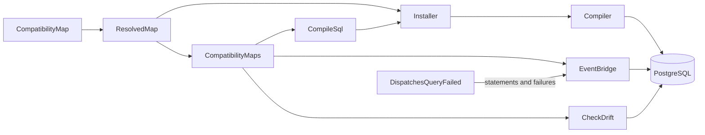

# Architecture

This page is for reviewers and maintainers of the package. It names the parts, follows one write through them, and suggests a reading order. The user documentation lives on the PHP Archetype standards site, on the eloquent-compatibility package pages. Its Architecture page explains why the package stores each value once and which designs it declines, so this page does not repeat that.

## The problem

An application replaces one Eloquent model with several, and existing code still reads and writes the old model's table. The package calls the old model the previous model, and the new models its current models. A compatibility map is one class that declares how each attribute of the previous model maps onto the current models.

The package serves the previous model from a PostgreSQL view, the compatibility view, which takes the old table's name. The old table, renamed, becomes the retained table. Each value lives in one table: a retained attribute in the retained table, and a mapped attribute in the current model's table that owns it.

## The two halves

The package has two halves, and both read one `ResolvedMap`.

- **The database half compiles SQL.** `Compiler` turns a compatibility map into the compatibility view and its trigger functions, and `Installer` runs that SQL. `compatibility:sql` prints the same SQL without running it. The triggers route every write to the table that owns the value, whatever client sends it: Eloquent, the query builder or raw SQL.
- **The PHP half mirrors events.** `EventBridge` raises the other side's model events for each write through a model, so listeners on both sides run. It stores no data. When a write's statement starts, it locks the records the write can change and reads them. After the statement it reads them again, and replays the events for each record that changed. When a write through the previous model moves a current model's state column, the bridge first runs that state machine's trigger without its transition. That step needs `aryeo/eloquent-state-machines`, which the package suggests and does not require.

A write that skips model events, such as a query builder update, still reaches the right tables through the triggers. Only the events are missing.

## The components

| Component | Namespace | Entry points | Job |
| :-- | :-- | :-- | :-- |
| compatibility map | Contracts, Mapping | `CompatibilityMap` and the Mapping builders | the application's declaration |
| resolved map | Mapping | `ResolvedMap::of()` | validates a map and answers every question about it |
| registry | root | `CompatibilityMaps::register()`, `CompatibilityMaps::get()` | holds the application's maps by name |
| schema | Schema | `Installer::install()`, `Installer::recompile()`, `Installer::uninstall()`, `Installer::statements()` | reads the catalog, compiles SQL and installs it in one transaction |
| model contract | Contracts, Provides | `Compatible`, `HasCompatibility` | marks each mapped model's own statement, and shows its model events to the event bridge |
| PHPStan rules | Tooling\Database\Eloquent\Compatibility\PhpStan | `CompatibleMustUseHasCompatibility`, `HasCompatibilityMustImplementCompatible`, `HasCompatibilityMustOnlyBeOnModel`, `HasCompatibilityMustNotRedeclareWriteHooks` | report a model that breaks the model contract at analysis time |
| event bridge | Bridge | `EventBridge::mirror()`, `EventBridge::withoutMirroring()` | mirrors model events across the two sides |
| drift check | Console | `compatibility:check`, run by `CheckDrift` | names the records where the two sides disagree |
| SQL printer | Console | `compatibility:sql`, run by `CompileSql` | prints the statements an Installer method runs, and runs only catalog reads |
| exceptions | Exceptions | `CompatibilityWriteRefused`, `InvalidCompatibilityMap`, `CompatibilityEventMirrorBypassed`, `CompatibilityConnectionUnsupported` | every error the package raises |
| testing trait | Testing | `InteractsWithCompatibilityMaps` | records mirrored events for application tests |
| provider | root | `Provider` | binds the singletons and releases failed writes |
| failure event | Connections | `DispatchesQueryFailed`, `QueryFailed` | a trait the application's connection class must use, which runs the event bridge's callbacks around every statement and raises an event for each failed statement |

`Installer` resolves each map itself and never reads the registry. `CompileSql` takes a map from the registry and asks `Installer::statements()` for the statements it prints. `EventBridge::mirror()` registers the map it mirrors, so `CheckDrift` sees every mirrored map. Three namespaces carry a README of their own: [Mapping](../src/Support/Database/Eloquent/Compatibility/Mapping/README.md), [Schema](../src/Support/Database/Eloquent/Compatibility/Schema/README.md) and [Bridge](../src/Support/Database/Eloquent/Compatibility/Bridge/README.md).

The Connections namespace holds a trait the application adds to its own connection class, `DispatchesQueryFailed`. The bridge hands the trait its `beforeExecuting` callbacks and its release, and the trait calls the release before it raises `QueryFailed`. So a failed write outside a transaction rolls back at once. The bridge refuses every mirrored write on a connection whose class does not use the trait, as [failure and rollback](flows/failure-and-rollback.md) describes.

## The life of a write

Take `$widget->update(['title' => 'Renamed'])` on the workbench map, [WidgetCompatibilityMap](../tests/Fixtures/Support/Workbench/WidgetCompatibilityMap.php). `Widget` is the previous model and `Gadget` its primary current model.

1. Eloquent fires `updating` on the widget. Before any listener runs, the event bridge records a pending mirrored write. It opens nothing yet.
2. The widget's save query passes through `HasCompatibility::setKeysForSaveQuery()`, which marks it as the widget's own statement. The bridge claims the write, and arms it when the query runs.
3. Eloquent sends `update "widgets" set ... where "id" = ?`. Just before it runs, the bridge opens the armed write: a transaction, or a savepoint when the caller already holds a transaction.
4. The bridge finds every record the write can change: the gadget, its place and its site.
5. It locks those records and the widget's retained row in the triggers' order, then reads each one.
6. The statement reaches the compatibility view. The update trigger checks every refusal, locks the gadget row, the retained row and the dependent rows, and runs the conflict check.
7. The trigger writes each changed attribute to the table that owns it, here `gadgets.name`.
8. `QueryExecuted` reaches the bridge, which completes the open write. It knows the statement by the SQL and bindings it recorded at the open, and parses no SQL.
9. The bridge reads each record again, and replays the gadget's `saving`, `updating`, `updated` and `saved` events. A write that moves a state column first runs the state machine's trigger, which this write does not.
10. The bridge commits or releases its savepoint, and forgets the write. Eloquent then fires the widget's own `updated` and `saved`, and the bridge finds no write of the widget left at their dispatch depth.

The flows below take each step in depth:

- [Declaring and registering a map](flows/declaring-and-registering-a-map.md)
- [Compiling and installing the schema](flows/compiling-and-installing-the-schema.md), and printing its statements with `compatibility:sql`
- [Writing through the view](flows/writing-through-the-view.md), the database side of steps 6 and 7
- [Mirroring a write](flows/mirroring-a-write.md), the PHP side of steps 1 to 5 and 8 to 10
- [Replaying a transition](flows/replaying-a-transition.md), the trigger a state change runs inside step 9
- [Failure and rollback](flows/failure-and-rollback.md)
- [Checking for drift](flows/checking-for-drift.md)

## A reading order

Read the code in this order. Each step answers one question.

1. [README.md](../README.md): what does a map look like, and how does an application install and mirror it?
2. [WidgetCompatibilityMap](../tests/Fixtures/Support/Workbench/WidgetCompatibilityMap.php) and [Tables](../tests/Fixtures/Support/Workbench/Tables.php): which builders does a real map use, over which tables?
3. `CompatibilityMap`, `Attribute`, `DependentCurrentModel` and `UnrepresentableState`: what does each builder store?
4. `ResolvedMap`: what does registration refuse, and how does a map locate a dependent row?
5. `Compiler`: what SQL does a map compile to? Read `Compiler::view()`, `Compiler::updateFunction()`, `Compiler::updateDependent()` and `Compiler::conflict()` first.
6. `Installer`, `InstallerAction` and `SqlFragments`: which statements does each Installer method run, in what order, and how does it raise a refusal?
7. `CompatibilityWriteRefused`: how does a refusal become a PHP exception?
8. `HasCompatibility`, `EventBridge`, `DispatchesQueryFailed` and `QueryFailed`: how does a model mark its own statement and show its events? When does a pending mirrored write begin, complete, finish and fail?
9. `AffectedRecords` and `KeyTranslator`: which records does a write change, and in what order does the bridge lock them?
10. `EventReplayer`: how does the bridge reproduce native model events, and how does it exclude listeners?
11. `EventReplayer::states()`, `EventReplayer::transition()` and the private `EventBridge::transitions()`: how does a mirrored state change run its trigger?
12. `DriftQueries`: which five kinds of drift does the check find?
13. `CompileSql`: how does a reviewer read the statements before a migration runs them?
14. The colocated tests, starting with `InstallerTest` and `EventBridgeTest`: what does each write do, end to end?

Then read the [invariants](invariants.md), the rules every change must keep, and the [decisions](decisions/), the choices a change should not undo by accident. The [glossary](glossary.md) defines each term once. [Adopting a map](adopting-a-map.md) lists what changes for an application's code and tests once a model is mapped.

## Keeping these docs true

These docs name classes and methods, never line numbers. CI runs [check-doc-names.php](../bin/check-doc-names.php) in the static-analysis job, and again without `aryeo/eloquent-state-machines` in the `tests-without-state-machines` job. It reads `README.md`, every page under `docs/` and every `README.md` under `src/`. It fails when:

- a backticked class name, or a backticked method, case, constant or property on a class, names nothing in the code;
- a page cites a line, such as `Compiler.php` followed by a colon and a number;
- a file name carries a line anchor, such as `#L42`, `#L42-L48` or `#L42C3`, in a link or anywhere else on the line;
- a relative link points at a file that does not exist;
- an `INV-` reference names no `## INV-` heading in the [invariants](invariants.md).

The check skips fenced code. A fence closes only on a marker of its own character and at least its own length, as in Markdown. A short name resolves to a class in `src/` or `tests/`, or through the script's small allowlist of Laravel classes. A second list names classes of `aryeo/eloquent-state-machines`, which the package suggests. The check resolves them when that package is installed, and accepts them unchecked without it. It then prints how many it left unchecked. Write any other outside class by its fully qualified name. Run the check locally with `docker compose run --rm --no-deps php php bin/check-doc-names.php`.
