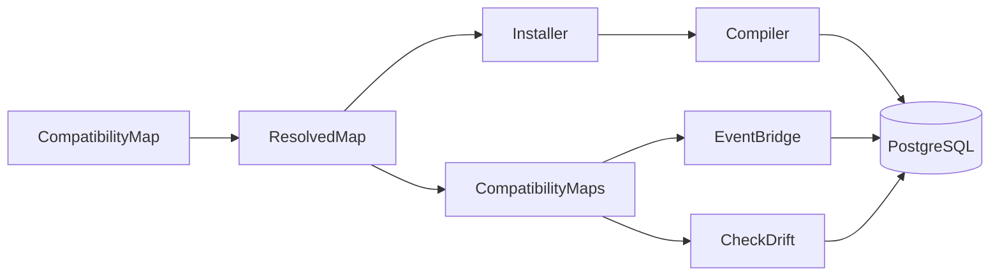

# Architecture

This page is for reviewers and maintainers of the package. It names the parts, follows one write through them, and suggests a reading order. The user documentation lives on the PHP Archetype standards site, on the eloquent-compatibility package pages. Its Architecture page explains why the package stores each value once and which designs it declines. This page does not repeat that.

## The problem

An application replaces one Eloquent model with several, and existing code still reads and writes the old model's table. The package calls the old model the previous model, and the new models its current models. A compatibility map is one class that declares how each attribute of the previous model maps onto the current models.

The package serves the previous model from a PostgreSQL view, the compatibility view, which takes the old table's name. The old table, renamed, becomes the retained table. Each value lives in one table: a retained attribute in the retained table, a mapped attribute in the current model's table that owns it.

## The two halves

The package has two halves, and both read one `ResolvedMap`.

- **The database half compiles SQL.** `Compiler` turns a compatibility map into the compatibility view and its trigger functions, and `Installer` runs that SQL. The triggers route every write to the table that owns the value, whatever client sends it: Eloquent, the query builder or raw SQL.
- **The PHP half mirrors events.** `EventBridge` raises the other side's model events for each write through a model, so listeners on both sides run. It stores no data. It locks the records a write can change, waits for the statement, reads the records again, and replays the events for each record that changed.

A write that skips model events, such as a query builder update, still reaches the right tables through the triggers. Only the events are missing.

## The components

| Component | Namespace | Entry points | Job |
| :-- | :-- | :-- | :-- |
| compatibility map | Contracts, Mapping | `CompatibilityMap` and the Mapping builders | the application's declaration |
| resolved map | Mapping | `ResolvedMap::of()` | validates a map and answers every question about it |
| registry | root | `CompatibilityMaps::register()`, `CompatibilityMaps::get()` | holds the application's maps by name |
| schema | Schema | `Installer::install()`, `Installer::recompile()`, `Installer::uninstall()` | reads the catalog, compiles SQL and installs it in one transaction |
| event bridge | Bridge | `EventBridge::mirror()`, `EventBridge::withoutMirroring()` | mirrors model events across the two sides |
| drift check | Console | `compatibility:check`, run by `CheckDrift` | names the records where the two sides disagree |
| exceptions | Exceptions | `CompatibilityWriteRefused`, `InvalidCompatibilityMap`, `CompatibilityEventMirrorBypassed` | every error the package raises |
| testing trait | Testing | `InteractsWithCompatibilityMaps` | records mirrored events for application tests |
| provider | root | `Provider` | binds the singletons and releases failed writes |

`Installer` resolves each map itself and never reads the registry. `EventBridge::mirror()` registers the map it mirrors, so `CheckDrift` sees every mirrored map. Three namespaces carry a README of their own: [Mapping](../src/Support/Database/Eloquent/Compatibility/Mapping/README.md), [Schema](../src/Support/Database/Eloquent/Compatibility/Schema/README.md) and [Bridge](../src/Support/Database/Eloquent/Compatibility/Bridge/README.md).

## The life of a write

Take `$widget->update(['title' => 'Renamed'])` on the workbench map, [WidgetCompatibilityMap](../tests/Fixtures/Support/Workbench/WidgetCompatibilityMap.php). `Widget` is the previous model and `Gadget` its primary current model.

1. Eloquent fires `updating` on the widget, and `EventBridge::begin()` records a `PendingMirroredWrite`.
2. The bridge opens a transaction, or a savepoint when the caller already holds one.
3. `AffectedRecords::before()` asks `AffectedRecords::of()` for every record the write can change: the gadget, its place and its site.
4. `AffectedRecords::before()` locks those records and the widget's retained row in the triggers' order. `AffectedRecords::snapshots()` then reads each one.
5. Eloquent sends `update "widgets" set ...` to the compatibility view.
6. The view's update trigger checks every refusal, locks the gadget row and the retained row, and runs the conflict check.
7. The trigger writes each changed attribute to the table that owns it, here `gadgets.name`.
8. `QueryExecuted` reaches `EventBridge::handleQuery()`, which matches the statement to the pending write.
9. `EventBridge::complete()` reads each record again, and `EventReplayer::record()` raises the gadget's `saving`, `updating`, `updated` and `saved` events.
10. The bridge commits or releases its savepoint, and Eloquent fires the widget's own `updated` and `saved`.

The flows below take each step in depth:

- [Declaring and registering a map](flows/declaring-and-registering-a-map.md)
- [Compiling and installing the schema](flows/compiling-and-installing-the-schema.md)
- [Writing through the view](flows/writing-through-the-view.md), the database side of steps 5 to 7
- [Mirroring a write](flows/mirroring-a-write.md), the PHP side of steps 1 to 4 and 8 to 10
- [Failure and rollback](flows/failure-and-rollback.md)
- [Checking for drift](flows/checking-for-drift.md)

## A reading order

Read the code in this order. Each step answers one question.

1. [README.md](../README.md): what does a map look like, and how does an application install and mirror it?
2. [WidgetCompatibilityMap](../tests/Fixtures/Support/Workbench/WidgetCompatibilityMap.php) and [Tables](../tests/Fixtures/Support/Workbench/Tables.php): which builders does a real map use, over which tables?
3. `CompatibilityMap`, `Attribute`, `DependentCurrentModel` and `UnrepresentableState`: what does each builder store?
4. `ResolvedMap`: what does registration refuse, and how is a dependent row located?
5. `Compiler`: what SQL does a map compile to? Read `Compiler::view()`, `Compiler::updateFunction()`, `Compiler::updateDependent()` and `Compiler::conflict()` first.
6. `Installer` and `SqlFragments`: in what order does the SQL run, and how is a refusal raised?
7. `CompatibilityWriteRefused`: how does a refusal become a PHP exception?
8. `EventBridge`: when does a pending write begin, complete, finish and fail?
9. `AffectedRecords` and `KeyTranslator`: which records does a write change, and in what order are they locked?
10. `EventReplayer`: how are native model events reproduced, and how are listeners excluded?
11. `DriftQueries`: which five kinds of drift does the check find?
12. `InstallerTest`, `EventBridgeTest`, `EventBridgeOutsideTransactionTest` and `DependentCurrentModelTest`: what does each write do, end to end?

Then read the [invariants](invariants.md), the rules every change must keep, and the [decisions](decisions/), the choices a change should not undo by accident. The [glossary](glossary.md) defines each term once.

## Keeping these docs true

These docs name classes and methods, never line numbers. CI runs [check-doc-names.php](../bin/check-doc-names.php) in the static-analysis job. It reads `README.md`, every page under `docs/` and every `README.md` under `src/`. It fails when:

- a backticked class name, or a backticked method, case, constant or property on a class, names nothing in the code;
- a page cites a line, such as `Compiler.php` followed by a colon and a number;
- a file name carries a line anchor, such as `#L42`, `#L42-L48` or `#L42C3`, in a link or anywhere else on the line;
- a relative link points at a file that does not exist;
- an `INV-` reference names no `## INV-` heading in the [invariants](invariants.md).

The check skips fenced code. A fence closes only on a marker of its own character and at least its own length, as in Markdown. A short name resolves to a class in `src/` or `tests/`, or through the script's small allowlist of Laravel classes. Write any other outside class by its fully qualified name. Run the check locally with `docker compose run --rm --no-deps php php bin/check-doc-names.php`.
