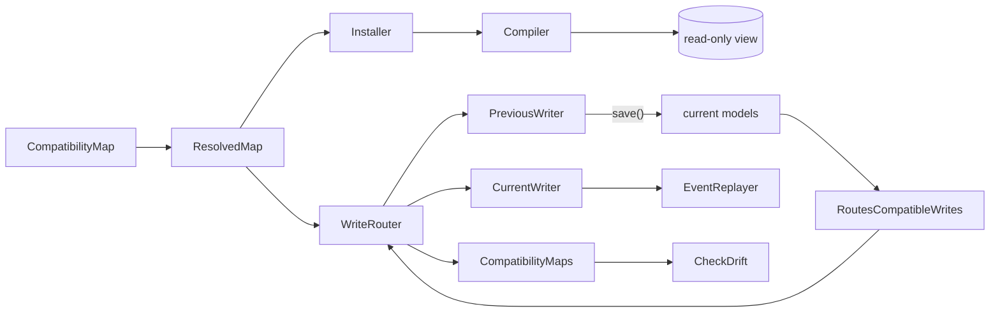

# Architecture

This page is for reviewers and maintainers of the package. It names the parts, follows one write through them, and suggests a reading order. The user documentation lives on the PHP Archetype standards site, on the eloquent-compatibility package pages.

## The problem

An application replaces one Eloquent model with several, and existing code still reads and writes the old model. The package calls the old model the previous model, and the new models its current models. A compatibility map is one class that declares how each attribute of the previous model maps onto the current models.

The package serves the previous model from a PostgreSQL view, the compatibility view, which takes the old table's name. The old table, renamed, becomes the retained table. Each value lives in one table: a retained attribute in the retained table, and a mapped attribute in the current model's table that owns it.

## The two halves

The package has two halves, and both read one `ResolvedMap`.

- **The database half serves reads.** `Compiler` turns a map into the compatibility view, and `Installer` creates it. The view joins two tables, so PostgreSQL cannot write through it. The database holds no trigger and no function.
- **The PHP half splits writes.** Every mapped model's Eloquent builder hands its writes to `WriteRouter`. A write through the previous model becomes saves of the real current models, through `PreviousWriter`. A write of a current model keeps the previous models in step and replays their events, through `CurrentWriter`.

A write that bypasses Eloquent is not split. Through the view it fails; on a current table it skips the previous models, and `compatibility:check` reports what it leaves behind. [Decision 0024](decisions/0024-writes-are-split-in-php-without-triggers.md) records why.

## The components

| Component | Namespace | Entry points | Job |
| :-- | :-- | :-- | :-- |
| compatibility map | Contracts, Mapping | `CompatibilityMap` and the Mapping builders | the application's declaration: reads in SQL, writes in PHP closures |
| resolved map | Mapping | `ResolvedMap::of()` | validates a map and answers every question about it |
| registry | root | `CompatibilityMaps::register()`, `CompatibilityMaps::get()` | holds the application's maps by name |
| schema | Schema | `Installer::install()`, `Installer::recompile()`, `Installer::uninstall()` | reads the catalog, compiles the read-only view and installs it in one transaction |
| model contract | Contracts, Provides | `Compatible`, `HasCompatibility` | gives each mapped model a routing builder, and marks the model's own writes |
| routing builder | Write | `RoutesCompatibleWrites`, `CompatibleBuilder` | hands every write method of the Eloquent builder to the router |
| write router | Write | `WriteRouter::register()`, `WriteRouter::withoutMirroring()` | registers maps, opens each write's transaction, and picks its writer |
| previous writer | Write | `PreviousWriter::insert()`, `PreviousWriter::update()`, `PreviousWriter::delete()` | splits one previous record's write into current-model saves |
| current writer | Write | `CurrentWriter::insert()`, `CurrentWriter::update()`, `CurrentWriter::delete()` | keeps retained rows, designations and refused states in step, and replays the previous model's events |
| records | Write | `Records` | the writers' SQL: locks, reads through the view, designations, refused-state checks |
| event replayer | Write | `EventReplayer::replay()` | raises a previous record's events on a fresh instance, and masks excluded listeners |
| PHPStan rules | Tooling\Database\Eloquent\Compatibility\PhpStan | `CompatibleMustUseHasCompatibility`, `HasCompatibilityMustImplementCompatible`, `HasCompatibilityMustOnlyBeOnModel`, `HasCompatibilityMustNotRedeclareWriteHooks` | report a model that breaks the model contract at analysis time |
| drift check | Console | `compatibility:check`, run by `CheckDrift` | names the records where the two sides disagree |
| exceptions | Exceptions | `CompatibilityWriteRefused`, `InvalidCompatibilityMap` | every error the package raises |
| testing trait | Testing | `InteractsWithCompatibilityMaps` | records mirrored events and asserts refusals in application tests |
| provider | root | `Provider` | binds the singletons and registers the command |

`Installer` resolves each map itself and never reads the registry. `WriteRouter::register()` registers the map it routes, so `CheckDrift` sees every routed map. Three namespaces carry a README of their own: [Mapping](../src/Support/Database/Eloquent/Compatibility/Mapping/README.md), [Schema](../src/Support/Database/Eloquent/Compatibility/Schema/README.md) and [Write](../src/Support/Database/Eloquent/Compatibility/Write/README.md).

## The life of a write

Take `$widget->update(['title' => 'Renamed'])` on the workbench map, [WidgetCompatibilityMap](../tests/Fixtures/Support/Workbench/WidgetCompatibilityMap.php). `Widget` is the previous model and `Gadget` its primary current model.

1. Eloquent fires `saving` and `updating` on the widget. Its listeners run, as they always do.
2. `Model::performUpdate()` passes its builder through `HasCompatibility::setKeysForSaveQuery()`, which marks it as the widget's own write.
3. `RoutesCompatibleWrites::update()` hands the dirty values to `WriteRouter::update()`, which opens a transaction, or a savepoint inside the caller's.
4. The router selects the widget's key through the view, and calls `PreviousWriter::update()` for it.
5. The writer locks the gadget row, the retained row and each dependent row it reads, then reads the record through the view.
6. It finds that `title` changed, checks the refusals, and computes `gadgets.name` from the map's `TargetColumn` closure.
7. It loads the gadget, sets `name`, and calls `save()`. The gadget fires its own `saving`, `updating`, `updated` and `saved`. Its listeners may change a value or veto the save.
8. The gadget's save reaches its own builder, and so `CurrentWriter`. The writer is marked as applying the widget map, so `CurrentWriter` only checks the gadget's refused states, and keeps every other map over `gadgets` in step.
9. The router commits or releases its savepoint. Eloquent then fires the widget's own `updated` and `saved`.

The flows below take each step in depth:

- [Declaring and registering a map](flows/declaring-and-registering-a-map.md)
- [Compiling and installing the schema](flows/compiling-and-installing-the-schema.md)
- [Writing through the previous model](flows/writing-through-the-previous-model.md), steps 2 to 8
- [Writing a current model](flows/writing-a-current-model.md), the other direction, with the replayed events
- [Failure and rollback](flows/failure-and-rollback.md)
- [Checking for drift](flows/checking-for-drift.md)

## A reading order

Read the code in this order. Each step answers one question.

1. [README.md](../README.md): what does a map look like, and how does an application install and register it?
2. [WidgetCompatibilityMap](../tests/Fixtures/Support/Workbench/WidgetCompatibilityMap.php) and [Tables](../tests/Fixtures/Support/Workbench/Tables.php): which builders does a real map use, over which tables?
3. `CompatibilityMap`, `Attribute`, `TargetColumn`, `DependentCurrentModel` and `UnrepresentableState`: what does each builder store?
4. `ResolvedMap`: what does registration refuse, and how does a map locate a dependent row?
5. `Compiler` and `Installer`: what view does a map compile to, and how is it installed?
6. `HasCompatibility` and `RoutesCompatibleWrites`: how does a write reach the router, and how does the router know it is a model's own?
7. `WriteRouter`: which writer takes a write, in which transaction?
8. `PreviousWriter`: how does one record's write become current-model saves, and what does it refuse?
9. `CurrentWriter` and `Records`: what does a current write keep in step, and in what order does it lock?
10. `EventReplayer`: how does the router reproduce native model events, and how does it exclude listeners?
11. `DriftQueries`: which five kinds of drift does the check find?
12. The colocated tests, starting with `WriteRouterTest` and `InstallerTest`: what does each write do, end to end?

Then read the [invariants](invariants.md), the rules every change must keep, and the [decisions](decisions/), the choices a change should not undo by accident. The [glossary](glossary.md) defines each term once. [Adopting a map](adopting-a-map.md) lists what changes for an application's code and tests once a model is mapped.

## Keeping these docs true

These docs name classes and methods, never line numbers. CI runs [check-doc-names.php](../bin/check-doc-names.php) in the static-analysis job, over `README.md`, every page under `docs/` and every `README.md` under `src/`. It fails when:

- a backticked class name, or a backticked method, case, constant or property on a class, names nothing in the code;
- a page cites a line, such as `Compiler.php` followed by a colon and a number;
- a file name carries a line anchor, such as `#L42`, `#L42-L48` or `#L42C3`, in a link or anywhere else on the line;
- a relative link points at a file that does not exist;
- an `INV-` reference names no `## INV-` heading in the [invariants](invariants.md).

The check skips fenced code. A fence closes only on a marker of its own character and at least its own length, as in Markdown. A short name resolves to a class in `src/` or `tests/`, or through the script's small allowlist of Laravel classes. Write any other outside class by its fully qualified name. Run the check locally with `docker compose run --rm --no-deps php php bin/check-doc-names.php`.
