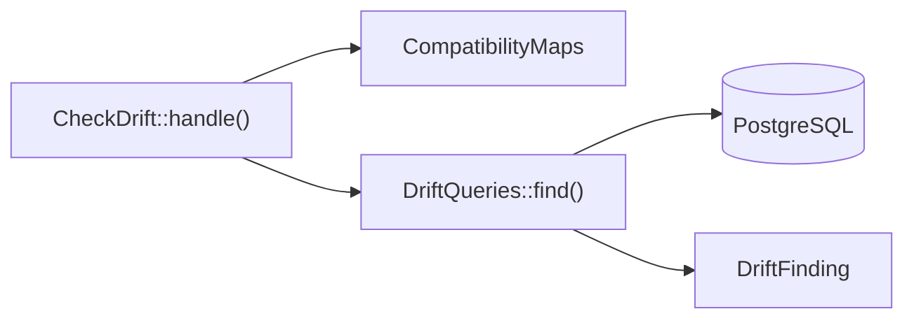

# Checking for drift

This flow follows `php artisan compatibility:check`, which names the records where a map's previous and current models disagree. The write router keeps every write through a model in step. The check finds rows that went wrong another way, such as raw SQL on a current table or on the retained table, which skips the router.

## Running

`Provider::boot()` registers the command, and `CheckDrift::handle()` runs it:

1. It takes the maps that `--map` names, or every registered map. An unknown name throws `InvalidCompatibilityMap`. With no map at all, it prints that nothing was checked and why, and fails, so a missing registration never reads as a pass.
2. It reads `--limit`, the most records each check reports: at least 1, and 100 by default.
3. It compares the installed view with the compiled one, then runs the five record checks, for each map.
4. It prints a table of findings and fails, or prints that it found no drift and succeeds.

The check reads only the registry. A map reaches it through `CompatibilityMaps::register()`, directly or through `WriteRouter::register()`. `Installer` registers nothing.

## The view definition

Before the record checks, `DriftQueries::find()` compares the installed view with the view the map compiles to now. A changed relation, scope or attribute changes the compiled view, and only `Installer::recompile()` changes the installed one. It creates the compiled view as a temporary view inside a transaction, reads both definitions through `pg_get_viewdef()`, which normalizes them alike, and rolls back. A difference, a missing view, or a map that no longer compiles is a `DriftCheck::ViewDefinition` finding.

## The five record checks

`DriftQueries::find()` runs one query per check. Each finding is a `DriftFinding`, labelled with a `DriftCheck` case:

| Case | Method | Finds |
| :-- | :-- | :-- |
| `DriftCheck::PreviousWithoutCurrent` | `DriftQueries::previousWithoutCurrent()` | a retained row that links no primary row, or links one that does not exist |
| `DriftCheck::OrphanCurrent` | `DriftQueries::orphanCurrents()` | a primary row that no retained row links |
| `DriftCheck::MoreThanOnePrimary` | `DriftQueries::sharedPrimaries()` | a primary row that more than one retained row links |
| `DriftCheck::RefusedState` | `DriftQueries::refusedStates()` | a row in a refused state that names `UnrepresentableState::checkedOn()`, or for a predicate state of `UnrepresentableState::checkedBy()`, a row of its candidates the predicate holds for |
| `DriftCheck::Designation` | `DriftQueries::brokenDesignations()` | a designation that names a missing row or a row of another primary row, or an empty one whose record has a readable row |

The `DriftCheck::PreviousWithoutCurrent` and `DriftCheck::Designation` checks skip the records a hidden state covers, as the view does. A refused state checked only on previous-model updates has no check, and neither has a degraded state.

The backing value of each `DriftCheck` case is the label the table prints. A test compares those labels as literal strings, so a changed value fails it, as [0012](../decisions/0012-tests-pin-printed-values-as-literals.md) records.
