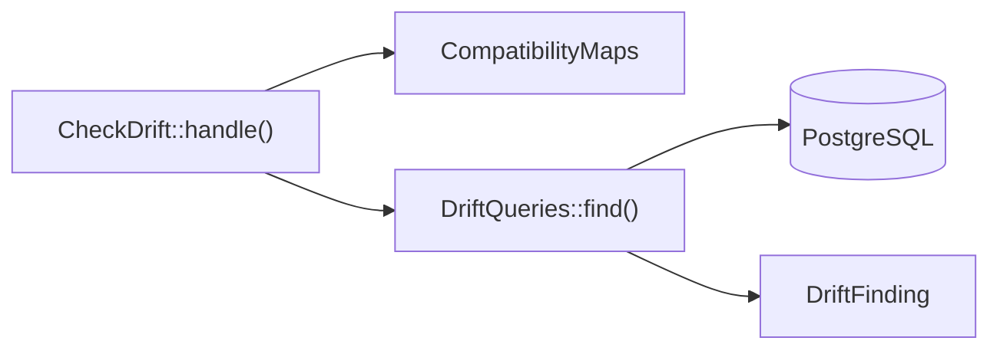

# Checking for drift

This flow follows `php artisan compatibility:check`, which names the records where a map's previous and current models disagree. The triggers keep writes through the view and the current models in step. The check finds rows that went wrong another way, such as a direct write to the retained table or a write with the triggers disabled.

## Running

`Provider::boot()` registers `CheckDrift`. `CheckDrift::handle()`:

1. Takes the maps named by `--map`, through `CompatibilityMaps::get()`, or every registered map. An unknown name throws `InvalidCompatibilityMap`.
2. Reads `--limit`, at least 1 and 100 by default, as the most records each check reports.
3. Calls `DriftQueries::find()` for each map.
4. Prints a table of findings and fails, or prints that it found no divergence and succeeds.

The check reads only the registry. A map reaches it through `CompatibilityMaps::register()`, directly or through `EventBridge::mirror()`. `Installer` registers nothing.

## The five checks

`DriftQueries::find()` runs one query per check, and each finding is a `DriftFinding` labelled with a `DriftCheck` case:

| Case | Method | Finds |
| :-- | :-- | :-- |
| `DriftCheck::PreviousWithoutCurrent` | `DriftQueries::previousWithoutCurrent()` | a retained row that links no primary row, or links one that does not exist |
| `DriftCheck::OrphanCurrent` | `DriftQueries::orphanCurrents()` | a primary row that no retained row links |
| `DriftCheck::MoreThanOnePrimary` | `DriftQueries::sharedPrimaries()` | a primary row that more than one retained row links |
| `DriftCheck::RefusedState` | `DriftQueries::refusedStates()` | a row in a refused state that names `UnrepresentableState::checkedOn()` |
| `DriftCheck::Designation` | `DriftQueries::brokenDesignations()` | a designation that names a missing row, or a row of another primary row |

`DriftQueries::previousWithoutCurrent()` and `DriftQueries::brokenDesignations()` skip the records a hidden state covers, as the view does. A refused state checked only on previous-model updates has no check, and neither has a degraded state.

The backing value of each `DriftCheck` case is the label the table prints. `CheckDriftTest` compares those labels as literal strings, so a changed value fails a test.

## Tests

- `CheckDriftTest::it_passes_when_every_record_has_its_previous_and_current_models()`: a clean map, with a hidden record.
- `CheckDriftTest::it_names_the_record_and_the_attribute_of_each_divergence_made_by_hand()`: four of the five checks.
- `CheckDriftTest::it_checks_only_the_compatibility_maps_it_is_given()`: the `--map` option.
- `DependentCurrentModelTest::the_check_names_a_designation_of_a_missing_row_or_of_a_row_of_another_record()`: the designation check.
- `ProviderTest::it_registers_the_divergence_check()`: the command's registration.
