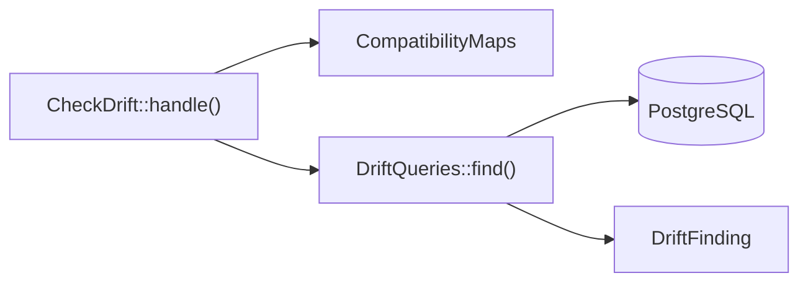

# Checking for drift

This flow follows `php artisan compatibility:check`, which names the records where a map's previous and current models disagree. The triggers keep writes through the view and the current models in step. The check finds rows that went wrong another way, such as a direct write to the retained table or a write with the triggers disabled.

## Running

`Provider::boot()` registers the command, and `CheckDrift::handle()` runs it:

1. It takes the maps that `--map` names, or every registered map. An unknown name throws `InvalidCompatibilityMap`. With no map at all, it prints that nothing was checked and why, and fails, so a missing registration never reads as a pass.
2. It reads `--limit`, the most records each check reports: at least 1, and 100 by default.
3. It runs the five drift checks for each map.
4. It looks for unguarded column triggers on each map's tables, and prints a warning section when it finds one. The section never changes the exit status.
5. It prints a table of findings and fails, or prints that it found no drift and succeeds.

The check reads only the registry. A map reaches it through `CompatibilityMaps::register()`, directly or through `EventBridge::mirror()`. `Installer` registers nothing.

## The five checks

`DriftQueries::find()` runs one query per check. Each finding is a `DriftFinding`, labelled with a `DriftCheck` case:

| Case | Method | Finds |
| :-- | :-- | :-- |
| `DriftCheck::PreviousWithoutCurrent` | `DriftQueries::previousWithoutCurrent()` | a retained row that links no primary row, or links one that does not exist |
| `DriftCheck::OrphanCurrent` | `DriftQueries::orphanCurrents()` | a primary row that no retained row links |
| `DriftCheck::MoreThanOnePrimary` | `DriftQueries::sharedPrimaries()` | a primary row that more than one retained row links |
| `DriftCheck::RefusedState` | `DriftQueries::refusedStates()` | a row in a refused state that names `UnrepresentableState::checkedOn()` |
| `DriftCheck::Designation` | `DriftQueries::brokenDesignations()` | a designation that names a missing row or a row of another primary row, or an empty one whose record has a readable row |

The `DriftCheck::PreviousWithoutCurrent` and `DriftCheck::Designation` checks skip the records a hidden state covers, as the view does. A refused state checked only on previous-model updates has no check, and neither has a degraded state.

The backing value of each `DriftCheck` case is the label the table prints. A test compares those labels as literal strings, so a changed value fails it, as [0012](../decisions/0012-tests-pin-printed-values-as-literals.md) records.

## Unguarded column triggers

An `UPDATE OF` trigger on a mapped column fires on every update through the view that writes its table, whether or not its column changed. [INV-7](../invariants.md#inv-7-the-update-trigger-writes-only-what-changed) records why. So the command warns of each such trigger without a guard.

`DriftQueries::unguardedColumnTriggers()` reads `pg_trigger` for each current table and the retained table. It returns each trigger whose `tgattr` column list names a mapped column of that table, as an `UnguardedColumnTrigger`. A mapped column is one the update trigger puts in its `SET` list. The query leaves out a trigger with a `WHEN` clause, whose `tgqual` is not null. It also leaves out an internal trigger, and every trigger whose name begins `compatibility__`.

The warning is a table of the map, the table, the trigger and its mapped columns, with a one-line hint: guard each one with `WHEN (OLD.<column> IS DISTINCT FROM NEW.<column>)`. [Adopting a map](../adopting-a-map.md#guard-each-column-trigger-on-a-mapped-column) shows how to guard one.
