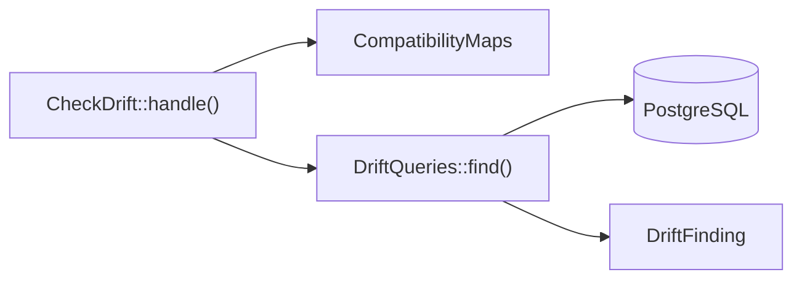

# Checking for drift

This flow follows `php artisan compatibility:check`, which names the records where a map's previous and current models disagree. The triggers keep writes through the view and the current models in step. The check finds rows that went wrong another way, such as a direct write to the retained table or a write with the triggers disabled.

## Running

`Provider::boot()` registers `CheckDrift`. `CheckDrift::handle()`:

1. Takes the maps named by `--map`, through `CompatibilityMaps::get()`, or every registered map. An unknown name throws `InvalidCompatibilityMap`. With no map at all, it prints that nothing was checked and why, and fails, so a missing registration never reads as a pass.
2. Reads `--limit`, at least 1 and 100 by default, as the most records each check reports.
3. Calls `DriftQueries::find()` for each map.
4. Calls `DriftQueries::unguardedColumnTriggers()` for each map, and prints the warning section below when it finds a trigger. The section never changes the exit status.
5. Prints a table of findings and fails, or prints that it found no divergence and succeeds.

The check reads only the registry. A map reaches it through `CompatibilityMaps::register()`, directly or through `EventBridge::mirror()`. `Installer` registers nothing.

## The five checks

`DriftQueries::find()` runs one query per check, and each finding is a `DriftFinding` labelled with a `DriftCheck` case:

| Case | Method | Finds |
| :-- | :-- | :-- |
| `DriftCheck::PreviousWithoutCurrent` | `DriftQueries::previousWithoutCurrent()` | a retained row that links no primary row, or links one that does not exist |
| `DriftCheck::OrphanCurrent` | `DriftQueries::orphanCurrents()` | a primary row that no retained row links |
| `DriftCheck::MoreThanOnePrimary` | `DriftQueries::sharedPrimaries()` | a primary row that more than one retained row links |
| `DriftCheck::RefusedState` | `DriftQueries::refusedStates()` | a row in a refused state that names `UnrepresentableState::checkedOn()` |
| `DriftCheck::Designation` | `DriftQueries::brokenDesignations()` | a designation that names a missing row or a row of another primary row, or an empty one whose record has a readable row |

`DriftQueries::previousWithoutCurrent()` and `DriftQueries::brokenDesignations()` skip the records a hidden state covers, as the view does. A refused state checked only on previous-model updates has no check, and neither has a degraded state.

## Unguarded column triggers

`DriftQueries::unguardedColumnTriggers()` reads `pg_trigger` for each current table and for the retained table, where the update trigger writes them. It returns each trigger whose `tgattr` column list names a mapped column of that table, as an `UnguardedColumnTrigger`. A mapped column is a target from `ResolvedMap::assignmentsTo()`, which `Compiler::update()` puts in its `SET` list. It leaves out a trigger with a `WHEN` clause, because `tgqual` is not null, an internal trigger and every trigger whose name begins `compatibility__`.

`CheckDrift::handle()` prints a warning, a table of the map, the table, the trigger and its mapped columns, and a one-line hint: guard each one with `WHEN (OLD.<column> IS DISTINCT FROM NEW.<column>)`. Such a trigger fires on every update through the view that writes its table, whether or not its column changed. [INV-7](../invariants.md) records why, and [adopting a map](../adopting-a-map.md) shows how to guard one.

The backing value of each `DriftCheck` case is the label the table prints. `CheckDriftTest` compares those labels as literal strings, so a changed value fails a test.

## Tests

- `CheckDriftTest::it_passes_when_every_record_has_its_previous_and_current_models()`: a clean map, with a hidden record.
- `CheckDriftTest::it_names_the_record_and_the_attribute_of_each_divergence_made_by_hand()`: four of the five checks.
- `CheckDriftTest::it_warns_of_each_unguarded_update_of_trigger_on_a_mapped_column_and_still_passes()`: the warning section, with the triggers it leaves out.
- `CheckDriftTest::it_checks_only_the_compatibility_maps_it_is_given()`: the `--map` option.
- `CheckDriftTest::it_fails_and_names_the_cause_when_no_compatibility_map_is_registered()`: an empty registry.
- `DependentCurrentModelTest::the_check_names_a_designation_of_a_missing_row_or_of_a_row_of_another_record()`: the designation check.
- `DriftQueriesTest::it_finds_an_empty_designation_whose_record_has_a_readable_row()`: an empty designation.
- `ProviderTest::it_registers_the_divergence_check()`: the command's registration.
- `DriftQueriesTest`: each of the five queries on its own, the hidden-state filter, and the order and limit of the report.
- `UnguardedColumnTriggerTest::it_carries_what_it_was_given()`: the warning's value object.
