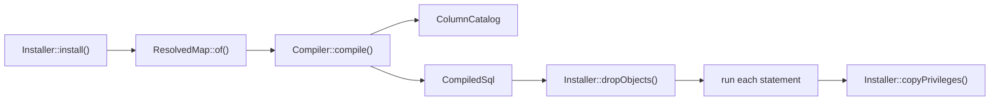

# Compiling and installing the schema

This flow follows `Installer::install()` from a compatibility map to a compatibility view with its triggers. A migration calls it after renaming the previous model's table to the retained table.



## Installing

1. `Installer::install()` resolves the map with `ResolvedMap::of()`.
2. It refuses when any relation already has the view's name. The message points at `Installer::recompile()`.
3. It opens one transaction with `Connection::transaction()`, which takes a savepoint inside a caller's transaction. Steps 4 to 7 run inside it.
4. `Installer::apply()` compiles first, so a compile error leaves the database unchanged.
5. `Installer::dropObjects()` drops every trigger whose name starts with the map's object prefix and whose table and function are in the current schema. It then drops every function with that prefix in the current schema.
6. `Installer::apply()` runs each of `CompiledSql::statements()` with `Connection::unprepared()`.
7. `Installer::copyPrivileges()` copies the retained table's grants to the view, except the owner's. Column grants follow only for columns the view also has.

A failed statement rolls back the whole install, so it leaves nothing behind. `Installer::recompile()` runs steps 3 to 6 only: it neither refuses an existing view nor copies grants. `Installer::uninstall()` drops the objects and then the view in one transaction, and leaves every table as it is. A failed recompile or uninstall therefore keeps the installed map, triggers included. A concurrent writer waits on the dropped triggers' locks until the commit, so it never meets the view without its triggers.

The schema scope lets one map name be installed in two schemas. Each install, recompile and uninstall changes only the objects in `current_schema()`. `Installer::dropObjects()` resolves that schema through `to_regnamespace(quote_ident(current_schema()))`, so a schema whose name needs quoting works too.

## Compiling

The `Compiler` constructor reads `current_schema()`, and each function pins its `search_path` to that schema and `pg_temp`. `Compiler::compile()` accepts a `CompatibilityMap` or a `ResolvedMap`.

`Compiler::validateColumns()` runs first and reads the catalog through `ColumnCatalog`. It refuses a map when:

- the retained table does not exist;
- the retained table lacks the previous model's key, its primary foreign key or a designation column;
- a retained attribute is not a column of the retained table;
- an attribute writes the primary foreign key or a designation column of the retained table;
- a dependent's table lacks its primary foreign key.

Three more refusals happen while the SQL is built. `Compiler::value()` refuses a write to a column its table lacks. `Compiler::insertValues()` refuses a column that both an attribute and a fill set. `ResolvedMap::function()` and its siblings refuse an object name longer than 63 characters.

`CompiledSql::statements()` returns the statements in this order:

1. The view, from `Compiler::view()`. It selects each attribute from the retained table joined to the primary current model's table. A retained attribute reads its own column. A mapped attribute is cast to its declared type, and a dependent's attribute reads through a subquery built by `ResolvedMap::locate()`. Each hidden state adds a `WHERE NOT` condition.
2. One `ALTER VIEW ... ALTER COLUMN` per attribute, from `Compiler::defaults()`. An attribute with a default gets `SET DEFAULT`, and every other attribute gets `DROP DEFAULT`. The default is `Attribute::defaultsTo()`, or else the stored column's default on the retained or primary table. A dependent's column contributes none. A recompile therefore removes a default the map no longer declares.
3. The five fixed trigger functions, one per `TriggerFunction` case: insert, update, delete, primary insert and primary delete.
4. One `refuse_<state>` function per refused state that names `UnrepresentableState::checkedOn()`. On a dependent's table or the retained table, it first locks the primary row and takes the refused-state lock. [Writing through the view](writing-through-the-view.md) describes the lock.
5. One `designate_<alias>` function per dependent with `DependentCurrentModel::designatedBy()`.
6. The triggers, from `Compiler::triggers()`, in the same order.

```
trigger                                   when                                  on
compatibility__<name>__insert             INSTEAD OF INSERT                     the view
compatibility__<name>__update             INSTEAD OF UPDATE                     the view
compatibility__<name>__delete             INSTEAD OF DELETE                     the view
compatibility__<name>__primary_insert     AFTER INSERT                          the primary current model's table
compatibility__<name>__primary_delete     BEFORE DELETE                         the primary current model's table
compatibility__<name>__refuse_<state>     BEFORE INSERT OR UPDATE               the table the state is checked on
compatibility__<name>__designate_<alias>  AFTER INSERT                          the dependent's table
```

Each trigger shares its function's name. `Compiler::function()` writes every function as `SECURITY DEFINER` PL/pgSQL, quoted with the `$compatibility$` tag. `Compiler::variables()` declares `previous_row`, `affected_rows` and one `key_<alias>` per current model.

## Tests

- `InstallerTest::it_exposes_every_attribute_with_its_declared_previous_model_type()`: the view's column types.
- `InstallerTest::it_refuses_to_install_a_compatibility_map_twice()`, `InstallerTest::it_recompiles_a_compatibility_map_without_duplicating_its_triggers()` and `InstallerTest::it_uninstalls_the_compatibility_view_and_leaves_the_current_models_untouched()`: the three Installer methods.
- `InstallerTest::it_leaves_nothing_behind_when_an_install_fails()`, `InstallerTest::it_keeps_the_installed_compatibility_map_when_a_recompile_fails()` and `InstallerTest::it_keeps_the_installed_compatibility_map_when_an_uninstall_fails()`: each method runs in one transaction.
- `InstallerTest::it_leaves_the_same_compatibility_map_in_another_schema_installed()` and `InstallerTest::it_keeps_a_prefixed_trigger_on_another_schemas_table_that_calls_a_function_of_this_schema()`: the cleanup keeps to the current schema.
- `InstallerTest::it_installs_recompiles_and_uninstalls_in_a_schema_whose_name_needs_quoting()`: the three Installer methods in a schema whose name needs quoting.
- `InstallerTest::it_drops_a_view_default_the_compatibility_map_no_longer_declares()`: a recompile removes a default.
- `InstallerTest::it_compiles_only_full_word_aliases_variables_and_object_names()`: the identifiers in the compiled SQL.
- `ResolvedMapTest::it_refuses_an_attribute_the_tables_cannot_store()`, `DependentCurrentModelTest::it_refuses_a_designation_the_retained_table_does_not_have()` and `DependentCurrentModelTest::it_refuses_an_attribute_that_writes_the_designation()`: the compile-time refusals.

No test covers the copied grants or the 63-character limit.
