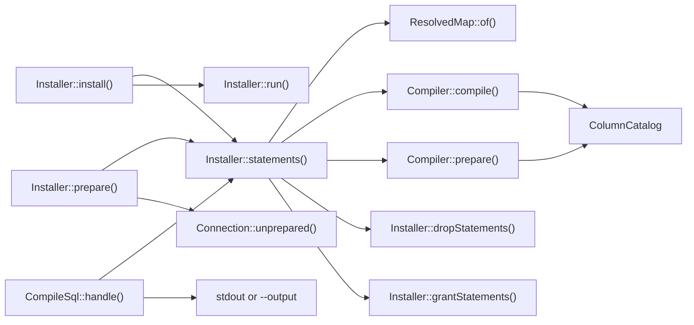

# Compiling and installing the schema

This flow follows `Installer::install()` from a compatibility map to a compatibility view with its triggers and planner objects. A migration calls it after it renames the previous model's table to the retained table. It then follows `Installer::prepare()`, which builds the planner objects ahead of the install, and `compatibility:sql`, which prints the same statements without running them.



## Installing

An install lists its statements from catalog reads alone, and then runs them, all in one transaction:

1. It opens one transaction with `Connection::transaction()`, which takes a savepoint inside a caller's transaction. Every later step runs inside it.
2. It resolves the map with `ResolvedMap::of()`.
3. It refuses when a relation with the view's name already exists in the current schema. A relation of that name in a later schema on the search path does not count. The message points at `Installer::recompile()`. [Before the rename](#before-the-rename) names the one exception.
4. It refuses while another view or materialized view reads the retained table, and names each one. [INV-42](../invariants.md#inv-42-only-the-compatibility-view-reads-the-retained-table) records why, and [adopting a map](../adopting-a-map.md#before-the-install-views-on-the-old-table) how to redirect such a view.
5. It refuses a retained or current table with row-level security, then compiles. [INV-38](../invariants.md#inv-38-the-schema-refuses-a-table-with-row-level-security) records the refusal.
6. It lists a drop of every trigger whose name starts with the map's object prefix, and whose table and function are in the current schema. It then lists a drop of every function with that prefix in the current schema. The compiled statements follow the drops. They end with the planner list, [described below](#planner-support).
7. It lists one `DO` block that revokes every grant on the view except its owner's. The block reads the view's grants when it runs, so it also revokes a default privilege that another session adds after the list is built. The role's own privileges stay, because it owns the view. So the view keeps no grant the default privileges add, as [INV-48](../invariants.md#inv-48-the-new-view-carries-no-grant-its-default-privileges-add) records.
8. It lists the grants the view takes from the retained table: the table's grants, and its column grants on the map's attribute columns, which are the view's columns. It leaves out the grants of the installing role, which owns the view. A retained table that was never granted gives its owner's default privileges, through `acldefault()`.
9. It runs each listed statement with `Connection::unprepared()`.

`Installer::statements()` builds the list in steps 2 to 8, which change nothing, and the private `Installer::run()` runs it. So a refusal or a compile error throws before the first statement runs. A failed statement rolls back the whole install, so it leaves nothing behind.

## Recompiling and uninstalling

A recompile replaces the installed map. It refuses no existing view, and copies no grants from the retained table. Its list:

1. Saves the view's own grants, when the view exists in the current schema. A view with no explicit grants saves its owner's default privileges.
2. Runs steps 5 to 7 above. After it compiles, it refuses while another object depends on the view or uses its row type, and names each one. It also refuses a trigger or a rule on the view that is not the map's own. It drops the view after the drops of step 6, without `CASCADE`, and before the compiled statements.
3. Grants the saved grants again, after the compiled statements. A column grant follows only when the map still has an attribute of that name, because the map's attribute columns are the new view's columns.

So a recompile can drop, retype or reorder an attribute, which `CREATE OR REPLACE VIEW` cannot. [INV-41](../invariants.md#inv-41-a-recompile-replaces-the-view-and-keeps-its-grants) and [0022](../decisions/0022-a-recompile-replaces-the-view-and-refuses-its-dependents.md) record the rule.

An uninstall lists the drops of step 6, then a drop of the view when it finds one in the current schema. It then lists a `DROP INDEX IF EXISTS` for every index in the current schema whose name starts with the map's object prefix, and a `DROP STATISTICS IF EXISTS` for every statistics object with that prefix. It leaves every table as it is.

A recompile drops no index. Its planner list creates each object the map now declares and the schema lacks, and rebuilds the statistics object when the map's zoned attributes changed. [Planning from the catalog](#planning-from-the-catalog) says how it decides, and [the limits below](#what-the-planning-leaves-alone) what that leaves.

Each of the three methods runs its list in one transaction, so a failed recompile or uninstall keeps the installed map, triggers included. A concurrent writer waits on the dropped triggers' locks until the commit, so it never meets the view without its triggers.

## Planner support

A map that declares an index with `PrimaryCurrentModel::indexedBy()`, or a zoned attribute with `Attribute::inTimeZone()`, declares planner support. `Compiler::compile()` returns its planner list as `CompiledSql::$planner`, after the triggers. A map that declares neither compiles an empty list, and install, recompile and prepare add nothing.

Every expression in the list comes from `Attribute::plannerExpression()`, which builds it from the same parts as the view column: the stored column, the zone and the declared type. So the index expression and the view expression match, and a query on the view can use the index. `ResolvedMap::of()` checks names, attributes and zones without a database, and `Compiler` checks the stored columns and the zones against the catalog. [INV-52](../invariants.md#inv-52-every-planner-expression-comes-from-the-structured-parts-of-the-view-column) records the rule, and [0024](../decisions/0024-planner-support-comes-from-structured-attributes.md) the choice.

### Planning from the catalog

The compiler plans the list from the catalog while it lists the statements, before anything runs, as [INV-26](../invariants.md#inv-26-the-printed-statements-are-the-statements-that-run) requires. It looks up each declared object by name in the current schema: the statistics object in `pg_statistic_ext`, and each index in `pg_index`. Install, recompile and prepare plan alike:

```
object in the catalog                               install and recompile              prepare
missing                                             its CREATE                         its CREATE, an index CONCURRENTLY
present and current                                 nothing                            nothing
an index whose pg_index.indisvalid is false         refuse                             refuse
a statistics object whose expressions differ        DROP STATISTICS, then its CREATE   DROP STATISTICS, then its CREATE
```

The list ends with an `ANALYZE` of the primary current model's table only when it creates something. So an install after a prepare, and a recompile that changes nothing in the planner support, list no planner statement and run no `ANALYZE`.

- **The statistics object records its expressions.** A `COMMENT ON STATISTICS` follows each `CREATE STATISTICS`, and holds the expression list exactly as the `CREATE` writes it. A comment that differs from the declared list, or none at all, means the expressions changed, so the list drops the object and creates it again. The compiler compares that comment, not `pg_get_statisticsobjdef_expressions()`, because PostgreSQL deparses an expression in its own form: it drops an identity cast, adds `::text` to the zone and quotes an identifier only where it must. `DROP STATISTICS`, `CREATE STATISTICS` and the comment each take a `SHARE UPDATE EXCLUSIVE` lock on the table, which blocks no read and no write.
- **An invalid index refuses.** A failed or unfinished `CREATE INDEX CONCURRENTLY` leaves an index whose `pg_index.indisvalid` is false, and the planner cannot use it. Install, recompile and prepare refuse it with `InvalidCompatibilityMap`, before they run anything, and the message ends with the hint `DROP INDEX CONCURRENTLY <name>, then prepare again`.
- **Each `CREATE` keeps `IF NOT EXISTS`, and the drop `IF EXISTS`.** Another session that builds or drops the object between the catalog read and the statement then fails nothing.

The list has up to five kinds of statement, in this order:

1. **One `DROP STATISTICS IF EXISTS`**, when the statistics object's expressions differ from the declared ones.
2. **One `CREATE STATISTICS IF NOT EXISTS`**, when the object is missing or was dropped, over the zoned attributes from `ResolvedMap::statisticsExpressions()`. It lists each distinct expression once, in the order first seen, because PostgreSQL rejects a duplicate with 42701. Two attributes that convert one column with one type and zone give one expression. PostgreSQL allows at most 8 in one statistics object, so `ResolvedMap::of()` refuses a map that gives more. A map with an index and no zoned attribute emits none.
3. **One `COMMENT ON STATISTICS`** after the `CREATE STATISTICS`, holding its expression list.
4. **One `CREATE INDEX IF NOT EXISTS` per missing index**, with the columns from `ResolvedMap::indexColumns()` and the filter from `ResolvedMap::indexFilter()`.
5. **One `ANALYZE` of the primary current model's table**, so the new statistics and the new index expressions have data. The list carries it only when it carries a `CREATE`.

For the workbench map, [WidgetCompatibilityMap](../../tests/Fixtures/Support/Workbench/WidgetCompatibilityMap.php), a fresh install lists:

```sql
CREATE STATISTICS IF NOT EXISTS "compatibility__widgets__statistics" ON (CAST(("delivered_at" AT TIME ZONE 'UTC') AS timestamp(0) without time zone)), (CAST(("created_at" AT TIME ZONE 'UTC') AS timestamp(0) without time zone)), (CAST(("updated_at" AT TIME ZONE 'UTC') AS timestamp(0) without time zone)), (CAST(("deleted_at" AT TIME ZONE 'UTC') AS timestamp(0) without time zone)) FROM "gadgets"

COMMENT ON STATISTICS "compatibility__widgets__statistics" IS '(CAST(("delivered_at" AT TIME ZONE ''UTC'') AS timestamp(0) without time zone)), (CAST(("created_at" AT TIME ZONE ''UTC'') AS timestamp(0) without time zone)), (CAST(("updated_at" AT TIME ZONE ''UTC'') AS timestamp(0) without time zone)), (CAST(("deleted_at" AT TIME ZONE ''UTC'') AS timestamp(0) without time zone))'

CREATE INDEX IF NOT EXISTS "compatibility__widgets__index_archived_newest" ON "gadgets" (CAST(("archived") AS boolean), CAST(("created_at" AT TIME ZONE 'UTC') AS timestamp(0) without time zone) DESC) WHERE CAST(("deleted_at" AT TIME ZONE 'UTC') AS timestamp(0) without time zone) IS NULL

ANALYZE "gadgets"
```

An install after a prepare lists none of them. A recompile that adds a zoned attribute lists `DROP STATISTICS IF EXISTS public.compatibility__widgets__statistics`, the `CREATE STATISTICS` and the comment with the new expression last, and `ANALYZE "gadgets"`, and no `CREATE INDEX`.

### What each action emits

```
action     planner statements                                          transaction
install    the planned list, with CREATE INDEX                         one, with the rest of the install
recompile  the planned list, with CREATE INDEX                         one, with the rest of the recompile
prepare    the planned list alone, with CREATE INDEX CONCURRENTLY      none: one statement at a time
uninstall  a DROP INDEX and a DROP STATISTICS for each object          one, with the rest of the uninstall
```

`Installer::prepare()` runs `Compiler::prepare()`'s list. It throws `InvalidCompatibilityMap` inside a transaction, because `CREATE INDEX CONCURRENTLY` cannot run in one. It reads the primary current model's table and nothing else, so it works before the migration that renames the previous model's table. Before it runs anything, it refuses a map whose primary current model's table does not exist, one whose zoned column is missing or is not a `timestamp with time zone`, one whose zone the catalog does not hold, one whose indexed or filtered column is missing, and an invalid index of the map. A map that declares no planner support makes it a no-op, and so does one whose planner objects are all present and current. [INV-24](../invariants.md#inv-24-each-installer-method-is-atomic) records why `prepare` stands outside the transaction.

A concurrent build is the way to add an index to a live table. In an install, a plain `CREATE INDEX` takes a `SHARE` lock on the primary current model's table, which blocks its writes until the build ends. In a recompile, the build runs under the `ACCESS EXCLUSIVE` lock that the recompile's `DROP TRIGGER` takes on that table, so it blocks reads as well. The adopter therefore runs `prepare` ahead of the install migration, and ahead of each recompile that adds or renames an index or changes a zoned attribute. The install or recompile then finds each object present and current, and lists no planner statement and no `ANALYZE`, as [adopting a map](../adopting-a-map.md#before-the-install-prebuild-the-planner-objects) describes.

### What the planning leaves alone

Three limits remain:

- **A changed index definition is never rebuilt.** The compiler matches an index by name alone, so an index keeps the definition it had when it was created. To change one, give it a new name, and prepare it before the recompile. An object the map no longer declares stays until an uninstall drops it: a renamed index's old name, and the statistics object of a map that no longer converts a zone.
- **`prepare` cannot serve a partitioned primary current model's table.** PostgreSQL refuses `CREATE INDEX CONCURRENTLY` on a partitioned table. Install can, with a plain `CREATE INDEX`.
- **The planner statements that run hold their locks longer.** In an install, a `CREATE INDEX` takes a `SHARE` lock on the primary current model's table while it builds, and the `ANALYZE` lengthens the transaction. A recompile and an uninstall take an `ACCESS EXCLUSIVE` lock on that table with their `DROP TRIGGER` and hold it until the commit, so reads wait too. A recompile that creates something runs its `CREATE` and its `ANALYZE` under that lock, and an uninstall runs its `DROP INDEX` and `DROP STATISTICS` under it. Prebuild with `prepare`, so that an install or a recompile runs no planner statement at all.

An index also needs an immutable expression. An attribute that an index names, and that reads a `timestamp with time zone` column as a `timestamp without time zone`, must declare `Attribute::inTimeZone()`. Without it, that cast is not immutable, and the install fails with PostgreSQL's 42P17. An attribute of its column's own type, such as `timestamp with time zone` or `boolean`, needs no zone: PostgreSQL drops the identity cast, so the column's own statistics and indexes serve the view. A statistics object is not affected, because it covers zoned attributes alone.

## The current schema

Each install, recompile and uninstall changes only the objects in `current_schema()`, so one map name can be installed in two schemas. `Installer::dropStatements()` resolves that schema through `to_regnamespace(quote_ident(current_schema()))`, and the private `Installer::relation()` and `Installer::relationKind()` through `quote_ident(current_schema())`. So a schema whose name needs quoting works too. Every lookup of a map table, the catalog read and the row-level security check included, resolves in that schema alone. A table found only further down the search path refuses at compile, as [INV-47](../invariants.md#inv-47-a-maps-tables-resolve-in-the-current-schema-alone) records.

## Printing the statements

`php artisan compatibility:sql <map>` prints the statements an Installer method would run for a registered map, so a reviewer can read the SQL before a migration runs it. The command:

1. Reads `--for` as an `InstallerAction`, `install` by default. Any other value exits non-zero and names the four values.
2. Takes the map from the registry and asks `Installer::statements()` for that action's list. A refusal exits non-zero with its message: an unknown map, a missing retained table, an install over an existing relation, or any other refusal of the action. So the command refuses every map the Installer refuses, row-level security, readers of the retained table and dependents of the view included.
3. Writes a header of `--` comment lines: the map and the action, the database, schema, search path, server version and role it read, and the time. For an install, the header says that the grants are derived, and that they leave out the grants of the role the command ran as. A line break in a value prints as `\r` or `\n`, so each header line stays one comment line. A `--for=prepare` header never names a retained table, because a prepare reads none, and `--retained-table-is-currently` changes nothing in its list.
4. Writes each statement with its closing semicolon on a line of its own, and a blank line between two statements, to stdout or to the `--output` file. So a statement that ends in a line comment, such as a default, keeps its semicolon. A file write that falls short exits non-zero.

The command runs only catalog reads, through the write connection even when the connection has a read host, as the Installer reads inside its transaction. Each Installer method runs exactly the list `Installer::statements()` returns, so the printed statements are the statements that method runs against the same catalog. [INV-26](../invariants.md#inv-26-the-printed-statements-are-the-statements-that-run) states the rule. A trigger, function, grant, index or statistics object that changes between the print and the install changes what the install runs. So print an install after its prepare has run, to read the list it runs.

### Before the rename

A migration renames the previous model's table before it installs, and `--retained-table-is-currently=<name>` compiles before that rename. The Installer then reads the retained table under its current name: its columns, its grants, the views that read it and its row-level security. `ColumnCatalog::source()` gives the compiler that name, so the fill check and the text comparison read the columns there too. The table may still carry the view's name. The install then allows that relation when it is a table and the option names it, and a view of that name still refuses. The printed SQL names the retained table by its name after the rename, so it runs once the migration has renamed the table. That includes the drop of a map trigger on the retained table, before a recompile or an uninstall, and the default of a `GENERATED BY DEFAULT` identity, whose `pg_get_serial_sequence()` call names the table at insert time.

A recompile or an uninstall before the first rename finds the retained table under the view's name. It treats that table as no installed view, as the same action after the rename finds none. So it lists no drop of the view, and a recompile restores no grants.

A column default that references the retained table, such as `'widgets'::regclass` or `'widgets'::regtype`, refuses before the rename. PostgreSQL prints that reference under the table's current name, so after the rename the printed default would reference another relation, often the view. The check reads the default the column takes: its own default, or else the default of its domain chain. The message names the column and says to compile after the rename. A serial column's default references its sequence, so it compiles. A generated column's expression is not copied, so it compiles too. A written column whose type is the retained table's row type or its array, such as `widgets[]`, refuses for the same reason, directly or through its domain chain. [INV-51](../invariants.md#inv-51-a-compile-before-the-rename-refuses-a-default-or-a-column-type-that-references-the-retained-table) records the rule.

## Compiling

Each compiled function pins its `search_path` to the current schema and `pg_temp`. The `Compiler` constructor reads `current_schema()` and hands that search path to its `ColumnCatalog`. `ColumnCatalog::of()` sets it inside a transaction or savepoint, reads the table, and rolls back, so the connection keeps its own search path. Each type and default it reads then carries its schema wherever the functions' search path would not find it. [INV-10](../invariants.md#inv-10-reads-and-writes-carry-their-types) records the rule. `Compiler::compile()` accepts a `CompatibilityMap` or a `ResolvedMap`.

`Compiler::validateColumns()` runs first and reads the catalog. It refuses a map when:

- the retained table, or a current table, does not exist in the current schema;
- the retained table lacks the previous model's key, its primary foreign key or a designation column;
- a retained attribute is not a column of the retained table;
- an attribute writes the primary foreign key or a designation column of the retained table;
- a dependent's table lacks its primary foreign key;
- an attribute that is not read-only writes a column the database always generates: a generated column or a `GENERATED ALWAYS` identity. A `GENERATED BY DEFAULT` identity stays writable, as [INV-45](../invariants.md#inv-45-a-generated-column-is-read-only-through-the-view) records;
- a zoned attribute's stored column is missing or is not a `timestamp with time zone`, or its zone is neither a name in `pg_timezone_names` nor an abbreviation in `pg_timezone_abbrevs`, compared in any letter case. An unknown zone would install over an empty table and then fail every write with 22023.

Five more refusals happen while the SQL is built:

- `Compiler::value()` refuses a write to a column its table lacks;
- `Compiler::insertValues()` refuses a column that both an attribute and a fill set;
- `ResolvedMap::functionName()` and its siblings refuse an object name longer than 63 characters;
- `Compiler::function()` refuses a body that contains `$compatibility$`, which would end it early, as [INV-44](../invariants.md#inv-44-no-map-expression-ends-a-function-body) records;
- the private `Compiler::planner()` refuses an invalid index of the map, as [planning from the catalog](#planning-from-the-catalog) describes.

After it builds the functions, the compiler refuses a `NOT NULL` column without a default that an insert leaves empty. It checks the retained table for a primary insert, and every table for an insert through the view. An identity or generated column counts as filled. [INV-39](../invariants.md#inv-39-every-insert-fills-each-required-column) records the rule.

## The compiled statements

`CompiledSql::statements()` returns the statements in this order:

1. **The view**, from `Compiler::view()`. It selects each attribute from the primary current model's table joined to the retained table. The primary table comes first, so a `FOR UPDATE` read through the view locks the primary row first, as [INV-1](../invariants.md#inv-1-locks-follow-one-order) requires. A retained attribute reads its own column. A mapped attribute is cast to its declared type, and a dependent's attribute reads through the subquery from `ResolvedMap::locate()`. Each hidden state adds a `WHERE NOT` condition.
2. **One `ALTER VIEW ... ALTER COLUMN` per attribute**, from `Compiler::defaults()`. An attribute with a default gets `SET DEFAULT`, and every other attribute gets `DROP DEFAULT`. So a recompile removes a default the map no longer declares. The default is `Attribute::defaultsTo()`, or else the stored column's default on the retained or primary table. For a zoned attribute, `Compiler::defaults()` converts the stored column's default `AT TIME ZONE` the attribute's zone, through `SqlFragments::atTimeZone()`, so an insert in any session stores the same instant. It takes an `Attribute::defaultsTo()` expression as written, so that expression must already be in the zone, such as `now() AT TIME ZONE 'UTC'`. A dependent's column contributes none, and a generated column has none. A `GENERATED BY DEFAULT` identity's default is `pg_catalog.nextval(pg_catalog.pg_get_serial_sequence(...)::regclass)`, with the table's schema, so an insert that omits it takes the next value.
3. **The five fixed trigger functions**, one per `TriggerFunction` case: insert, update, delete, primary insert and primary delete. A `REVOKE EXECUTE ... FROM PUBLIC` follows each function, here and in the next two steps.
4. **One `refuse_<state>` function per refused state** that names `UnrepresentableState::checkedOn()`. On a dependent's table or the retained table, it first locks the primary row and takes the refused-state lock, as [writing through the view](writing-through-the-view.md#the-refused-state-lock) describes.
5. **One `designate_<alias>` function per dependent** with `DependentCurrentModel::designatedBy()`.
6. **The triggers**, from `Compiler::triggers()`, in the same order:

```
trigger                                   when                                  on
compatibility__<name>__insert             INSTEAD OF INSERT                     the view
compatibility__<name>__update             INSTEAD OF UPDATE                     the view
compatibility__<name>__delete             INSTEAD OF DELETE                     the view
compatibility__<name>__primary_insert     AFTER INSERT                          the primary current model's table
compatibility__<name>__primary_delete     BEFORE DELETE                         the primary current model's table
compatibility__<name>__refuse_<state>     BEFORE INSERT OR UPDATE               the table the state is checked on
compatibility__<name>__designate_<alias>  AFTER INSERT OR UPDATE                the dependent's table
```

Each trigger shares its function's name. `Compiler::function()` writes every function as `SECURITY DEFINER` PL/pgSQL, quoted with the `$compatibility$` tag. Its first statement refuses with CM001 when `TG_RELID` names a relation other than the function's own or a partition of it. Every built-in function the bodies call is qualified with `pg_catalog`, as [INV-37](../invariants.md#inv-37-a-trigger-function-runs-only-for-its-own-relation) records. The insert, update and delete functions also carry a `SET` clause for the applying flag, as [INV-3](../invariants.md#inv-3-the-views-own-writes-skip-this-maps-current-side-triggers) requires. `Compiler::variables()` declares `previous_row`, `affected_rows` and one `key_<alias>` per current model.

The planner list, from the private `Compiler::planner()`, comes last, after the triggers. It holds the statistics and index statements that the catalog lacks or holds out of date, and an `ANALYZE` when it creates something. [Planner support](#planner-support) lists them, and `Compiler::prepare()` plans the same list with `CREATE INDEX CONCURRENTLY`.
