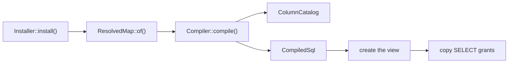

# Compiling and installing the schema

This flow follows `Installer::install()` from a compatibility map to a read-only compatibility view. A migration calls it after it renames the previous model's table to the retained table. The schema holds no trigger and no function: every write goes through the write router, as [decision 0024](../decisions/0024-writes-are-split-in-php-without-triggers.md) records.

## Installing

An install resolves the map, checks the database, and then changes it in one transaction:

1. It resolves the map with `ResolvedMap::of()`.
2. It refuses when a relation with the view's name already exists in the current schema. A relation of that name in a later schema on the search path does not count. The message points at `Installer::recompile()`.
3. It refuses while another view or materialized view reads the retained table, and names each one. [INV-25](../invariants.md#inv-25-only-the-compatibility-view-reads-the-retained-table) records why, and [adopting a map](../adopting-a-map.md#before-the-install-views-on-the-old-table) how to redirect such a view.
4. It opens one transaction with `Connection::transaction()`, which takes a savepoint inside a caller's transaction. Steps 5 to 8 run inside it.
5. It refuses a retained or current table with row-level security, then compiles. A refusal or a compile error leaves the database unchanged. [INV-26](../invariants.md#inv-26-the-schema-refuses-a-table-with-row-level-security) records the refusal.
6. It drops every trigger and function with the map's legacy prefix, `ResolvedMap::legacyObjectPrefix()`, that an earlier version of the package installed in the current schema.
7. It creates the view. It then revokes every grant the default privileges gave the new view, except its owner's.
8. It copies the retained table's `SELECT` grants to the view, except the grants the view's owner holds. A retained table that was never granted copies its owner's default `SELECT` privilege, through `acldefault()`. Column grants follow only for columns the view also has. A write grant would mislead, because no one can write the view.

A failed statement rolls back the whole install, so it leaves nothing behind.

## Recompiling and uninstalling

A recompile replaces the installed view. It refuses no existing view, and copies no grants from the retained table. In its transaction, `Installer::recompile()`:

1. Saves the view's own grants. A view with no explicit grants saves its owner's default privileges.
2. Refuses while another object depends on the view or uses its row type, and names each one. It also refuses a trigger or a rule on the view that is not an earlier version's own.
3. Drops the legacy triggers and functions, then the view, without `CASCADE`, and creates the view again.
4. Grants the saved grants again. A column grant follows only when the new view still has that column.

So a recompile can drop, retype or reorder an attribute, which `CREATE OR REPLACE VIEW` cannot, and it moves a map an earlier version installed onto the write router. [INV-24](../invariants.md#inv-24-a-recompile-replaces-the-view-keeps-its-grants-and-drops-legacy-triggers) and [0022](../decisions/0022-a-recompile-replaces-the-view-and-refuses-its-dependents.md) record the rule.

An uninstall drops the legacy objects and the view, when it finds one in the current schema, in one transaction. It leaves every table as it is.

## The current schema

Each install, recompile and uninstall changes only the objects in `current_schema()`, so one map name can be installed in two schemas. Every lookup of a map table, the catalog read and the row-level security check included, resolves in that schema alone. A table found only further down the search path refuses at compile, as [INV-30](../invariants.md#inv-30-a-maps-tables-resolve-in-the-current-schema-alone) records.

## Compiling

`Compiler::compile()` accepts a `CompatibilityMap` or a `ResolvedMap`, reads the catalog through `ColumnCatalog`, and refuses a map when:

- the retained table, or a current table, does not exist in the current schema;
- the retained table lacks the previous model's key, its primary foreign key or a designation column;
- a retained attribute is not a column of the retained table;
- an attribute writes the primary foreign key or a designation column of the retained table;
- an attribute or a fill writes a column its table lacks;
- a dependent's table lacks its primary foreign key;
- an attribute that is not read-only writes a column the database always generates: a generated column or a `GENERATED ALWAYS` identity. A `GENERATED BY DEFAULT` identity stays writable, as [INV-29](../invariants.md#inv-29-a-generated-column-is-read-only) records;
- a `NOT NULL` column without a default would stay empty on an insert path: the retained table for a primary row created through its own model, and every table for an insert through the previous model. An identity or generated column counts as filled. [INV-27](../invariants.md#inv-27-every-insert-fills-each-required-column) records the rule.

## The compiled view

`CompiledSql::statements()` returns one statement, the view. It selects each attribute from the primary current model's table joined to the retained table. A retained attribute reads its own column. A mapped attribute is cast to its declared type, and a dependent's attribute reads through the subquery from `ResolvedMap::locate()`. Each hidden state adds a `WHERE NOT` condition.

The join makes the view read-only: PostgreSQL refuses an `INSERT`, `UPDATE` or `DELETE` through a view that selects from two tables, and the view carries no trigger or rule to take the write. [INV-9](../invariants.md#inv-9-the-compatibility-view-is-read-only) records the rule.
