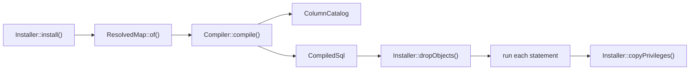

# Compiling and installing the schema

This flow follows `Installer::install()` from a compatibility map to a compatibility view with its triggers. A migration calls it after it renames the previous model's table to the retained table.



## Installing

An install resolves the map, checks the database, and then changes it in one transaction:

1. It resolves the map with `ResolvedMap::of()`.
2. It refuses when a relation with the view's name already exists in the current schema. A relation of that name in a later schema on the search path does not count. The message points at `Installer::recompile()`.
3. It refuses while another view or materialized view reads the retained table, and names each one. [INV-42](../invariants.md#inv-42-only-the-compatibility-view-reads-the-retained-table) records why, and [adopting a map](../adopting-a-map.md#before-the-install-views-on-the-old-table) how to redirect such a view.
4. It opens one transaction with `Connection::transaction()`, which takes a savepoint inside a caller's transaction. Steps 5 to 8 run inside it.
5. It refuses a retained or current table with row-level security, then compiles. A refusal or a compile error leaves the database unchanged. [INV-38](../invariants.md#inv-38-the-schema-refuses-a-table-with-row-level-security) records the refusal.
6. It drops every trigger whose name starts with the map's object prefix, and whose table and function are in the current schema. It then drops every function with that prefix in the current schema.
7. It runs each compiled statement with `Connection::unprepared()`. It then revokes every grant the default privileges gave the new view, except its owner's, as [INV-48](../invariants.md#inv-48-the-new-view-carries-no-grant-its-default-privileges-add) records.
8. It copies the retained table's grants to the view, except the grants the view's owner holds. A retained table that was never granted copies its owner's default privileges, through `acldefault()`. Column grants follow only for columns the view also has.

A failed statement rolls back the whole install, so it leaves nothing behind. `Installer::apply()` runs steps 5 to 7, `Installer::dropObjects()` step 6, and `Installer::copyPrivileges()` step 8. No test pins that the copy skips the grants of the view's owner.

## Recompiling and uninstalling

A recompile replaces the installed map. It refuses no existing view, and copies no grants from the retained table. In its transaction, `Installer::recompile()`:

1. Saves the view's own grants. A view with no explicit grants saves its owner's default privileges.
2. Runs steps 5 to 7 above. Before step 6, it refuses while another object depends on the view or uses its row type, and names each one. It also refuses a trigger or a rule on the view that is not the map's own. After step 6, it drops the view, without `CASCADE`.
3. Grants the saved grants again. A column grant follows only when the new view still has that column.

So a recompile can drop, retype or reorder an attribute, which `CREATE OR REPLACE VIEW` cannot. [INV-41](../invariants.md#inv-41-a-recompile-replaces-the-view-and-keeps-its-grants) and [0022](../decisions/0022-a-recompile-replaces-the-view-and-refuses-its-dependents.md) record the rule.

An uninstall drops the objects in one transaction, then the view when it finds one in the current schema. It leaves every table as it is.

A failed recompile or uninstall keeps the installed map, triggers included. A concurrent writer waits on the dropped triggers' locks until the commit, so it never meets the view without its triggers.

## The current schema

Each install, recompile and uninstall changes only the objects in `current_schema()`, so one map name can be installed in two schemas. `Installer::dropObjects()` resolves that schema through `to_regnamespace(quote_ident(current_schema()))`, and the private `Installer::relation()` through `quote_ident(current_schema())`. So a schema whose name needs quoting works too. Every lookup of a map table, the catalog read and the row-level security check included, resolves in that schema alone. A table found only further down the search path refuses at compile, as [INV-47](../invariants.md#inv-47-a-maps-tables-resolve-in-the-current-schema-alone) records.

## Compiling

Each compiled function pins its `search_path` to the current schema and `pg_temp`. The `Compiler` constructor reads `current_schema()` and hands that search path to its `ColumnCatalog`. `ColumnCatalog::of()` sets it inside a transaction or savepoint, reads the table, and rolls back, so the connection keeps its own search path. Each type and default it reads then carries its schema wherever the functions' search path would not find it. [INV-10](../invariants.md#inv-10-reads-and-writes-carry-their-types) records the rule. `Compiler::compile()` accepts a `CompatibilityMap` or a `ResolvedMap`.

`Compiler::validateColumns()` runs first and reads the catalog. It refuses a map when:

- the retained table, or a current table, does not exist in the current schema;
- the retained table lacks the previous model's key, its primary foreign key or a designation column;
- a retained attribute is not a column of the retained table;
- an attribute writes the primary foreign key or a designation column of the retained table;
- a dependent's table lacks its primary foreign key;
- an attribute that is not read-only writes a column the database always generates: a generated column or a `GENERATED ALWAYS` identity. A `GENERATED BY DEFAULT` identity stays writable, as [INV-45](../invariants.md#inv-45-a-generated-column-is-read-only-through-the-view) records.

Four more refusals happen while the SQL is built:

- `Compiler::value()` refuses a write to a column its table lacks;
- `Compiler::insertValues()` refuses a column that both an attribute and a fill set;
- `ResolvedMap::functionName()` and its siblings refuse an object name longer than 63 characters;
- `Compiler::function()` refuses a body that contains `$compatibility$`, which would end it early, as [INV-44](../invariants.md#inv-44-no-map-expression-ends-a-function-body) records.

After it builds the functions, the compiler refuses a `NOT NULL` column without a default that an insert leaves empty. It checks the retained table for a primary insert, and every table for an insert through the view. An identity or generated column counts as filled. [INV-39](../invariants.md#inv-39-every-insert-fills-each-required-column) records the rule.

## The compiled statements

`CompiledSql::statements()` returns the statements in this order:

1. **The view**, from `Compiler::view()`. It selects each attribute from the primary current model's table joined to the retained table. The primary table comes first, so a `FOR UPDATE` read through the view locks the primary row first, as [INV-1](../invariants.md#inv-1-locks-follow-one-order) requires. A retained attribute reads its own column. A mapped attribute is cast to its declared type, and a dependent's attribute reads through the subquery from `ResolvedMap::locate()`. Each hidden state adds a `WHERE NOT` condition.
2. **One `ALTER VIEW ... ALTER COLUMN` per attribute**, from `Compiler::defaults()`. An attribute with a default gets `SET DEFAULT`, and every other attribute gets `DROP DEFAULT`. So a recompile removes a default the map no longer declares. The default is `Attribute::defaultsTo()`, or else the stored column's default on the retained or primary table. A dependent's column contributes none, and a generated column has none. A `GENERATED BY DEFAULT` identity's default is `pg_catalog.nextval(pg_catalog.pg_get_serial_sequence(...)::regclass)`, with the table's schema, so an insert that omits it takes the next value.
3. **The five fixed trigger functions**, one per `TriggerFunction` case: insert, update, delete, primary insert and primary delete. A `REVOKE EXECUTE ... FROM PUBLIC` follows each function, here and in the next two steps.
4. **One `refuse_<state>` function per refused state** that names `UnrepresentableState::checkedOn()`. On a dependent's table or the retained table, it first locks the primary row and takes the refused-state lock, as [writing through the view](writing-through-the-view.md#the-refused-state-lock) describes.
5. **One `designate_<alias>` function per dependent** with `DependentCurrentModel::designatedBy()`.
6. **The triggers**, from `Compiler::triggers()`, in the same order:

```
trigger                                   when                                  on
compatibility__<name>__insert             INSTEAD OF INSERT                     the view
compatibility__<name>__update             INSTEAD OF UPDATE                     the view
compatibility__<name>__delete             INSTEAD OF DELETE                     the view
compatibility__<name>__primary_insert     AFTER INSERT                          the primary current model's table
compatibility__<name>__primary_delete     BEFORE DELETE                         the primary current model's table
compatibility__<name>__refuse_<state>     BEFORE INSERT OR UPDATE               the table the state is checked on
compatibility__<name>__designate_<alias>  AFTER INSERT OR UPDATE                the dependent's table
```

Each trigger shares its function's name. `Compiler::function()` writes every function as `SECURITY DEFINER` PL/pgSQL, quoted with the `$compatibility$` tag. Its first statement refuses with CM001 when `TG_RELID` names a relation other than the function's own or a partition of it. Every built-in function the bodies call is qualified with `pg_catalog`, as [INV-37](../invariants.md#inv-37-a-trigger-function-runs-only-for-its-own-relation) records. The insert, update and delete functions also carry a `SET` clause for the applying flag, as [INV-3](../invariants.md#inv-3-the-views-own-writes-skip-this-maps-current-side-triggers) requires. `Compiler::variables()` declares `previous_row`, `affected_rows` and one `key_<alias>` per current model.
