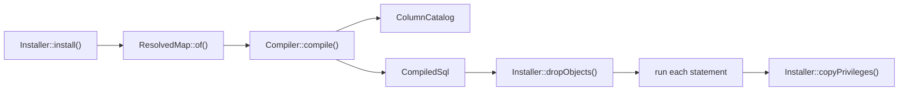

# Compiling and installing the schema

This flow follows `Installer::install()` from a compatibility map to a compatibility view with its triggers. A migration calls it after renaming the previous model's table to the retained table.



## Installing

1. `Installer::install()` resolves the map with `ResolvedMap::of()`.
2. It refuses when a relation with the view's name already exists in the current schema. The private `Installer::relation()` looks the name up there alone, so a relation of that name in a later schema on the search path does not count. The message points at `Installer::recompile()`.
3. It refuses while another view or materialized view reads the retained table, and names each one. [INV-42](../invariants.md) records why, and [adopting a map](../adopting-a-map.md) how to redirect such a view.
4. It opens one transaction with `Connection::transaction()`, which takes a savepoint inside a caller's transaction. Steps 5 to 8 run inside it.
5. `Installer::apply()` refuses a retained or current table with row-level security, then compiles. A refusal or a compile error leaves the database unchanged. [INV-38](../invariants.md) records the refusal.
6. `Installer::dropObjects()` drops every trigger whose name starts with the map's object prefix and whose table and function are in the current schema. It then drops every function with that prefix in the current schema.
7. `Installer::apply()` runs each of `CompiledSql::statements()` with `Connection::unprepared()`. The private `Installer::revokeDefaultPrivileges()` then revokes every grant the default privileges gave the new view, except its owner's. [INV-48](../invariants.md) records why.
8. `Installer::copyPrivileges()` copies the retained table's grants to the view, except the grants held by the view's owner. A retained table that was never granted copies its owner's default privileges, through `acldefault()`. Column grants follow only for columns the view also has.

A failed statement rolls back the whole install, so it leaves nothing behind.

`Installer::recompile()` refuses no existing view and copies no grants from the retained table. In its transaction it:

1. Saves the view's own grants through the private `Installer::viewGrants()`. A view with no explicit grants saves its owner's default privileges.
2. Runs `Installer::apply()`, steps 5 to 7 above. Before step 6, it refuses while another object depends on the view or uses its row type, and names each one. It also refuses a trigger or a rule on the view that is not the map's own. After step 6, it drops the view, without `CASCADE`.
3. Grants the saved grants again. A column grant follows only when the new view still has that column.

So a recompile can drop, retype or reorder an attribute, which `CREATE OR REPLACE VIEW` cannot. [INV-41](../invariants.md) and [0022](../decisions/0022-a-recompile-replaces-the-view-and-refuses-its-dependents.md) record the rule. `Installer::uninstall()` drops the objects in one transaction, then the view when `Installer::relation()` finds it in the current schema. It leaves every table as it is. A failed recompile or uninstall therefore keeps the installed map, triggers included. A concurrent writer waits on the dropped triggers' locks until the commit, so it never meets the view without its triggers.

The schema scope lets one map name be installed in two schemas. Each install, recompile and uninstall changes only the objects in `current_schema()`. `Installer::dropObjects()` resolves that schema through `to_regnamespace(quote_ident(current_schema()))`, and `Installer::relation()` through `quote_ident(current_schema())`. So a schema whose name needs quoting works too. `ColumnCatalog::of()`, the row-level security check and every other lookup of a map table resolve it in that schema alone. A table found only further down the search path refuses at compile. [INV-47](../invariants.md) records the rule.

## Compiling

The `Compiler` constructor reads `current_schema()`, and each function pins its `search_path` to that schema and `pg_temp`. `Compiler::compile()` accepts a `CompatibilityMap` or a `ResolvedMap`.

`Compiler::validateColumns()` runs first and reads the catalog through `ColumnCatalog`. It refuses a map when:

- the retained table, or a current table, does not exist in the current schema;
- the retained table lacks the previous model's key, its primary foreign key or a designation column;
- a retained attribute is not a column of the retained table;
- an attribute writes the primary foreign key or a designation column of the retained table;
- a dependent's table lacks its primary foreign key;
- an attribute that is not read-only writes a column the database always generates: a generated column or a `GENERATED ALWAYS` identity. A `GENERATED BY DEFAULT` identity stays writable. [INV-45](../invariants.md) records the rule.

Four more refusals happen while the SQL is built. `Compiler::value()` refuses a write to a column its table lacks. `Compiler::insertValues()` refuses a column that both an attribute and a fill set. `ResolvedMap::functionName()` and its siblings refuse an object name longer than 63 characters. `Compiler::function()` refuses a body that contains `$compatibility$`, which would end it early; [INV-44](../invariants.md) records the rule.

After it builds the functions, `Compiler::compile()` runs the private `Compiler::validateFills()`. It refuses a `NOT NULL` column without a default that an insert leaves empty. It checks the retained table for a primary insert, and every table for an insert through the view. An identity or generated column counts as filled. [INV-39](../invariants.md) records the rule.

`CompiledSql::statements()` returns the statements in this order:

1. The view, from `Compiler::view()`. It selects each attribute from the primary current model's table joined to the retained table. The primary table comes first, so a `FOR UPDATE` read through the view locks the primary row first, as [INV-1](../invariants.md) requires. A retained attribute reads its own column. A mapped attribute is cast to its declared type, and a dependent's attribute reads through a subquery built by `ResolvedMap::locate()`. Each hidden state adds a `WHERE NOT` condition.
2. One `ALTER VIEW ... ALTER COLUMN` per attribute, from `Compiler::defaults()`. An attribute with a default gets `SET DEFAULT`, and every other attribute gets `DROP DEFAULT`. The default is `Attribute::defaultsTo()`, or else the stored column's default on the retained or primary table. A dependent's column contributes none, and `ColumnCatalog::of()` reports no default for a generated column. It reports a `GENERATED BY DEFAULT` identity's default as `nextval(pg_get_serial_sequence(...)::regclass)`, with the table's schema, so an insert that omits it takes the next value. A recompile therefore removes a default the map no longer declares.
3. The five fixed trigger functions, one per `TriggerFunction` case: insert, update, delete, primary insert and primary delete. A `REVOKE EXECUTE ... FROM PUBLIC` follows each function, here and in the next two steps.
4. One `refuse_<state>` function per refused state that names `UnrepresentableState::checkedOn()`. On a dependent's table or the retained table, it first locks the primary row and takes the refused-state lock. [Writing through the view](writing-through-the-view.md) describes the lock.
5. One `designate_<alias>` function per dependent with `DependentCurrentModel::designatedBy()`.
6. The triggers, from `Compiler::triggers()`, in the same order.

```
trigger                                   when                                  on
compatibility__<name>__insert             INSTEAD OF INSERT                     the view
compatibility__<name>__update             INSTEAD OF UPDATE                     the view
compatibility__<name>__delete             INSTEAD OF DELETE                     the view
compatibility__<name>__primary_insert     AFTER INSERT                          the primary current model's table
compatibility__<name>__primary_delete     BEFORE DELETE                         the primary current model's table
compatibility__<name>__refuse_<state>     BEFORE INSERT OR UPDATE               the table the state is checked on
compatibility__<name>__designate_<alias>  AFTER INSERT OR UPDATE                the dependent's table
```

Each trigger shares its function's name. `Compiler::function()` writes every function as `SECURITY DEFINER` PL/pgSQL, quoted with the `$compatibility$` tag. Its first statement refuses with CM001 when `TG_RELID` names a relation other than the function's own or a partition of it. [INV-37](../invariants.md) records why. `Compiler::variables()` declares `previous_row`, `affected_rows` and one `key_<alias>` per current model.

## Tests

- `InstallerTest::it_exposes_every_attribute_with_its_declared_previous_model_type()`: the view's column types.
- `InstallerTest::it_refuses_to_install_a_compatibility_map_twice()`, `InstallerTest::it_recompiles_a_compatibility_map_without_duplicating_its_triggers()` and `InstallerTest::it_uninstalls_the_compatibility_view_and_leaves_the_current_models_untouched()`: the three Installer methods.
- `InstallerTest::it_leaves_nothing_behind_when_an_install_fails()`, `InstallerTest::it_keeps_the_installed_compatibility_map_when_a_recompile_fails()` and `InstallerTest::it_keeps_the_installed_compatibility_map_when_an_uninstall_fails()`: each method runs in one transaction.
- `InstallerTest::it_leaves_the_same_compatibility_map_in_another_schema_installed()` and `InstallerTest::it_keeps_a_prefixed_trigger_on_another_schemas_table_that_calls_a_function_of_this_schema()`: the cleanup keeps to the current schema.
- `InstallerTest::it_installs_recompiles_and_uninstalls_in_a_schema_whose_name_needs_quoting()`: the three Installer methods in a schema whose name needs quoting.
- `InstallerTest::it_installs_recompiles_and_uninstalls_ahead_of_a_later_schema_that_has_the_compatibility_map()` and `InstallerTest::it_uninstalls_nothing_of_a_later_schema_when_the_current_schema_has_no_compatibility_view()`: the view is looked up in the current schema alone.
- `InstallerTest::it_copies_the_retained_tables_grants_to_the_view_when_it_installs()`, `InstallerTest::it_lets_a_role_granted_a_retained_column_write_that_column_through_the_view()` and `InstallerTest::it_leaves_the_views_grants_as_they_are_when_it_recompiles()`: the copied grants, and `SECURITY DEFINER`.
- `InstallerTest::it_drops_a_view_default_the_compatibility_map_no_longer_declares()`: a recompile removes a default.
- `InstallerTest::it_recompiles_a_map_that_removes_retypes_or_reorders_an_attribute()`, `InstallerTest::it_keeps_every_grant_on_the_view_when_it_recompiles_the_view_anew()` and `InstallerTest::it_refuses_to_recompile_while_another_object_depends_on_the_view_and_names_it()` and `InstallerTest::it_refuses_to_recompile_while_an_object_uses_the_views_row_type_or_sits_on_the_view_and_names_it()`: a recompile replaces the view.
- `InstallerTest::it_refuses_to_install_while_another_view_reads_the_retained_table_and_names_it()` and `InstallerTest::it_refuses_to_install_or_recompile_over_a_table_with_row_level_security()`: the install's refusals.
- `InstallerTest::it_copies_the_owners_privileges_to_the_view_when_the_retained_table_was_never_granted()`: a retained table that was never granted.
- `InstallerTest::it_lets_no_other_role_execute_a_trigger_function_after_an_install_or_a_recompile()` and `CompilerTest::it_refuses_to_run_a_trigger_function_fired_on_any_relation_but_its_own()`: the revoke and the relation check. `CompilerTest::it_runs_its_trigger_functions_on_the_partitions_of_a_partitioned_current_table()` pins a partitioned primary and dependent table.
- `CompilerTest::it_refuses_a_not_null_column_without_a_default_that_an_insert_leaves_empty()` and `CompilerTest::it_counts_a_filled_default_identity_or_generated_column_as_filled_on_every_insert()`: the fill check.
- `CompilerTest::it_refuses_a_writable_attribute_whose_column_the_database_always_generates()`, `CompilerTest::it_compiles_and_writes_a_writable_attribute_whose_column_is_a_default_identity()` and `InstallerTest::it_installs_and_recompiles_a_map_that_exposes_a_generated_column_read_only()`: the generated-column rule.
- `CompilerTest::it_lets_the_table_number_an_identity_retained_key_that_an_insert_through_the_view_omits()`: an identity retained key, of either kind.
- `CompilerTest::it_refuses_a_map_whose_current_table_is_outside_the_schema_it_installs_into()`: a table outside the current schema.
- `InstallerTest::it_keeps_every_grant_the_default_privileges_add_off_the_view_it_creates()`: the revoke of default privileges, on an install and a recompile.
- `InstallerTest::it_compiles_only_full_word_aliases_variables_and_object_names()`: the identifiers in the compiled SQL.
- `ResolvedMapTest::it_refuses_an_attribute_the_tables_cannot_store()`, `DependentCurrentModelTest::it_refuses_a_designation_the_retained_table_does_not_have()` and `DependentCurrentModelTest::it_refuses_an_attribute_that_writes_the_designation()`: the compile-time refusals.
- `CompilerTest::it_refuses_at_compile_time_a_map_the_tables_cannot_store()`: every compile-time refusal, the fill collision and the 63-character limit included.
- `CompilerTest::it_installs_an_object_name_of_exactly_63_characters_without_truncating_it()` and `CompilerTest::it_compiles_every_trigger_function_of_a_map_whose_name_has_the_most_characters_allowed()`: the 63-character limit's edge.
- `CompilerTest::it_compiles_the_view_before_its_trigger_functions_and_the_functions_before_their_triggers()` and `CompilerTest::it_attaches_each_trigger_function_to_its_table_and_events()`: the statement order and the trigger table above.
- `CompilerTest::it_defaults_a_view_column_to_its_declared_default_or_else_to_the_default_of_a_retained_or_primary_column_that_stores_it()`: the view defaults.
- `CompilerTest::it_runs_the_trigger_functions_on_the_schema_of_the_connection_it_was_built_on_whatever_the_writers_search_path()`: the pinned `search_path`.

`ColumnCatalogTest`, `CompiledSqlTest` and `SqlFragmentsTest` cover their classes' own contracts. No test pins that `Installer::copyPrivileges()` skips the grants of the view's owner.
