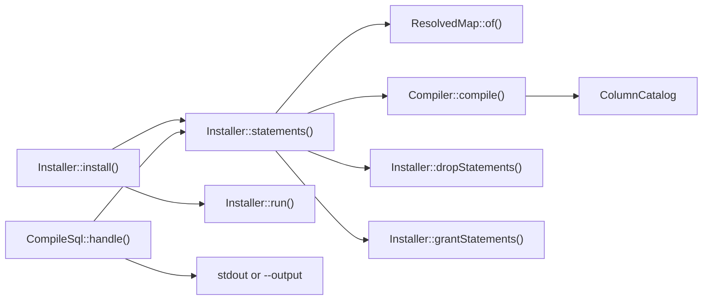

# Compiling and installing the schema

This flow follows `Installer::install()` from a compatibility map to a compatibility view with its triggers. A migration calls it after it renames the previous model's table to the retained table. It then follows `compatibility:sql`, which prints the same statements without running them.



## Installing

An install lists its statements from catalog reads alone, and then runs them, all in one transaction:

1. It opens one transaction with `Connection::transaction()`, which takes a savepoint inside a caller's transaction. Every later step runs inside it.
2. It resolves the map with `ResolvedMap::of()`.
3. It refuses when a relation with the view's name already exists in the current schema. A relation of that name in a later schema on the search path does not count. The message points at `Installer::recompile()`. [Before the rename](#before-the-rename) names the one exception.
4. It refuses while another view or materialized view reads the retained table, and names each one. [INV-42](../invariants.md#inv-42-only-the-compatibility-view-reads-the-retained-table) records why, and [adopting a map](../adopting-a-map.md#before-the-install-views-on-the-old-table) how to redirect such a view.
5. It refuses a retained or current table with row-level security, then compiles. [INV-38](../invariants.md#inv-38-the-schema-refuses-a-table-with-row-level-security) records the refusal.
6. It lists a drop of every trigger whose name starts with the map's object prefix, and whose table and function are in the current schema. It then lists a drop of every function with that prefix in the current schema. The compiled statements follow the drops.
7. It lists one `DO` block that revokes every grant on the view except its owner's. The block reads the view's grants when it runs, so it also revokes a default privilege that another session adds after the list is built. The role's own privileges stay, because it owns the view. So the view keeps no grant the default privileges add, as [INV-48](../invariants.md#inv-48-the-new-view-carries-no-grant-its-default-privileges-add) records.
8. It lists the grants the view takes from the retained table: the table's grants, and its column grants on the map's attribute columns, which are the view's columns. It leaves out the grants of the installing role, which owns the view. A retained table that was never granted gives its owner's default privileges, through `acldefault()`.
9. It runs each listed statement with `Connection::unprepared()`.

`Installer::statements()` builds the list in steps 2 to 8, which change nothing, and the private `Installer::run()` runs it. So a refusal or a compile error throws before the first statement runs. A failed statement rolls back the whole install, so it leaves nothing behind.

## Recompiling and uninstalling

A recompile replaces the installed map. It refuses no existing view, and copies no grants from the retained table. Its list:

1. Saves the view's own grants, when the view exists in the current schema. A view with no explicit grants saves its owner's default privileges.
2. Runs steps 5 to 7 above. After it compiles, it refuses while another object depends on the view or uses its row type, and names each one. It also refuses a trigger or a rule on the view that is not the map's own. It drops the view after the drops of step 6, without `CASCADE`, and before the compiled statements.
3. Grants the saved grants again, after the compiled statements. A column grant follows only when the map still has an attribute of that name, because the map's attribute columns are the new view's columns.

So a recompile can drop, retype or reorder an attribute, which `CREATE OR REPLACE VIEW` cannot. [INV-41](../invariants.md#inv-41-a-recompile-replaces-the-view-and-keeps-its-grants) and [0022](../decisions/0022-a-recompile-replaces-the-view-and-refuses-its-dependents.md) record the rule.

An uninstall lists the drops of step 6, then a drop of the view when it finds one in the current schema. It leaves every table as it is.

Each of the three methods runs its list in one transaction, so a failed recompile or uninstall keeps the installed map, triggers included. A concurrent writer waits on the dropped triggers' locks until the commit, so it never meets the view without its triggers.

## The current schema

Each install, recompile and uninstall changes only the objects in `current_schema()`, so one map name can be installed in two schemas. `Installer::dropStatements()` resolves that schema through `to_regnamespace(quote_ident(current_schema()))`, and the private `Installer::relation()` and `Installer::relationKind()` through `quote_ident(current_schema())`. So a schema whose name needs quoting works too. Every lookup of a map table, the catalog read and the row-level security check included, resolves in that schema alone. A table found only further down the search path refuses at compile, as [INV-47](../invariants.md#inv-47-a-maps-tables-resolve-in-the-current-schema-alone) records.

## Printing the statements

`php artisan compatibility:sql <map>` prints the statements an Installer method would run for a registered map, so a reviewer can read the SQL before a migration runs it. The command:

1. Reads `--for` as an `InstallerAction`, `install` by default. Any other value exits non-zero and names the three values.
2. Takes the map from the registry and asks `Installer::statements()` for that action's list. A refusal exits non-zero with its message: an unknown map, a missing retained table, an install over an existing relation, or any other refusal of the action. So the command refuses every map the Installer refuses, row-level security, readers of the retained table and dependents of the view included.
3. Writes a header of `--` comment lines: the map and the action, the database, schema, search path, server version and role it read, and the time. For an install, the header says that the grants are derived, and that they leave out the grants of the role the command ran as. A line break in a value prints as `\r` or `\n`, so each header line stays one comment line.
4. Writes each statement with its closing semicolon on a line of its own, and a blank line between two statements, to stdout or to the `--output` file. So a statement that ends in a line comment, such as a default, keeps its semicolon. A file write that falls short exits non-zero.

The command runs only catalog reads. Each Installer method runs exactly the list `Installer::statements()` returns, so the printed statements are the statements that method runs against the same catalog. [INV-26](../invariants.md#inv-26-the-printed-statements-are-the-statements-that-run) states the rule. A trigger, function or grant that changes between the print and the install changes what the install runs.

### Before the rename

A migration renames the previous model's table before it installs, and `--retained-table-is-currently=<name>` compiles before that rename. The Installer then reads the retained table under its current name: its columns, its grants, the views that read it and its row-level security. `ColumnCatalog::source()` gives the compiler that name, so the fill check and the text comparison read the columns there too. The table may still carry the view's name. The install then allows that relation when it is a table and the option names it, and a view of that name still refuses. The printed SQL names the retained table by its name after the rename, so it runs once the migration has renamed the table. That includes the drop of a map trigger on the retained table, before a recompile, and the default of a `GENERATED BY DEFAULT` identity, whose `pg_get_serial_sequence()` call names the table at insert time.

## Compiling

Each compiled function pins its `search_path` to the current schema and `pg_temp`. The `Compiler` constructor reads `current_schema()` and hands that search path to its `ColumnCatalog`. `ColumnCatalog::of()` sets it inside a transaction or savepoint, reads the table, and rolls back, so the connection keeps its own search path. Each type and default it reads then carries its schema wherever the functions' search path would not find it. [INV-10](../invariants.md#inv-10-reads-and-writes-carry-their-types) records the rule. `Compiler::compile()` accepts a `CompatibilityMap` or a `ResolvedMap`.

`Compiler::validateColumns()` runs first and reads the catalog. It refuses a map when:

- the retained table, or a current table, does not exist in the current schema;
- the retained table lacks the previous model's key, its primary foreign key or a designation column;
- a retained attribute is not a column of the retained table;
- an attribute writes the primary foreign key or a designation column of the retained table;
- a dependent's table lacks its primary foreign key;
- an attribute that is not read-only writes a column the database always generates: a generated column or a `GENERATED ALWAYS` identity. A `GENERATED BY DEFAULT` identity stays writable, as [INV-45](../invariants.md#inv-45-a-generated-column-is-read-only-through-the-view) records.

Four more refusals happen while the SQL is built:

- `Compiler::value()` refuses a write to a column its table lacks;
- `Compiler::insertValues()` refuses a column that both an attribute and a fill set;
- `ResolvedMap::functionName()` and its siblings refuse an object name longer than 63 characters;
- `Compiler::function()` refuses a body that contains `$compatibility$`, which would end it early, as [INV-44](../invariants.md#inv-44-no-map-expression-ends-a-function-body) records.

After it builds the functions, the compiler refuses a `NOT NULL` column without a default that an insert leaves empty. It checks the retained table for a primary insert, and every table for an insert through the view. An identity or generated column counts as filled. [INV-39](../invariants.md#inv-39-every-insert-fills-each-required-column) records the rule.

## The compiled statements

`CompiledSql::statements()` returns the statements in this order:

1. **The view**, from `Compiler::view()`. It selects each attribute from the primary current model's table joined to the retained table. The primary table comes first, so a `FOR UPDATE` read through the view locks the primary row first, as [INV-1](../invariants.md#inv-1-locks-follow-one-order) requires. A retained attribute reads its own column. A mapped attribute is cast to its declared type, and a dependent's attribute reads through the subquery from `ResolvedMap::locate()`. Each hidden state adds a `WHERE NOT` condition.
2. **One `ALTER VIEW ... ALTER COLUMN` per attribute**, from `Compiler::defaults()`. An attribute with a default gets `SET DEFAULT`, and every other attribute gets `DROP DEFAULT`. So a recompile removes a default the map no longer declares. The default is `Attribute::defaultsTo()`, or else the stored column's default on the retained or primary table. A dependent's column contributes none, and a generated column has none. A `GENERATED BY DEFAULT` identity's default is `pg_catalog.nextval(pg_catalog.pg_get_serial_sequence(...)::regclass)`, with the table's schema, so an insert that omits it takes the next value.
3. **The five fixed trigger functions**, one per `TriggerFunction` case: insert, update, delete, primary insert and primary delete. A `REVOKE EXECUTE ... FROM PUBLIC` follows each function, here and in the next two steps.
4. **One `refuse_<state>` function per refused state** that names `UnrepresentableState::checkedOn()`. On a dependent's table or the retained table, it first locks the primary row and takes the refused-state lock, as [writing through the view](writing-through-the-view.md#the-refused-state-lock) describes.
5. **One `designate_<alias>` function per dependent** with `DependentCurrentModel::designatedBy()`.
6. **The triggers**, from `Compiler::triggers()`, in the same order:

```
trigger                                   when                                  on
compatibility__<name>__insert             INSTEAD OF INSERT                     the view
compatibility__<name>__update             INSTEAD OF UPDATE                     the view
compatibility__<name>__delete             INSTEAD OF DELETE                     the view
compatibility__<name>__primary_insert     AFTER INSERT                          the primary current model's table
compatibility__<name>__primary_delete     BEFORE DELETE                         the primary current model's table
compatibility__<name>__refuse_<state>     BEFORE INSERT OR UPDATE               the table the state is checked on
compatibility__<name>__designate_<alias>  AFTER INSERT OR UPDATE                the dependent's table
```

Each trigger shares its function's name. `Compiler::function()` writes every function as `SECURITY DEFINER` PL/pgSQL, quoted with the `$compatibility$` tag. Its first statement refuses with CM001 when `TG_RELID` names a relation other than the function's own or a partition of it. Every built-in function the bodies call is qualified with `pg_catalog`, as [INV-37](../invariants.md#inv-37-a-trigger-function-runs-only-for-its-own-relation) records. The insert, update and delete functions also carry a `SET` clause for the applying flag, as [INV-3](../invariants.md#inv-3-the-views-own-writes-skip-this-maps-current-side-triggers) requires. `Compiler::variables()` declares `previous_row`, `affected_rows` and one `key_<alias>` per current model.
