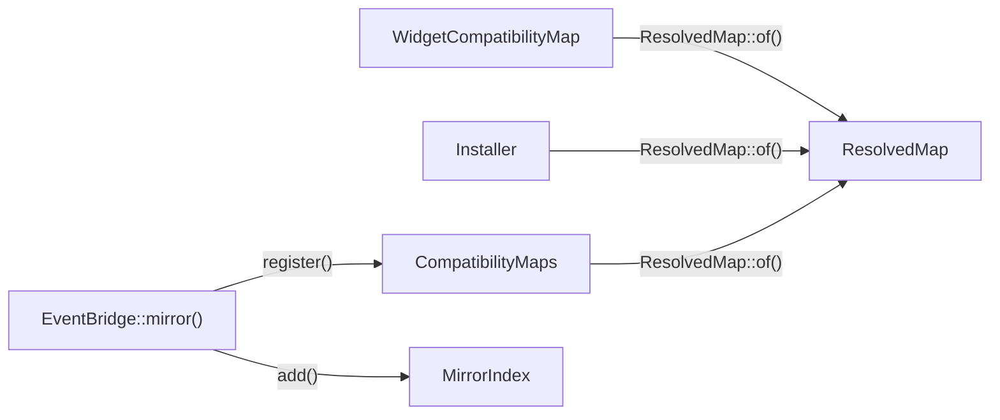

# Declaring and registering a map

This flow follows a compatibility map from its class to a `ResolvedMap` that the schema and the event bridge can use. The example is the workbench map, [WidgetCompatibilityMap](../../tests/Fixtures/Support/Workbench/WidgetCompatibilityMap.php).

## The declaration

A map implements `CompatibilityMap`, whose six methods return builders. Every builder is a `final readonly` class: each call returns a new instance, and nothing mutates.

- `PreviousModel::servedAsView()` names the compatibility view. `PreviousModel::retainedInTable()`, `PreviousModel::forModel()`, `PreviousModel::aliasedAs()` and `PreviousModel::primaryForeignKey()` are required. `PreviousModel::keyedBy()` is optional, and the key defaults to the model's own key name.
- `PrimaryCurrentModel::for()` and `DependentCurrentModel::for()` take the model class. Each needs an alias, and a dependent needs `DependentCurrentModel::primaryForeignKey()`.
- `DependentCurrentModel::readableWhen()` defaults to `true`. `DependentCurrentModel::createdWhen()` and `DependentCurrentModel::designatedBy()` are optional.
- `PrimaryCurrentModel::triggerArguments()` and `DependentCurrentModel::triggerArguments()` are optional. Each declares the constructor arguments of one state machine trigger, with one closure per argument name. A second call for the same trigger replaces the first. [Replaying a transition](replaying-a-transition.md) describes how the bridge calls the closures.
- `PrimaryCurrentModel::indexedBy()` is optional. It takes one or more `PlannerIndex` values, each built with `PlannerIndex::named()`, `PlannerIndex::on()` and, for a partial index, one `PlannerIndex::whereNull()` or `PlannerIndex::whereNotNull()`. A second call adds to the first. `PlannerIndex` records every call in order: each `PlannerIndex::on()` as one entry of `PlannerIndex::$columns`, and each filter as one entry of `PlannerIndex::$filters`, typed by `PlannerIndexFilter`. It replaces nothing, so resolving sees a repeated column or a second filter and refuses it. [Compiling and installing the schema](compiling-and-installing-the-schema.md#planner-support) describes what the installer builds from them.
- `Attribute::retained()` keeps a column in the retained table. `Attribute::mapped()` stores it in a current model's table and needs `Attribute::asType()`.
- `UnrepresentableState::refuse()`, `UnrepresentableState::degrade()` and `UnrepresentableState::hide()` declare the states one side holds and the other cannot.

Each model builder stores the class name as Eloquent's events spell it. `ModelClass::canonical()` returns the declared name of a class that loads, so a leading backslash or another letter case still names the class. A name that loads no class stays as written, and resolution refuses it.

`Attribute` orders its calls. `Attribute::storedAs()` sets the read and one `TargetColumn` together. `Attribute::readAs()` and `Attribute::readOnlyBecause()` clear the writes, so `Attribute::writesTo()` must follow `Attribute::readAs()`. The workbench `price` attribute shows that order. `Attribute::inTimeZone()` follows `Attribute::storedAs()`, or comes before it, and either order gives the same attribute. It says the stored column is a `timestamp with time zone` and the attribute a `timestamp without time zone`, and only that conversion needs it: an attribute of its column's own type declares no zone. It changes the read and the write together, and so the expression an index or the statistics object uses. `Compiler::defaults()` converts the stored column's default with the same zone. It takes an `Attribute::defaultsTo()` expression as written, so that expression must already be in the zone, such as `now() AT TIME ZONE 'UTC'`. The workbench `created_at` attribute declares it. An insert through the view still stores a read-only attribute's `storedAs()` column, as [INV-49](../invariants.md#inv-49-an-insert-through-the-view-stores-a-read-only-attribute) records.

## Resolving

`ResolvedMap::of()` turns the declaration into a checked, immutable `ResolvedMap`, without the database. It checks, in order:

1. The name has at most 24 lowercase letters, digits and single underscores, and does not end in an underscore.
2. The previous model made every required call. A missing key defaults to the model's key name.
3. Each current model is an Eloquent model with a unique alias, and its class appears once among the map's current models. Two spellings of one class count as one class, because the check compares the class names of the instances it creates. A fresh instance of each model gives its table and key, held as an `AliasedTable`.
4. Each dependent declares its primary foreign key.
5. Each alias is a lowercase identifier other than `new`, `old` and the PostgreSQL reserved words. It names no variable the triggers declare, and does not start with `key_`. [INV-22](../invariants.md#inv-22-compiled-identifiers-are-full-words) records the rule.
6. Each current model that declares trigger arguments names a trigger its state machines use, and passes only arguments that trigger's constructor takes. Registration refuses the map in five cases:
   - eloquent-state-machines is missing, or it has no `Trigger::withoutTransition()`.
   - The trigger is not the `using` of a `#[Transition]` on a state machine that one of the model's columns casts to. The class name must match exactly.
   - An argument name is not a parameter of the trigger's constructor, or two names differ only in case. The check ignores case, as `Trigger::make()` does, so it also refuses a constructor with two parameter names that differ only in case.
   - An argument names a variadic parameter. The container would pass the closure's result as one element of it.
   - The closures leave out a constructor parameter the container cannot resolve: one with no default, no nullable type, no class or interface type and no contextual attribute such as `#[Config]`. An enum type counts as no class type, nullable or not. A model type with no default counts as unresolvable, nullable or not, through `EventReplayer::buildsEmptyModel()`, the predicate the bridge's write-time check uses.
7. Each retained attribute reads from the previous model's alias. A retained attribute that is not read-only writes its own column.
8. Each attribute has a unique identifier, a type when it is mapped, a read on a known alias, and a write or a read-only reason. Each stored column has one owner. Two read-only attributes stored in one column need a writable owner. The previous model's key and primary foreign key are attributes.
9. No attribute stores a dependent's primary foreign key, whether it writes it or is read-only. No fill sets a dependent's primary foreign key, the retained table's primary foreign key or a designation column. The map maintains those links itself, as [INV-8](../invariants.md#inv-8-each-stored-column-has-one-owner) records.
10. Each unrepresentable state has a unique identifier and a known alias, and every refused state has a check.
11. Each zoned attribute says `Attribute::storedAs()`, is not retained, has an `Attribute::asType()` of a `timestamp without time zone`, and is stored on the primary current model, never on the retained table or a dependent, because the statistics object covers the primary current model's table alone. The zoned attributes give at most 8 distinct expressions, the most one PostgreSQL statistics object holds, and two that convert one column with one type and zone count once. `ResolvedMap::validateTimeZones()` holds this step.
12. Each declared index has a name of lowercase words of at least three letters, joined by single underscores, and no other index has it. It names at least one column through `PlannerIndex::on()`, and no column twice, and has at most one `PlannerIndex::whereNull()` or `PlannerIndex::whereNotNull()` filter. Each column, and the filter's attribute, is a mapped attribute that `Attribute::storedAs()` stores on the primary current model. Its object name, `ResolvedMap::indexName()`, fits in 63 characters. `ResolvedMap::validateIndexes()` holds this step.

Registration cannot see a contextual binding such as `when()->needs('$reason')->give()`, because a provider may register it after the map. Such a parameter must come from a closure. [INV-32](../invariants.md#inv-32-registration-checks-every-declared-trigger-argument-against-the-triggers-constructor) records the trigger argument checks.

Every failure throws `InvalidCompatibilityMap`, whose message names the map. Checks that need the catalog wait for compile time, which [compiling and installing the schema](compiling-and-installing-the-schema.md#compiling) lists. A zoned attribute's column, for one, must be a `timestamp with time zone`, and its zone a name or an abbreviation the catalog holds. `Compiler::prepare()` checks both too. `Attribute::resolve()` holds step 7, and `ResolvedMap::validateAttributes()`, `ResolvedMap::validateLinks()` and `ResolvedMap::validateUnrepresentableStates()` hold steps 8 to 10.

## Registering

Three callers resolve a map, and each resolves it again:

- `Installer` resolves the map in each of its methods, and never reads the registry.
- `CompatibilityMaps::register()` resolves a map and stores it by name. It refuses a second map with the same name and a different view. A map with the same name and the same view replaces the stored one.
- `EventBridge::mirror()` resolves the map that `EventMirror::compatibilityMap()` returns and runs its own checks. Only then does it register the map, so a refused mirror leaves the registry as it was.

`EventBridge::mirror()` refuses an event mirror for one of six reasons:

- A second event mirror for one map name.
- A model class that uses Parental's HasChildren trait. A Parental child fires its events under its own class name, which the bridge would never match, as [INV-43](../invariants.md#inv-43-the-event-bridge-refuses-a-parental-model) records.
- A pivot model. Its delete of a pivot loaded without its key sends a statement neither marking method sees.
- A model without the model contract, or one whose `setKeysForSaveQuery()`, `getAttributesForInsert()` or `fireModelEvent()` resolves to a declaration other than the trait's. Such a model would never mark its own statement, or never show the bridge its events, as [INV-50](../invariants.md#inv-50-every-mapped-model-marks-its-own-statement) records.
- A model that one mirrored map names as its primary current model and another as a dependent, as [INV-1](../invariants.md#inv-1-locks-follow-one-order) records.

After the checks, the first mirror also listens for `QueryExecuted`. `MirrorIndex::add()` then indexes the map two ways: by model class, and by current table under its model's connection. A model without a connection name counts under the connection that is the default at each lookup, not at registration. The bridge attaches no listener to the model classes, because `HasCompatibility::fireModelEvent()` hands it their events, as [mirroring a write](mirroring-a-write.md#seeing-the-model-events) describes.

`Provider` binds `CompatibilityMaps` and `EventBridge` as singletons. A map reaches `compatibility:check` only through `CompatibilityMaps::register()`, directly or through `EventBridge::mirror()`.
