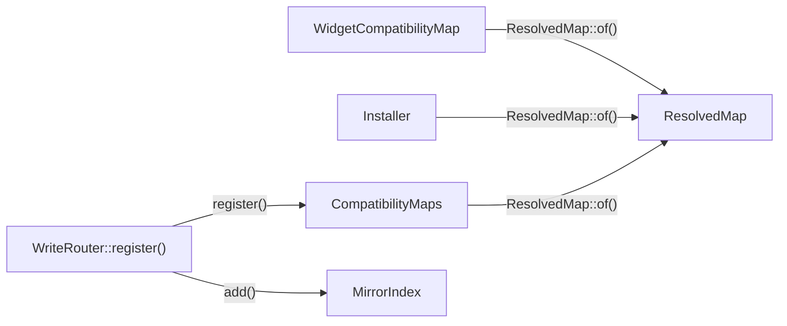

# Declaring and registering a map

This flow follows a compatibility map from its class to a `ResolvedMap` that the schema and the write router can use. The example is the workbench map, [WidgetCompatibilityMap](../../tests/Fixtures/Support/Workbench/WidgetCompatibilityMap.php).

## The declaration

A map implements `CompatibilityMap`, whose six methods return builders. Every builder is a `final readonly` class: each call returns a new instance, and nothing mutates.

- `PreviousModel::servedAsView()` names the compatibility view. `PreviousModel::retainedInTable()`, `PreviousModel::forModel()`, `PreviousModel::aliasedAs()` and `PreviousModel::primaryForeignKey()` are required. `PreviousModel::keyedBy()` is optional, and the key defaults to the model's own key name.
- `PrimaryCurrentModel::for()` and `DependentCurrentModel::for()` take the model class. Each needs an alias, and a dependent needs `DependentCurrentModel::primaryForeignKey()`.
- `DependentCurrentModel::readableWhen()` defaults to `true`. `DependentCurrentModel::createdWhen()` and `DependentCurrentModel::designatedBy()` are optional.
- `Attribute::retained()` keeps a column in the retained table. `Attribute::mapped()` stores it in a current model's table and needs `Attribute::asType()`.
- Reads are SQL, because the compatibility view runs them: `Attribute::readAs()`, `DependentCurrentModel::readableWhen()`, `UnrepresentableState::checkedOn()` and the condition of `UnrepresentableState::hide()`. Writes are PHP closures, because the write router runs them: `Attribute::writesTo()`, `PreviousModel::fillWhenCreatedFromCurrent()`, the `fillWhenCreatedFromPrevious()` of each current model, `DependentCurrentModel::createdWhen()` and `UnrepresentableState::checkedOnPreviousUpdate()`.
- `UnrepresentableState::refuse()`, `UnrepresentableState::degrade()` and `UnrepresentableState::hide()` declare the states one side holds and the other cannot.

Each model builder stores the class name as Eloquent's events spell it. `ModelClass::canonical()` returns the declared name of a class that loads, so a leading backslash or another letter case still names the class. A name that loads no class stays as written, and resolution refuses it.

`Attribute` orders its calls. `Attribute::storedAs()` sets the read and one `TargetColumn` together, a copy of the attribute's value. `Attribute::readAs()` and `Attribute::readOnlyBecause()` clear the writes, so `Attribute::writesTo()` must follow `Attribute::readAs()`. The workbench `price` attribute shows that order: it reads cents through SQL and writes them through a closure. An insert through the previous model still stores a read-only attribute's `storedAs()` column, through `ResolvedMap::insertAssignmentsTo()`.

## Resolving

`ResolvedMap::of()` turns the declaration into a checked, immutable `ResolvedMap`, without the database. It checks, in order:

1. The name has at most 24 lowercase letters, digits and single underscores, and does not end in an underscore.
2. The previous model made every required call. A missing key defaults to the model's key name.
3. Each current model is an Eloquent model with a unique alias, and its class appears once among the map's current models. Two spellings of one class count as one class, because the check compares the class names of the instances it creates. A fresh instance of each model gives its table and key, held as an `AliasedTable`.
4. Each dependent declares its primary foreign key.
5. Each alias is a lowercase identifier other than `new`, `old` and the PostgreSQL reserved words, as [decision 0010](../decisions/0010-compiled-identifiers-are-full-words.md) records.
6. Each retained attribute reads from the previous model's alias. A retained attribute that is not read-only writes its own column.
7. Each attribute has a unique identifier, a type when it is mapped, a read on a known alias, and a write or a read-only reason. Each stored column has one owner. Two read-only attributes stored in one column need a writable owner. The previous model's key and primary foreign key are attributes.
8. No attribute stores a dependent's primary foreign key, whether it writes it or is read-only. No fill sets a dependent's primary foreign key, the retained table's primary foreign key or a designation column, or a column an attribute already writes on insert. The map maintains those links itself, as [INV-8](../invariants.md#inv-8-each-stored-column-has-one-owner) records.
9. Each unrepresentable state has a unique identifier and a known alias, and every refused state has a check.

Every failure throws `InvalidCompatibilityMap`, whose message names the map. Checks that need the catalog wait for compile time, which [compiling and installing the schema](compiling-and-installing-the-schema.md#compiling) lists. `ResolvedMap::validateAttributes()`, `ResolvedMap::validateLinks()` and `ResolvedMap::validateUnrepresentableStates()` hold steps 7 to 9.

## Registering

Three callers resolve a map, and each resolves it again:

- `Installer` resolves the map in each of its methods, and never reads the registry.
- `CompatibilityMaps::register()` resolves a map and stores it by name. It refuses a second map with the same name and a different view. A map with the same name and the same view replaces the stored one.
- `WriteRouter::register()` resolves the map that `EventMirror::compatibilityMap()` returns and runs its own checks. Only then does it register the map, so a refused registration leaves the registry as it was.

`WriteRouter::register()` refuses for one of seven reasons:

- A second registration of one map name.
- A model class that uses Parental's HasChildren trait. A Parental child writes under its own class name, which the router would never match.
- A pivot model. A relation writes its pivot rows through the base query, which the router never sees.
- A model without the model contract, or one whose `setKeysForSaveQuery()`, `getAttributesForInsert()` or `newEloquentBuilder()` resolves to a declaration other than the trait's. Such a model's writes would bypass the router, as [INV-21](../invariants.md#inv-21-every-mapped-model-routes-its-writes) records.
- A previous model that another map already names, in any role.
- A current model that another map names as its previous model.
- A model that one map names as its primary current model and another as a dependent, as [INV-1](../invariants.md#inv-1-locks-follow-one-order) records.

`MirrorIndex::add()` then indexes the map two ways: by model class, and by current table under its model's connection. A model without a connection name counts under the connection that is the default at each lookup, not at registration.

A map must be registered for its models to write. Until then, a write through the previous model reaches the read-only view and fails, and a write of a current model skips the map's work. `Provider` binds `CompatibilityMaps` and `WriteRouter` as singletons. A map reaches `compatibility:check` through `CompatibilityMaps::register()`, directly or through `WriteRouter::register()`.
