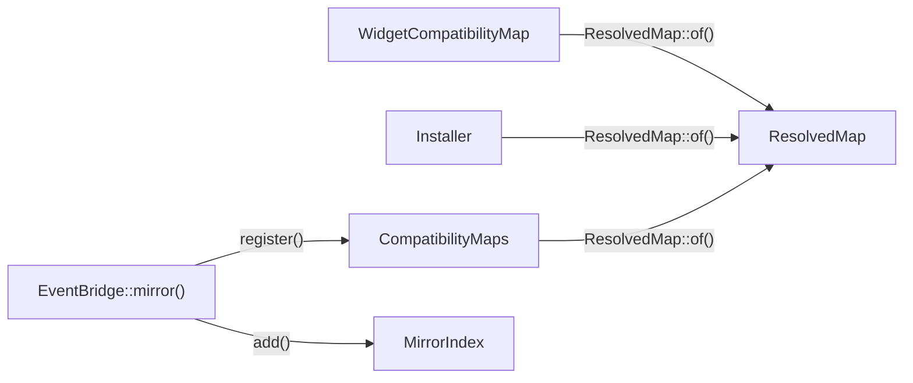

# Declaring and registering a map

This flow follows a compatibility map from its class to a `ResolvedMap` that the schema and the event bridge can use. The example is the workbench map, [WidgetCompatibilityMap](../../tests/Fixtures/Support/Workbench/WidgetCompatibilityMap.php).

## The declaration

A map implements `CompatibilityMap`, whose six methods return builders. Every builder is a `final readonly` class: each call returns a new instance, and nothing mutates.

- `PreviousModel::servedAsView()` names the compatibility view. `PreviousModel::retainedInTable()`, `PreviousModel::forModel()`, `PreviousModel::aliasedAs()` and `PreviousModel::primaryForeignKey()` are required. `PreviousModel::keyedBy()` is optional; without it the key is the model's own key name.
- `PrimaryCurrentModel::for()` and `DependentCurrentModel::for()` take the model class. Each needs an alias, and a dependent needs `DependentCurrentModel::primaryForeignKey()`.
- `DependentCurrentModel::readableWhen()` defaults to `true`. `DependentCurrentModel::createdWhen()` and `DependentCurrentModel::designatedBy()` are optional.
- `Attribute::retained()` keeps a column in the retained table. `Attribute::mapped()` stores it in a current model's table and needs `Attribute::asType()`.
- `UnrepresentableState::refuse()`, `UnrepresentableState::degrade()` and `UnrepresentableState::hide()` declare the states one side holds and the other cannot.

`Attribute` orders its calls. `Attribute::storedAs()` sets the read and one `TargetColumn` together. `Attribute::readAs()` and `Attribute::readOnlyBecause()` clear the writes, so `Attribute::writesTo()` must follow `Attribute::readAs()`. The workbench `price` attribute shows that order.

## Resolving

`ResolvedMap::of()` turns the declaration into a checked, immutable `ResolvedMap`. It needs no database. It checks, in order:

1. The name has at most 24 lowercase letters, digits and single underscores, and does not end in an underscore.
2. The previous model made every required call. `ResolvedMap::previous()` fills a missing key from the model's key name.
3. Each current model is an Eloquent model with a unique alias. A fresh instance of each model gives its table and key, held as an `AliasedTable`.
4. Each dependent declares its primary foreign key.
5. Each alias is a lowercase identifier other than `new` and `old`, and not one of `ReservedWords::POSTGRESQL`.
6. `Attribute::resolve()` points each retained attribute at the previous model's alias. A retained attribute that is not read-only writes its own column.
7. `ResolvedMap::validateAttributes()` checks each attribute: a unique identifier, `Attribute::asType()` on a mapped attribute, a read on a known alias, and a write or a read-only reason. Each stored column has one owner, and the previous model's key and primary foreign key are attributes.
8. `ResolvedMap::validateUnrepresentableStates()` checks each state: a unique identifier, a check on every refused state, and a known alias.

Every failure throws `InvalidCompatibilityMap`, whose message names the map. Checks that need the catalog wait for compile time; [compiling and installing the schema](compiling-and-installing-the-schema.md) lists them.

## Registering

Three callers resolve a map, and each resolves it again:

- `Installer` calls `ResolvedMap::of()` in each of its methods, and never reads the registry.
- `CompatibilityMaps::register()` resolves a map and stores it by name. It refuses a second map with the same name and a different view. A map with the same name and the same view replaces the stored one.
- `EventBridge::mirror()` calls `CompatibilityMaps::register()` with the map that `EventMirror::compatibilityMap()` returns.

`EventBridge::mirror()` refuses a second event mirror for one map name. The first call also listens for `QueryExecuted`. `MirrorIndex::add()` then indexes the map three ways: by model class, by current table and by relation. It returns the model classes it has not seen before. `EventBridge::listen()` attaches the beginning and finishing listeners to each, as [mirroring a write](mirroring-a-write.md) describes.

`Provider` binds `CompatibilityMaps` and `EventBridge` as singletons. A map reaches `compatibility:check` only through `CompatibilityMaps::register()`, directly or through `EventBridge::mirror()`.

## Tests

`ResolvedMapTest` covers the registration refusals. Most of its tests call `ResolvedMap::of()` directly. `ResolvedMapTest::it_refuses_a_mapped_attribute_without_a_type_when_the_map_is_registered()` goes through `CompatibilityMaps::register()`, and `ResolvedMapTest::it_refuses_an_attribute_the_tables_cannot_store()` compiles. `ProviderTest::it_shares_one_set_of_compatibility_maps_and_one_event_bridge_across_the_application()` covers the singletons.
