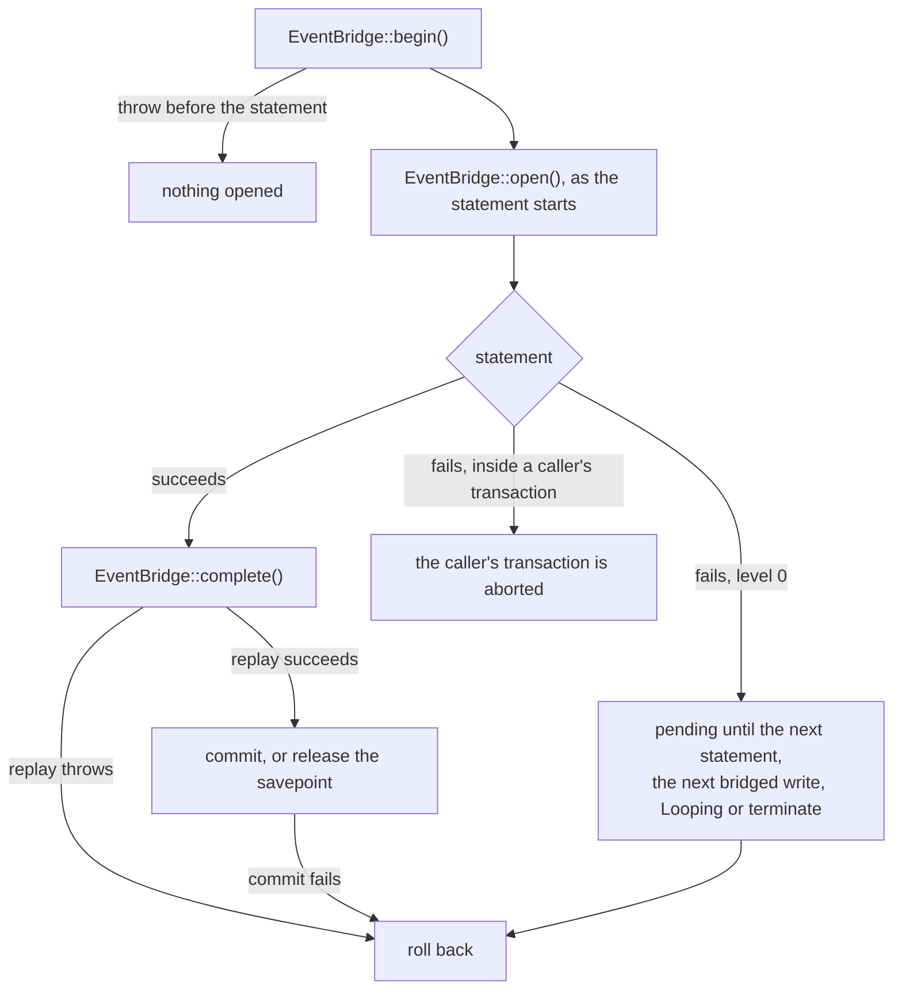

# Failure and rollback

This flow follows a write that fails: refused by the database, refused by a mirrored listener, or failed for any other reason. It covers how a refusal reaches PHP and how the event bridge gives back its transaction or savepoint.

## Refusals

Every refusal in the compiled SQL goes through `SqlFragments::refuse()`. It raises `SqlState::Refused`, which is CM001, with a message, a detail and a hint: what was refused, why, and what to do instead.

Laravel raises a `QueryException` with the code CM001. `CompatibilityWriteRefused::isRefusal()` recognises it. `CompatibilityWriteRefused::fromQueryException()` reads the driver's `ERROR`, `DETAIL` and `HINT` lines into `CompatibilityWriteRefused::$refused`, `CompatibilityWriteRefused::$because` and `CompatibilityWriteRefused::$instead`.

The event bridge refuses in PHP. `EventReplayer::ing()` throws `CompatibilityWriteRefused::byMirroredListener()` or `CompatibilityWriteRefused::byMirroredChange()` directly. `CompatibilityWriteRefused::isRefusal()` accepts both forms, and `InteractsWithCompatibilityMaps::assertWriteRefused()` turns either into a `CompatibilityWriteRefused`.

## A concurrent change

`Compiler::conflict()` raises `SqlState::SerializationFailure`, which is 40001, not CM001. It fires when another transaction changed the record after the statement's snapshot and before the trigger's locks. That includes a dependent row the record reads, which the trigger locks after the primary and retained rows. The hint tells the caller to retry, or to write through the model, whose bridge locks the record before the statement. `CompatibilityWriteRefused::isRefusal()` does not recognise it.

## A throw in PHP

A throw while the bridge holds an open pending write calls `EventBridge::close()` without a commit, then rethrows. That covers a lock or read that fails in the private `EventBridge::open()`, and a mirrored listener that refuses or throws in `EventBridge::complete()`.

A throw after the beginning event and before the statement starts, such as a cast, the encrypter or a later listener, finds nothing to close. The bridge opens its transaction or savepoint only when the write's own statement starts, so no transaction and no lock outlives the write. [INV-34](../invariants.md) records the rule.

- At level 0, `EventBridge::close()` rolls the connection back to the level the write began at.
- In savepoint mode, it issues `ROLLBACK TO SAVEPOINT`, then `RELEASE SAVEPOINT`.

In savepoint mode the replay runs inside `Connection::transaction()`. Laravel drops the `afterCommit` work a mirrored listener queued when that nested transaction rolls back.

## A failed commit

A `COMMIT` can fail after a successful replay, for example on a deferred constraint or a lost connection. Laravel then still counts the bridge's transaction. The private `EventBridge::endTransaction()` keeps the write until its commit finishes. When the commit fails, it rolls the connection back to the level the write began at, forgets the write and rethrows. The connection is then outside a transaction again. [INV-35](../invariants.md) records the rule.

## A failed statement at level 0

A failed statement fires no `QueryExecuted`, so `EventBridge::complete()` never runs and the write stays pending. At level 0, PostgreSQL has aborted the bridge's own transaction. The first of four events closes it:

1. **The next statement on the connection.** The `beforeExecuting` callback from `EventBridge::watch()` opens a write when its statement starts. A new statement while that write is still pending means its statement failed. The callback rolls back before the new statement runs. It then opens the armed write, so an outer write whose listener caught the failure still opens on its own statement.
2. **The next bridged write.** `EventBridge::begin()` calls `EventBridge::finishFailed()`. When the connection sits one level above the write, it runs `select 1`. A failure rolls back, and a success commits. It reaps only a write whose statement started: an unstarted write holds no transaction, and may still be waiting for its statement.
3. **A queue worker's next loop.** `Provider::boot()` calls `EventBridge::releaseFailed()` on each `Looping` event.
4. **Application termination.** `Provider::boot()` calls `EventBridge::releaseFailed()` from the terminating callbacks too.

`EventBridge::releaseFailed()` forgets every write that holds no transaction: one whose statement never started, and one that completed. It then runs `EventBridge::finishFailed()` for each connection with a pending write. `Provider::boot()` skips it when the application never resolved the bridge.

Until one of the four happens, `Connection::transactionLevel()` still reports 1. `EventBridgeOutsideTransactionTest` names this a declared limit. `EventBridge::finishFailed()` leaves the write alone when the connection's level no longer sits one above it.

## A failed statement inside a caller's transaction

In savepoint mode, the bridge does nothing for a failed statement. The caller's transaction is aborted, as it is after any failed native statement, and the next query raises 25P02 until the caller rolls back. The next statement, or the next `EventBridge::finishFailed()`, drops the pending write without a rollback.

A caller that wrapped the write in `Connection::transaction()` rolls back to its own savepoint, and its outer transaction stays usable.

## Tests

- `EventBridgeOutsideTransactionTest::it_commits_a_mirrored_write_made_outside_a_transaction()` and `EventBridgeOutsideTransactionTest::it_rolls_back_a_write_made_outside_a_transaction_when_a_mirrored_listener_refuses()`: level 0 success and a PHP refusal.
- `EventBridgeOutsideTransactionTest::it_rolls_back_its_transaction_before_the_next_statement_after_a_database_refusal_outside_a_transaction()`: the next statement, and the declared limit.
- `EventBridgeOutsideTransactionTest::it_releases_the_transaction_left_by_a_database_refusal_on_the_next_bridged_write()`, `EventBridgeOutsideTransactionTest::it_rolls_back_its_transaction_when_a_queued_bridged_write_fails_so_the_worker_records_the_failed_job()` and `EventBridgeOutsideTransactionTest::it_releases_the_transaction_left_by_a_database_refusal_when_the_application_terminates()`: the other three releases.
- `EventBridgeOutsideTransactionTest::it_leaves_a_caller_transaction_aborted_after_a_database_refusal_inside_it_as_a_native_write_would()` and `EventBridgeTest::it_leaves_the_callers_transaction_usable_after_a_database_refusal()`: savepoint mode.
- `EventBridgeTest::it_rolls_back_the_whole_write_when_a_mirrored_listener_refuses()` and `EventBridgeTest::it_rolls_back_the_write_and_its_after_commit_work_when_a_mirrored_listener_throws()`: PHP failures in savepoint mode.
- `InstallerTest::it_refuses_a_change_to_a_read_only_attribute_with_what_why_and_what_to_do()`: the three parts of a refusal.
- `CompatibilityWriteRefusedTest`: `CompatibilityWriteRefused::isRefusal()`, `CompatibilityWriteRefused::fromQueryException()` and the two PHP refusals.
- `CompilerTest::it_raises_a_serialization_failure_when_a_primary_or_retained_attribute_changed_after_the_statement_read_the_view()`, `CompilerTest::it_raises_a_serialization_failure_when_a_dependent_attribute_changed_after_the_statement_read_the_view()` and `CompilerTest::it_lets_a_write_through_proceed_when_its_dependent_row_is_gone_after_the_statement_read_the_view()`: the 40001 conflict check.
- `EventBridgeOutsideTransactionTest::it_opens_no_transaction_and_takes_no_lock_when_a_listener_throws_before_the_statement()` and `EventBridgeTest::it_mirrors_nothing_for_a_later_write_without_events_to_the_record_of_a_vetoed_save()`: a throw or a veto before the statement.
- `EventBridgeOutsideTransactionTest::it_mirrors_the_outer_write_when_a_beginning_listener_catches_a_refused_write_to_another_mapped_model_outside_a_transaction()` and `EventBridgeTest::it_mirrors_the_outer_write_when_a_beginning_listener_catches_a_refused_write_to_another_mapped_model_inside_a_callers_transaction()`: a failed nested write.
- `EventBridgeOutsideTransactionTest::it_rolls_back_a_mirrored_write_whose_commit_fails_and_leaves_the_connection_outside_a_transaction()`: a failed commit.
