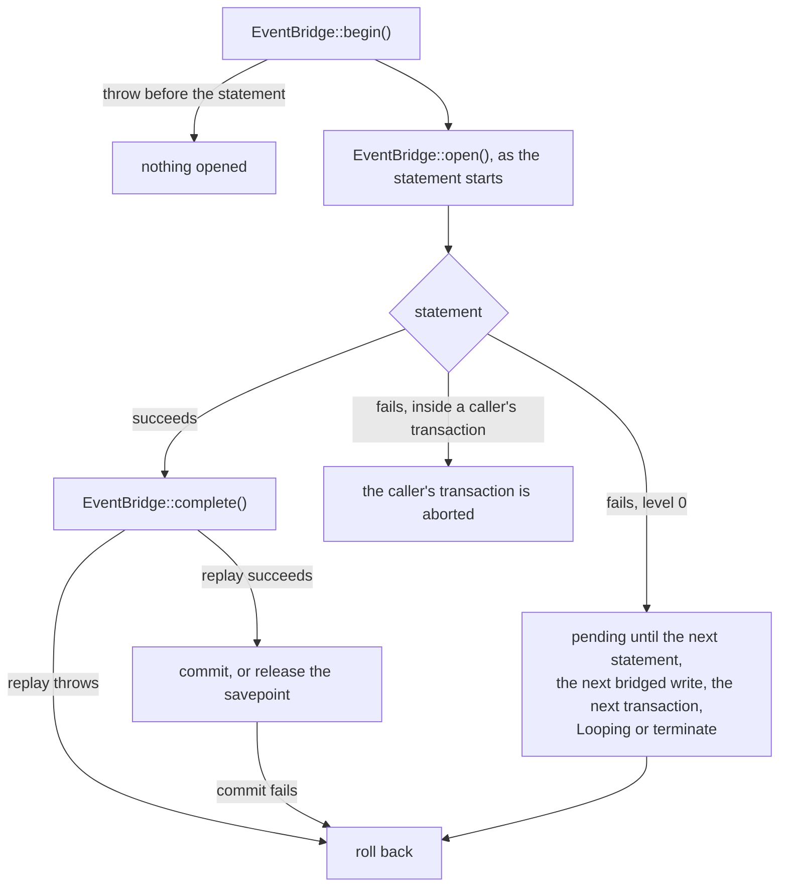

# Failure and rollback

This flow follows a write that fails: refused by the database, refused by a mirrored listener, or failed for any other reason. It covers how a refusal reaches PHP, and how the event bridge gives back its transaction or savepoint.

## Refusals

Every refusal in the compiled SQL raises SQLSTATE CM001, with a message, a detail and a hint. They say what was refused, why, and what to do instead. `SqlFragments::refuse()` builds each one.

Laravel turns the error into a `QueryException` with the code CM001, which `CompatibilityWriteRefused::isRefusal()` recognises. `CompatibilityWriteRefused::fromQueryException()` reads the driver's `ERROR`, `DETAIL` and `HINT` lines into `CompatibilityWriteRefused::$refused`, `CompatibilityWriteRefused::$because` and `CompatibilityWriteRefused::$instead`.

The event bridge refuses in PHP. A mirrored listener that refuses or changes the record makes the replayer throw `CompatibilityWriteRefused::byMirroredListener()` or `CompatibilityWriteRefused::byMirroredChange()` directly. A state change whose trigger cannot run makes it throw `CompatibilityWriteRefused::byTransition()`, as [replaying a transition](replaying-a-transition.md) describes. `CompatibilityWriteRefused::isRefusal()` accepts both forms, and `InteractsWithCompatibilityMaps::assertWriteRefused()` turns either into a `CompatibilityWriteRefused`.

## A concurrent change

A concurrent change is not a refusal: the conflict check raises SQLSTATE 40001, a serialization failure. It fires when another transaction changed the record after the statement's snapshot and before the trigger's locks. That includes a dependent row the record reads, which the trigger locks after the primary and retained rows. The hint tells the caller to retry, or to write through the model, whose bridge locks the record before the statement. `CompatibilityWriteRefused::isRefusal()` does not recognise it.

## A throw in PHP

A throw while the bridge holds an open write closes the write without a commit, then rethrows. That covers a lock or read that fails as the write opens, and a mirrored listener that refuses or throws during the replay. `EventBridge::close()` undoes the write in one of two ways:

- At transaction level 0, it rolls the connection back to the level the write began at.
- In savepoint mode, it issues `ROLLBACK TO SAVEPOINT`, then `RELEASE SAVEPOINT`.

In savepoint mode the replay runs inside `Connection::transaction()`. When that nested transaction rolls back, Laravel drops the `afterCommit` work a mirrored listener queued.

A throw after the beginning event and before the statement starts finds nothing to close. A cast, the encrypter or a later listener can throw there. The bridge opens its transaction or savepoint only when the write's own statement starts, so no transaction and no lock outlives the write. [INV-34](../invariants.md#inv-34-a-pending-mirrored-write-opens-at-its-statement) records the rule.

## A failed commit

A `COMMIT` can fail after a successful replay, for example on a deferred constraint or a lost connection. Laravel then still counts the bridge's transaction. So the bridge keeps the write until its commit finishes. When the commit fails, the private `EventBridge::endTransaction()` rolls the connection back to the level the write began at, forgets the write and rethrows. The connection is then outside a transaction again. [INV-35](../invariants.md#inv-35-a-pending-mirrored-write-leaves-the-stack-only-once-its-close-finishes) records the rule.

## A failed statement at level 0

A failed statement fires no `QueryExecuted`, so the write never completes and stays pending. At level 0, PostgreSQL has aborted the bridge's own transaction. The first of five events closes it:

1. **The next statement on the connection.** A new statement can find a started write still pending. The bridge's `beforeExecuting` callback then runs `select 1`, through the private `EventBridge::closeFailed()`. A failure means the write's statement failed, so the callback rolls back before the new statement runs. It then opens the armed write, so an outer write whose listener caught the failure still opens on its own statement.
2. **The next bridged write.** Its beginning event runs `EventBridge::finishFailed()`, which makes the same check. It reaps only a write whose statement started: an unstarted write holds no transaction, and may still wait for its statement.
3. **The next transaction the application begins.** Laravel issues `BEGIN` and `SAVEPOINT` through PDO, so no `beforeExecuting` callback sees them. A `beforeStartingTransaction` callback runs `EventBridge::finishFailed()` first. Without it, `Connection::transaction()` right after a caught failure would raise 25P02.
4. **A queue worker's next loop.** `Provider::boot()` calls `EventBridge::releaseFailed()` on each `Looping` event.
5. **Application termination.** `Provider::boot()` calls `EventBridge::releaseFailed()` from the terminating callbacks too.

A statement can start while the write's own statement still runs. A `beforeExecuting` callback registered after the bridge's runs one after the write opens. A `QueryExecuted` listener registered before the bridge's runs one after the statement, and before the bridge's own handler. The first three events then find `select 1` healthy, because no statement failed, and leave the write open. The write completes on its own `QueryExecuted`, as [mirroring a write](mirroring-a-write.md#completing) describes. A `QueryExecuted` listener registered before the bridge's that throws leaves the statement's write open and unmirrored. Only the last two events commit it.

`EventBridge::releaseFailed()` first forgets every write that holds no transaction, such as one whose statement never started. A completed write has already left the stack. It then closes the pending mirrored write of each connection, and commits a healthy write and rolls back a failed one. `Provider::boot()` skips the release when the application never resolved the bridge.

Until one of the five happens, `Connection::transactionLevel()` still reports 1, a declared limit. The bridge leaves the write alone when the connection's level sits above the bridge's transaction, and forgets it when the level sits below.

## A failed statement inside a caller's transaction

In savepoint mode, the bridge does nothing for a failed statement. The caller's transaction is aborted, as it is after any failed native statement, and the next query raises 25P02 until the caller rolls back. The next statement, or the next `EventBridge::finishFailed()`, drops the write without a rollback. It drops it when `select 1` fails, or when the caller's rollback has taken the level below the write's. A healthy savepoint write stays open, as it does at level 0.

A caller that wrapped the write in `Connection::transaction()` rolls back to its own savepoint, and its outer transaction stays usable.
