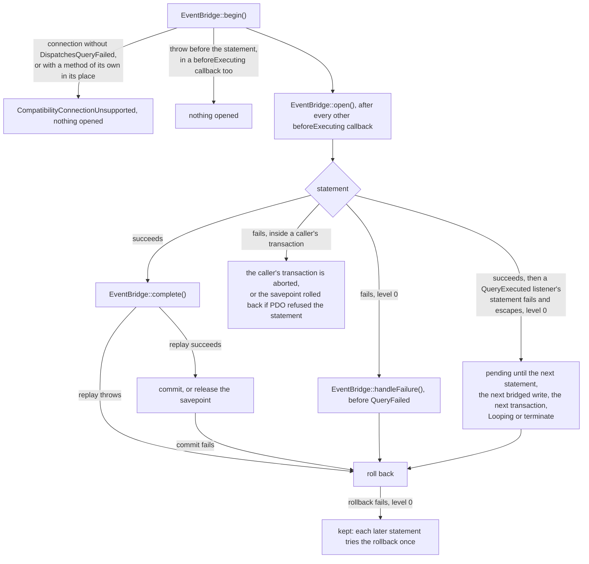

# Failure and rollback

This flow follows a write that fails: refused by the database, refused by a mirrored listener, or failed for any other reason. It covers how a refusal reaches PHP, and how the event bridge gives back its transaction or savepoint.

## Refusals

Every refusal in the compiled SQL raises SQLSTATE CM001, with a message, a detail and a hint. They say what was refused, why, and what to do instead. `SqlFragments::refuse()` builds each one.

Laravel turns the error into a `QueryException` with the code CM001, which `CompatibilityWriteRefused::isRefusal()` recognises. `CompatibilityWriteRefused::fromQueryException()` reads the driver's `ERROR`, `DETAIL` and `HINT` lines into `CompatibilityWriteRefused::$refused`, `CompatibilityWriteRefused::$because` and `CompatibilityWriteRefused::$instead`.

The event bridge refuses in PHP. A mirrored listener that refuses or changes the record makes the replayer throw `CompatibilityWriteRefused::byMirroredListener()` or `CompatibilityWriteRefused::byMirroredChange()` directly. A state change whose trigger cannot run makes it throw `CompatibilityWriteRefused::byTransition()`, and a closure of `triggerArguments()` that throws makes it throw `CompatibilityWriteRefused::byTriggerArgument()`, unless it throws a deadlock or a serialization failure, as [replaying a transition](replaying-a-transition.md) describes. `CompatibilityWriteRefused::isRefusal()` accepts both forms, and `InteractsWithCompatibilityMaps::assertWriteRefused()` turns either into a `CompatibilityWriteRefused`.

A connection whose class lacks the required trait, or replaces one of its methods, makes the bridge throw `CompatibilityConnectionUnsupported` at its first mirrored write. [The required trait](#the-required-trait) describes both cases. Neither is a refusal of the map's rules, so `CompatibilityWriteRefused::isRefusal()` rejects it. `InteractsWithCompatibilityMaps::assertWriteRefused()` throws it again, so a test that expects a refusal fails.

## A concurrent change

A concurrent change is not a refusal: the conflict check raises SQLSTATE 40001, a serialization failure. It fires when another transaction changed the record after the statement's snapshot and before the trigger's locks. That includes a dependent row the record reads, which the trigger locks after the primary and retained rows. The hint tells the caller to retry, or to write through the model, whose bridge locks the record before the statement. `CompatibilityWriteRefused::isRefusal()` does not recognise it.

## A throw in PHP

A throw while the bridge holds an open write closes the write without a commit, then rethrows. That covers a lock or read that fails as the write opens, and a mirrored listener that refuses or throws during the replay. `EventBridge::close()` undoes the write in one of two ways:

- At transaction level 0, it rolls the connection back to the level the write began at.
- In savepoint mode, it issues `ROLLBACK TO SAVEPOINT`, then `RELEASE SAVEPOINT`.

In savepoint mode the replay runs inside `Connection::transaction()`. When that nested transaction rolls back, Laravel drops the `afterCommit` work a mirrored listener queued.

A throw after the beginning event and before the statement starts finds nothing to close. A cast, the encrypter or a later listener can throw there. The bridge opens its transaction or savepoint only when the write's own statement starts, so no transaction and no lock outlives the write. [INV-34](../invariants.md#inv-34-a-pending-mirrored-write-opens-at-its-statement) records the rule.

## A failed commit

A `COMMIT` can fail after a successful replay, for example on a deferred constraint or a lost connection. Laravel then still counts the bridge's transaction. So the bridge keeps the write until its commit finishes. When the commit fails, the private `EventBridge::endTransaction()` rolls the connection back to the level the write began at, forgets the write and rethrows. The connection is then outside a transaction again. [INV-35](../invariants.md#inv-35-a-pending-mirrored-write-leaves-the-stack-only-once-its-close-finishes) records the rule.

## A failed statement at level 0

A failed statement fires no `QueryExecuted`, so the write never completes and stays pending. At level 0, PostgreSQL has usually aborted the bridge's own transaction. A statement that PDO refuses before the database sees it leaves the transaction healthy, such as one with mixed named and positional parameters (HY093). Either way, the connection trait calls the bridge before it raises `QueryFailed`. The bridge rolls its transaction back at once, before the `QueryException` reaches the caller.

## The required trait

Laravel raises no event for a failed statement. `Connections\DispatchesQueryFailed` is a trait for the application's connection class that raises one, `QueryFailed`. [Decision 0019](../decisions/0019-a-connection-trait-raises-query-failed.md) records why the package ships a trait, and why the bridge requires it.

The bridge checks the connection's class when it first meets the connection, at its first mirrored write. A class that does not use the trait gets `CompatibilityConnectionUnsupported::byMissingTrait()`, which names the connection, its class and the trait. For a framework class it offers a resolver with `Connection::resolverFor()`, and for any other class it names the class that needs the trait. A class that resolves `beforeExecuting()`, `runQueryCallback()`, `handleQueryException()` or `registerEventBridge()` to a declaration of its own gets `CompatibilityConnectionUnsupported::byOverride()`, which names the declaring class. The bridge has opened nothing, and it refuses every later mirrored write on that connection too. Registering a map resolves no connection, so registration still needs no database.

Without the trait, the bridge would see a failed statement only when the next statement started. Laravel creates the savepoint of `Connection::transaction()` and `createOrFirst()` through `getPdo()->exec()`, which no `beforeExecuting` callback sees, so both would fail with 25P02. A `Connection::afterCommit()` callback registered before the next statement would join the bridge's aborted transaction and be lost with it. [INV-19](../invariants.md#inv-19-a-failed-write-at-level-0-releases-its-transaction) records the rule.

The trait raises the event from `DispatchesQueryFailed::handleQueryException()`, which Laravel calls from `Connection::run()` when a statement throws. Outside a transaction, the parent method first runs the lost-connection retry. The trait catches the `QueryException` the parent method throws. It calls the bridge's release, raises `QueryFailed` once, and throws the same exception again:

- A statement that a lost-connection retry recovers throws nothing, so it raises no event.
- A statement that fails inside a `QueryFailed` listener, on the same connection, raises no second event. The bridge's release still runs for it.
- A listener that throws does not replace the statement's `QueryException`. The trait reports the listener's throwable and throws the `QueryException`. A report that throws does not replace it either, because the trait drops that throwable too.
- When a parent class and its subclass both use the trait, only the copy in the subclass calls the bridge and raises the event. The subclass can use the trait through another trait.
- The trait keeps no reference to a failure once the caller lets it go.
- The event carries the SQL, the bindings, the connection and its name, the exception and the read/write type. Its `QueryFailed::$time` is null, because no statement completed.
- The trait reads the read/write type before the bridge's release. So a listener that reads when that release rolls back the transaction cannot change the type the event carries.

`EventBridge::watch()` hands the trait its callbacks through `DispatchesQueryFailed::registerEventBridge()`. The trait then holds the application's `beforeExecuting` callbacks in its own list, and gives Laravel one callback. That callback runs the bridge's first callback, then the application's in registration order, then the bridge's last. It holds the write the bridge's last callback opened, through a weak reference. `DispatchesQueryFailed::runQueryCallback()` takes that write as the statement starts, and pairs a `QueryException` the statement throws with it. [Mirroring a write](mirroring-a-write.md#opening-at-the-statement) describes the two callbacks.

A connection class that overrides `Connection::run()` or the lost-connection retry, such as Aryeo's ResilientPostgresConnection, still calls `DispatchesQueryFailed::handleQueryException()`. So the trait composes with it, and the event fires after that class's own retry. The retry reruns `Connection::runQueryCallback()` without the `beforeExecuting` callbacks, so it carries no write. It never reruns a mirrored write's statement, which runs inside the bridge's transaction or savepoint, because Laravel retries only outside a transaction.

## The immediate release

The trait calls `EventBridge::handleFailure()` for every failed statement, before it raises `QueryFailed`. So a `QueryFailed` listener that returns false or throws cannot stop the release. The bridge ignores its own statements. For any other failure it receives the write that the failed statement's own call opened, or null. It acts only when that write is still the connection's top pending write, on the connection object the write began on. It marks the write failed, through `PendingMirroredWrite::$failed`, and passes it to the private `EventBridge::closeFailed()`. At level 0 that rolls the bridge's transaction back without `select 1`, while the level is the write's level + 1. So the connection is back at level 0 before the `QueryException` reaches the caller, even when PDO refused the statement and the transaction stayed healthy.

A failure of another statement leaves the write alone. Every other `beforeExecuting` callback runs before the write opens, so its failure aborts no transaction of the bridge's. A `QueryExecuted` listener registered before the bridge's runs after the write's own statement. When it catches the failure of a statement it runs, the transaction is aborted, so the write's completion fails with 25P02 and rolls the write back. That statement's own call opened no write, so its failure never counts as the write's, even with the same SQL and bindings. A StatementPrepared listener runs inside the write's own statement, before PDO executes it, as for an incrementing model's insert. A statement it runs pairs with its own call too, so the write's own failure still releases the write at once.

A rollback that fails there, as after a lost connection, never replaces the statement's `QueryException`. The bridge drops the rollback's own exception, and the caller receives the original one. When Laravel still counts the transaction after the failed rollback, the bridge keeps the write. Each later statement tries the rollback once before it runs, and fails with the rollback's exception while the rollback fails. `Looping` and termination roll the write back too, and never commit it. [INV-35](../invariants.md#inv-35-a-pending-mirrored-write-leaves-the-stack-only-once-its-close-finishes) records the rule.

In savepoint mode, `EventBridge::closeFailed()` forgets the write when `select 1` fails, so the caller's transaction stays aborted. When `select 1` succeeds, the statement never reached the database, and the bridge rolls back to its savepoint and releases it. [A failed statement inside a caller's transaction](#a-failed-statement-inside-a-callers-transaction) describes both cases.

## A write left pending

One case leaves a level-0 write pending after its statement started. A `QueryExecuted` listener registered before the bridge's can run a statement after the write's own, and let its failure escape. Its failure leaves the bridge's transaction aborted, and nothing reports it as the write's own. A `beforeExecuting` callback that throws leaves no such write, because the bridge opens the write after every other callback. The first of five events closes the write:

1. **The next statement on the connection.** A new statement can find a started write still pending. The bridge's first `beforeExecuting` callback then runs `select 1`, through the private `EventBridge::closeFailed()`. A failure means the write's statement failed, so the callback rolls back before the new statement runs. It then takes the armed write, so an outer write whose listener caught the failure still opens on its own statement.
2. **The next bridged write.** Its beginning event runs `EventBridge::finishFailed()`, which makes the same check. It reaps only a write whose statement started: an unstarted write holds no transaction, and may still wait for its statement.
3. **The next transaction the application begins.** Laravel issues `BEGIN` and `SAVEPOINT` through PDO, so no `beforeExecuting` callback sees them. A `beforeStartingTransaction` callback runs `EventBridge::finishFailed()` first. Without it, `Connection::transaction()` right after a caught failure would raise 25P02.
4. **A queue worker's next loop.** `Provider::boot()` calls `EventBridge::releaseFailed()` on each `Looping` event.
5. **Application termination.** `Provider::boot()` calls `EventBridge::releaseFailed()` from the terminating callbacks too.

A statement can start while the write's own statement still runs. A `QueryExecuted` listener registered before the bridge's runs one after the statement, and before the bridge's own handler. The first three events then find `select 1` healthy, because no statement failed, and leave the write open. The write completes on its own `QueryExecuted`, as [mirroring a write](mirroring-a-write.md#completing) describes. A `QueryExecuted` listener registered before the bridge's that throws leaves the statement's write open and unmirrored. Only the last two events commit it.

`EventBridge::releaseFailed()` first forgets every write that holds no transaction, such as one whose statement never started. A completed write has already left the stack. It then closes the pending mirrored write of each connection. It commits a healthy write, and rolls back a failed one, a write whose rollback failed included. `Provider::boot()` skips the release when the application never resolved the bridge.

Until one of the five happens, `Connection::transactionLevel()` still reports 1, a declared limit. The bridge leaves the write alone when the connection's level sits above the bridge's transaction, and forgets it when the level sits below.

## A failed statement inside a caller's transaction

In savepoint mode, the bridge rolls back nothing for a statement that failed in the database. The caller's transaction is aborted, as it is after any failed native statement, and the next query raises 25P02 until the caller rolls back. The release forgets the write at once, without a rollback, because `select 1` fails. The next statement, or the next `EventBridge::finishFailed()`, drops any other failed write the same way. It also drops a write when the caller's rollback has taken the level below the write's. A healthy savepoint write stays open, as it does at level 0.

A statement that PDO refuses before the database sees it leaves the caller's transaction healthy, as a native one would. The release then finds `select 1` healthy, so it rolls back to the write's savepoint and releases it. The bridge's locks go with the savepoint, and the caller's transaction goes on as if the write never started.

A caller that wrapped the write in `Connection::transaction()` rolls back to its own savepoint, and its outer transaction stays usable.
