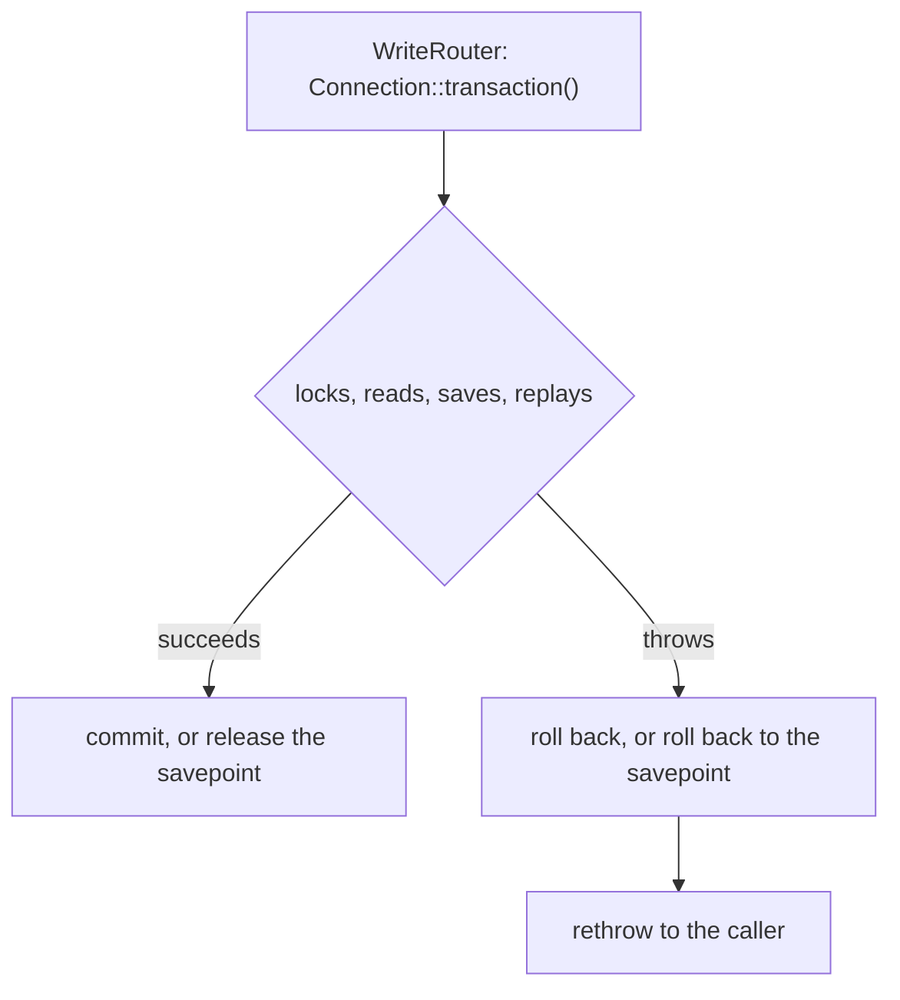

# Failure and rollback

This flow follows a write that fails: refused by the write router, vetoed by a listener, or failed for any other reason.

## One transaction per write

`WriteRouter` runs each routed write inside `Connection::transaction()`, as [INV-19](../invariants.md#inv-19-every-routed-write-runs-in-one-transaction-or-savepoint) records. At transaction level 0 that is the write's own transaction. Inside a caller's transaction it is a savepoint. A throw anywhere inside, from a lock, a read, a refusal, a listener or the database, rolls the whole write back and rethrows. Laravel's own transaction handling does the rollback, so nothing is left pending and no lock outlives the write.

A mapped write at level 0 gives up Laravel's lost-connection retry, because its statements run at level 1, as [decision 0021](../decisions/0021-a-mapped-write-at-level-0-gives-up-the-lost-connection-retry.md) records.

## Refusals

Every refusal is a `CompatibilityWriteRefused`, thrown in PHP from inside the transaction. It says what was refused in `CompatibilityWriteRefused::$refused`, why in `CompatibilityWriteRefused::$because`, and what to do instead in `CompatibilityWriteRefused::$instead`. Each kind has a named factory, such as `CompatibilityWriteRefused::readOnly()`, `CompatibilityWriteRefused::refusedState()` and `CompatibilityWriteRefused::byCurrentListener()`. [INV-4](../invariants.md#inv-4-every-refusal-is-a-compatibilitywriterefused-inside-the-writes-transaction) records the rule.

`InteractsWithCompatibilityMaps::assertWriteRefused()` runs a write inside a transaction, expects a `CompatibilityWriteRefused`, and rethrows anything else.

## A veto

A listener that returns false from a current model's `saving`, `creating`, `updating`, `deleting` or `restoring` event, during a write through the previous model, vetoes that save. The previous writer turns the veto into `CompatibilityWriteRefused::byCurrentListener()`, so the whole write rolls back.

A listener that returns false from the previous model's own beginning event stops the write before it reaches the router, as Eloquent always does.

## The model's own events

The previous model's `updated` and `saved` events fire after the router returns, as Eloquent fires them after its statement. At level 0 the router's transaction has committed by then, so a throw from one of those listeners does not undo the write, as it would not for a native write. Inside a caller's transaction, the caller's rollback undoes it.
