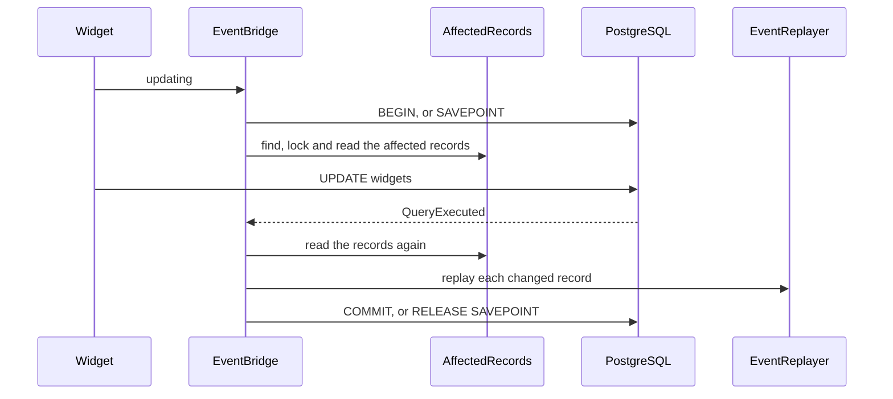

# Mirroring a write

This flow follows `EventBridge` through one write: `$widget->update(['title' => 'Renamed'])` on the workbench map. The bridge raises the gadget's model events, so the gadget's listeners run for a write through the widget. A write through a current model mirrors the other way, onto the previous model.

## Listening

`EventBridge::listen()` listens on each model class of a mirrored map: the previous model and every current model. Each `ModelEvent::beginning()` event (creating, updating, deleting) begins a pending write. Each `ModelEvent::finishing()` event (saved, updated, deleted) calls `EventBridge::finish()`.

The bridge listens on the beginning events through a wildcard and acts only on the exact event name. Laravel runs wildcard listeners after the event's direct listeners. A direct listener that returns false therefore stops the write before the bridge begins.

## Beginning

`EventBridge::begin()` returns at once inside `EventBridge::withoutMirroring()`, and for an instance the `EventReplayer` is replaying. Otherwise it:

1. Adds a `Connection::beforeExecuting()` callback, once per connection, through `EventBridge::watch()`.
2. Closes any pending write a failed statement left behind, through `EventBridge::finishFailed()`.
3. Opens a transaction at transaction level 0. Above it, it issues `SAVEPOINT compatibility_<n>`, which Laravel's transaction level does not count.
4. Calls `AffectedRecords::before()`, which finds the affected records, locks them, and reads each into a `RecordSnapshot`. The next two sections describe it.
5. Pushes the `PendingMirroredWrite` onto the connection's stack.

A throw in step 4 rolls the transaction or savepoint back and rethrows.

## Finding the affected records

`AffectedRecords::of()` asks `MirrorIndex::forModel()` which maps the model belongs to, and under which alias. Each `MapMember` adds records:

- **A previous model** adds its current records. `KeyTranslator::currentKeys()` turns its key into the primary key and the key of each dependent row the view reads. After an insert, the key comes from `Setting::Created`.
- **A previous model's delete that removes the row** also adds every dependent row under the record's primary foreign key. The private `AffectedRecords::removed()` finds them through `KeyTranslator::dependentKeys()`. The delete trigger removes them all, child rows and soft-deleted rows included, so each one raises its delete events. A delete removes the row when the model has no `isForceDeleting()` method, or when that method returns true. A soft delete keeps to the rows the view reads, and locks no others.
- **A primary current model** adds the previous records that link it, through `KeyTranslator::previousKeys()`. Before an insert there are none.
- **A dependent current model** adds the previous records of its original and its new primary foreign key. A move between primary rows mirrors both.

A model loaded without the column that names its record still mirrors. `AffectedRecords::originalKey()` reads the original value when the model's raw original, `Model::getRawOriginal()`, holds the column. Otherwise it selects the persisted value by the model's own key: from the view for the previous model, and from the table for a current model. So a column assigned but never loaded uses the persisted value too. That column is the mapped key for a previous or primary model, and the primary foreign key for a dependent.

The bridge reads a new value only from an attribute the model holds, through the private `AffectedRecords::loaded()`. So a bridged write does not throw under `Model::preventAccessingMissingAttributes()`. A model with no persisted key, such as one before its insert, selects nothing.

`AffectedRecords::acrossMaps()` then adds, for each current record, the previous records of every other map over the same table. Each `AffectedRecord` carries a `RecordRole`. A previous record locks its retained table, `AffectedRecord::$lockedTable`, but reads its view, `AffectedRecord::$readFrom`.

## Locking and reading

`AffectedRecords::before()` takes three steps after `AffectedRecords::of()`:

1. The private `AffectedRecords::lock()` locks the affected records and the model's own record, from the private `AffectedRecords::native()`. It sorts them by `RecordRole::lockOrder()`, then by lock table and key, and runs `select 1 ... for update` on each. Primary rows come first and retained rows second, the order the update and delete triggers use.
2. For a delete that removes the row, `AffectedRecords::removed()` reads the dependent rows again under those locks. A row that another transaction committed before the primary lock is a newcomer. `AffectedRecords::acrossMaps()` adds the other maps' previous records for it, and `AffectedRecords::lock()` locks the newcomers.
3. `AffectedRecords::snapshots()` reads every record with `select *`. It takes no lock.

`AffectedRecords::native()` reads the model's own key from its attributes. When the model does not hold the key column, it selects the persisted value as `AffectedRecords::originalKey()` does. So a model loaded without its mapped key still locks its own row before the statement.

Without a concurrent writer, step 2 finds no newcomer and locks nothing. A newcomer locks after the first pass's dependent rows, so [INV-1](../invariants.md) records it as an exception to the lock order.

## Matching the statement

`EventBridge::handleQuery()` receives every `QueryExecuted`. `ParsedWrite::of()` reads the operation and the relation from the head of the SQL: `insert into`, `update` or `delete from`. The write completes the top pending write when that write is still pending and `PendingMirroredWrite::expects()` accepts it.

`PendingMirroredWrite::expects()` compares the relation with the model's table, then asks `Operation::accepts()`. A delete accepts an `UPDATE`, because a soft delete sends one. A write that completes nothing goes to `EventBridge::guard()`.

## Completing

`EventBridge::complete()`:

1. Marks the write as no longer pending.
2. Adds the records `AffectedRecords::of()` finds after the write, such as the current records of a new previous record. These have no row from before.
3. Reads every record again, without locks.
4. Calls `EventReplayer::replay()` for each record, with its row from before and after.
5. Commits at level 0, or releases its savepoint.

In savepoint mode, step 4 runs inside `Connection::transaction()`, a Laravel nested transaction. Work a mirrored listener queues with `afterCommit` then rolls back with a failed replay. A throw in steps 2 to 4 rolls back and rethrows.

## Replaying

`EventReplayer::replay()` skips a record whose two rows are equal. Otherwise it builds a fresh instance of the record's model on the source connection, marks it as replaying, and picks the events from the rows:

| Change | Events, in order |
| :-- | :-- |
| no row before | saving, creating, created, saved |
| no row after | forceDeleting, deleting, deleted, forceDeleted (the force events only for a soft-deleting model) |
| `deleted_at` set | deleting, trashed, deleted |
| `deleted_at` cleared | restoring, saving, updating, updated, saved, restored |
| any other change | saving, updating, updated, saved |

For a soft-deleting model, `EventReplayer::deleted()` sets the model's `forceDeleting` property as a native force delete does. It is false for forceDeleting, true for deleting and deleted, and false again for forceDeleted. So `isForceDeleting()` reports to a mirrored listener what it reports to a native one.

Each `-ing` event can stop the write. A listener that returns false raises `CompatibilityWriteRefused::byMirroredListener()`. A listener that changes an attribute raises `CompatibilityWriteRefused::byMirroredChange()`. `EventReplayer::equivalent()` compares numbers and JSON strings by value. It compares two numbers by their exact decimal value, never through a float, so `'47.600000000000'` equals `47.6` and differs from `'47.600000000000001'`. A number it cannot parse, such as INF or NAN, equals only an identical value. The `-ed` events cannot stop anything.

A class in the model's `$dispatchesEvents` fires before the string event, as Eloquent does it. After the events, `EventReplayer::replay()` dispatches `RecordMirrored` with the map, the source model, the mirrored instance, the events and both rows.

## Excluding listeners

`EventMirror::excludedListeners()` lists the listeners to skip for mirrored events. `ExcludedListener::matches()` compares a listener's class, its method when one is named, and the event.

For a dispatch with exclusions, `EventReplayer::mask()` swaps the event's listeners for wrappers from `EventReplayer::guard()`. A wrapper skips its listener only when the payload's subject is the instance under replay. An `Exclusion`, held per subject, records what to skip. `EventReplayer::unmask()` restores the listeners after the dispatch. A native write inside a mirrored listener has another subject, so the excluded listener runs for it. The masking acts on the real dispatcher behind an `EventFake`. `EventReplayer::identify()` names a listener only when it is a class string, or an array of a class or object and a method name. A closure or an invokable object cannot be excluded.

## Finishing, re-entry and fakes

`EventBridge::finish()` runs on the source model's finishing events. It commits the top pending write when that write is still pending and belongs to the model. That closes a write whose statement the bridge never matched.

A replayed instance never begins a pending write. A native write inside a mirrored listener begins its own, on top of the stack. Its transaction level is above 0, so it takes a savepoint.

`saveQuietly()`, query builder writes and raw SQL fire no model events. The triggers still store them correctly, and nothing is mirrored.

`EventBridge::guard()` catches a test that fakes model events. It looks at a write that completed no pending write, to a relation a mirrored model uses. When `Model::getEventDispatcher()` is an `EventFake`, it counts the faked beginning events for that relation's models. It keeps one count per fake and per relation. A count that grew since its last check of that relation throws `CompatibilityEventMirrorBypassed`. So a bypass on one relation does not hide a bypass on another. Inside `EventBridge::withoutMirroring()`, the guard still stores each count and only skips the throw. So a faked write with the mirror off does not make the next raw write throw.

`EventBridge::internally()` marks the bridge's own statements, and `EventBridge::handleQuery()` and the `beforeExecuting` callback ignore them.

## Tests

`EventBridgeTest` covers the events of each kind of write, refusals and excluded listeners. It also covers fakes, quiet and bulk writes, maps that share a current table, re-entry and the caller's transaction. Its tests named for a model loaded without its mapped key or primary foreign key cover `AffectedRecords::originalKey()`. Each runs with `Model::preventAccessingMissingAttributes()` off and on. `EventBridgeTest::it_raises_the_previous_model_events_of_both_primary_records_when_a_dependent_loaded_without_its_primary_foreign_key_moves()` covers a primary foreign key assigned but never loaded. `EventBridgeTest::it_raises_the_force_delete_events_of_every_dependent_row_a_previous_model_force_delete_removes()` covers the removed dependent rows. `EventBridgeTest::it_lets_a_raw_write_through_after_a_faked_write_with_the_mirror_off()` covers the guard's count while the mirror is off.

Two tests write from a second connection. `EventBridgeOutsideTransactionTest::it_raises_the_force_delete_events_of_a_dependent_row_committed_before_the_primary_record_is_locked()` covers a newcomer. `EventBridgeOutsideTransactionTest::it_locks_the_own_record_of_a_model_loaded_without_its_mapped_key_before_the_statement()` covers the model's own-row lock, in both strict modes. `DependentCurrentModelTest::a_previous_model_write_mirrors_only_the_designated_dependent_row()` covers the dependent row the bridge mirrors.
