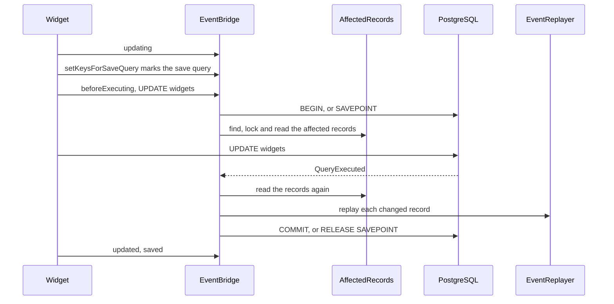

# Mirroring a write

This flow follows `EventBridge` through one write: `$widget->update(['title' => 'Renamed'])` on the workbench map. The bridge raises the gadget's model events, so the gadget's listeners run for a write through the widget. A write through a current model mirrors the other way, onto the previous model.

## Listening

`EventBridge::listen()` listens on each model class of a mirrored map: the previous model and every current model. Each `ModelEvent::beginning()` event (creating, updating, deleting) begins a pending write. Each saving event counts one save in progress for its instance. Each created event, and each `ModelEvent::finishing()` event (saved, updated, deleted), calls `EventBridge::finish()`.

The bridge listens on the saving and beginning events through a wildcard and acts only on the exact event name. Laravel runs wildcard listeners after the event's direct listeners. A direct listener that returns false therefore stops the write before the bridge begins.

## The model contract

Every model of a mirrored map implements `Compatible` and uses `HasCompatibility`. The trait overrides two protected methods of Eloquent, and each calls its parent first. Laravel 12 and 13 call each one only inside the model's own write method, after its beginning event:

- `HasCompatibility::setKeysForSaveQuery()` serves an update, an increment, a decrement, a delete, a soft delete and a force delete. A restore and a touch call `Model::save()`, so they take that path too.
- `HasCompatibility::getAttributesForInsert()` serves an insert, through `Model::save()` or saveOrIgnore().

Each method hands the model to `EventBridge::markOwnStatement()`, with the save query when there is one. No listener's query passes through either method, so the bridge never guesses which statement is the model's own.

`EventBridge::mirror()` refuses a map whose model lacks the interface or the trait. It also refuses a model whose `setKeysForSaveQuery()` or `getAttributesForInsert()` resolves to another declaration, in its own class or in a class it extends. PHP gives a class's own method precedence over a trait's, so that model would never mark its statement. [INV-50](../invariants.md) records the rule, and [decision 0023](../decisions/0023-a-mapped-model-marks-its-own-statement.md) records why.

## Beginning

`EventBridge::begin()` returns at once inside `EventBridge::withoutMirroring()`, and for an instance the `EventReplayer` is replaying. Otherwise it:

1. Adds a `Connection::beforeExecuting()` callback, once per connection, through `EventBridge::watch()`.
2. Closes any pending write a failed statement left behind, through `EventBridge::finishFailed()`. It closes only a write whose statement started.
3. Drops the connection's armed write, whose statement never came.
4. Pushes a `PendingMirroredWrite` onto the connection's stack. It records the model dispatcher in `PendingMirroredWrite::$dispatcher`, and the write's last finishing event in `PendingMirroredWrite::$lastEvent`. It opens nothing yet.

The last finishing event is saved for an insert. It is saved for an update too, when a saving event of the same instance came first and no other write took it. It is updated for an increment or a decrement, which fire no saved event, and deleted for a delete.

## Marking the statement

`EventBridge::markOwnStatement()` returns at once inside `EventBridge::withoutMirroring()`. Otherwise it claims the topmost pending write of the same instance that no earlier mark claimed, and sets `PendingMirroredWrite::$claimed`. It claims only a write begun under the current model dispatcher. A quiet write inside a listener runs under Laravel's null dispatcher, so it claims nothing. With no write to claim, it calls the private `EventBridge::guard()`, which [finishing, re-entry and fakes](#finishing-re-entry-and-fakes) describes.

A claimed write is then armed. Each connection holds one armed write at a time. For a save query, `EventBridge::markOwnStatement()` registers a `beforeQuery` callback on the query, so the write arms only when that query runs. A soft delete sets its deleted-at and updated-at attributes after `setKeysForSaveQuery()`, and a mutator there is user code. An insert arms at once. A listener's query carries no mark, even one built from the same instance's `Model::newQuery()`, so it arms nothing. [INV-33](../invariants.md) records the rule and its limits.

## Opening at the statement

The `beforeExecuting` callback sees each statement the connection runs, before it runs. It takes the armed write only when the statement's first keyword is `INSERT`, `UPDATE` or `DELETE`. Any other statement leaves the write armed, such as a `SELECT` that an earlier `beforeExecuting` callback runs first. The callback then closes or forgets each write on top of the stack whose statement started, because a new statement means that statement failed. With an armed write, it also forgets each other write above that one: a listener's vetoed save, or a nested write that has completed. Those write methods have returned. Without an armed write, the statement is a listener's or another write's, and the stack stays as it is. To open the armed write, the callback calls the private `EventBridge::open()`. It:

1. Sets `PendingMirroredWrite::$statementSent`.
2. Opens a transaction at transaction level 0. Above it, it issues `SAVEPOINT compatibility_<n>`, which Laravel's transaction level does not count.
3. Calls `AffectedRecords::before()`, which finds the affected records, locks them, and reads each into a `RecordSnapshot`. The next two sections describe it.

A throw in step 3 rolls the transaction or savepoint back and rethrows, so the statement never runs. A throw between the beginning event and the statement, such as a cast or a later listener, opens nothing at all. [INV-34](../invariants.md) records the rule.

A listener on the beginning event can write another mapped model. That write begins, opens, completes and closes on top of the stack, before the outer write's statement starts. `EventBridge::finishFailed()` leaves the outer write alone, because its statement has not started.

## Finding the affected records

`AffectedRecords::of()` asks `MirrorIndex::forModel()` which maps the model belongs to, and under which alias. Each `MapMember` adds records:

- **A previous model** adds its current records. `KeyTranslator::currentKeys()` turns its key into the primary key and the key of each dependent row the view reads. After an insert, the key comes from `Setting::Created`.
- **A previous model's delete that removes the row** also adds every dependent row under the record's primary foreign key. The private `AffectedRecords::removed()` finds them through `KeyTranslator::dependentKeys()`. The delete trigger removes them all, child rows and soft-deleted rows included, so each one raises its delete events. A delete removes the row when the model has no `isForceDeleting()` method, or when that method returns true. A soft delete keeps to the rows the view reads, and locks no others.
- **A primary current model** adds the previous records that link it, through `KeyTranslator::previousKeys()`. Before an insert there are none. After an insert, the record comes from `Setting::Created` alone, so an insert that inserted no row adds none. A model whose key resolves to no row adds none either, and never the record an earlier insert created.
- **A dependent current model** adds the previous records of its original and its new primary foreign key. A move between primary rows mirrors both.

A model loaded without the column that names its record still mirrors. `AffectedRecords::originalKey()` reads the original value when the model's raw original, `Model::getRawOriginal()`, holds the column. Otherwise it selects the persisted value by the model's own key: from the view for the previous model, and from the table for a current model. So a column assigned but never loaded uses the persisted value too. That column is the mapped key for a previous or primary model, and the primary foreign key for a dependent.

Eloquent syncs a new model's original only after its `created` and `saved` events. So a listener on either event that updates the same instance holds an empty raw original. When `Model::$wasRecentlyCreated` is set and the raw original lacks the model's key, the private `AffectedRecords::persisted()` selects by the key in the model's attributes. So that update mirrors to the record the create made.

The bridge reads a new value only from an attribute the model holds, through the private `AffectedRecords::loaded()`. So a bridged write does not throw under `Model::preventAccessingMissingAttributes()`. A model with no persisted key, such as one before its insert, selects nothing.

`AffectedRecords::acrossMaps()` then adds, for each current record, the previous records of every other map over the same table. Each `AffectedRecord` carries a `RecordRole`. A previous record locks its retained table, `AffectedRecord::$lockedTable`, but reads its view, `AffectedRecord::$readFrom`.

## Locking and reading

`AffectedRecords::before()` takes three steps after `AffectedRecords::of()`:

1. The private `AffectedRecords::lock()` locks the affected records and the records from the private `AffectedRecords::lockedOnly()`. Those are the model's own record, from the private `AffectedRecords::native()`, and a dependent write's primary records. It sorts them by `RecordRole::lockOrder()`, then by lock table and key, and runs `select 1 ... for update` on each. Primary rows come first and retained rows second, the order the update and delete triggers use. So a dependent write locks its primary rows before its statement, and snapshots none of them.
2. `AffectedRecords::of()` runs again under those locks, for every operation. A record it finds only on that second call is a newcomer, such as a dependent row another transaction committed before the primary lock. `AffectedRecords::lock()` locks the newcomers, sorted by `RecordRole::lockOrder()` among themselves.
3. `AffectedRecords::snapshots()` reads every record with `select *`. It takes no lock.

Before an insert, `AffectedRecords::before()` first calls `KeyTranslator::clearCreatedPreviousKey()` for each of the model's maps. `Setting::Created` is local to the transaction, so it still holds the key of the transaction's previous insert. An insert that inserts no row, such as an ignored `saveOrIgnore()`, fires no trigger to replace it. The cleared setting then names no record, so the bridge replays no earlier record's created events.

`AffectedRecords::native()` reads the model's own key from its attributes. When the model does not hold the key column, it selects the persisted value as `AffectedRecords::originalKey()` does. So a model loaded without its mapped key still locks its own row before the statement.

Without a concurrent writer, step 2 finds no newcomer and locks nothing. A newcomer locks after every record of the first pass, so [INV-1](../invariants.md) records it as an exception to the lock order.

No dependent row another transaction inserts escapes step 2. An insert that has not committed by the primary lock waits on the locked primary row, because its foreign key check takes `FOR KEY SHARE` on it. This holds only when each dependent's primary foreign key has a foreign key constraint to the primary table, or the dependent's table has a refuse function. The package does not require either. Without one, a row another transaction inserts after the second pass can escape it: a removing delete then removes that row without its delete events, and an update replays the row's create events in place of its update events. An update can make an existing dependent row readable without changing its primary foreign key, and it takes no lock on the primary row. Only a refuse function on that dependent's table blocks such an update. Without one, the update can commit after step 2. The bridge then has no row from before for that dependent row, and replays its create events in place of its update events. [INV-1](../invariants.md) records this limit.

## Completing

`EventBridge::handleQuery()` receives every `QueryExecuted`. It completes the top pending write when that write's statement started and the write is still pending. It reads no SQL. `EventBridge::complete()`:

1. Marks the write as no longer pending.
2. Adds the records `AffectedRecords::of()` finds after the write, such as the current records of a new previous record. These have no row from before.
3. Reads every record again, without locks.
4. Calls `EventReplayer::replay()` for each record, with its row from before and after.
5. Commits at level 0, or releases its savepoint, through the private `EventBridge::endTransaction()`. A failed commit rolls back to the write's level, forgets the write and rethrows; [failure and rollback](failure-and-rollback.md) describes it.

The completed write stays on the stack until its last finishing event. A nested write of the same instance therefore pairs its finishing events with itself, and never with the outer write.

In savepoint mode, step 4 runs inside `Connection::transaction()`, a Laravel nested transaction. Work a mirrored listener queues with `afterCommit` then rolls back with a failed replay. A throw in steps 2 to 4 rolls back and rethrows.

## Replaying

`EventReplayer::replay()` skips a record whose two rows are equal. Otherwise it builds a fresh instance of the record's model on the source connection, marks it as replaying, and picks the events from the rows:

| Change | Events, in order |
| :-- | :-- |
| no row before | saving, creating, created, saved |
| no row after | forceDeleting, deleting, deleted, forceDeleted (the force events only for a soft-deleting model) |
| `deleted_at` set | deleting, trashed, deleted |
| `deleted_at` cleared | restoring, saving, updating, updated, saved, restored |
| any other change | saving, updating, updated, saved |

For a soft-deleting model, `EventReplayer::deleted()` sets the model's `forceDeleting` property as a native force delete does. It is false for forceDeleting, true for deleting and deleted, and false again for forceDeleted. So `isForceDeleting()` reports to a mirrored listener what it reports to a native one.

Each `-ing` event can stop the write. A listener that returns false raises `CompatibilityWriteRefused::byMirroredListener()`. A listener that changes an attribute raises `CompatibilityWriteRefused::byMirroredChange()`. `EventReplayer::equivalent()` compares by the attribute's cast, or else by its column type. A numeric cast or column compares two numbers by their exact decimal value, never through a float, so `'47.600000000000'` equals `47.6` and differs from `'47.600000000000001'`. A number it cannot parse, such as INF or NAN, equals only an identical value. A JSON cast or a `json` or `jsonb` column compares the decoded JSON: an object and an array differ, and the order of an object's keys does not count. Every other attribute compares exactly, so a text column's `'1'` and `'001'` differ. The `-ed` events cannot stop anything.

A class in the model's `$dispatchesEvents` fires before the string event, as Eloquent does it. After the events, `EventReplayer::replay()` dispatches `RecordMirrored` with the map, the source model, the mirrored instance, the events and both rows.

## Excluding listeners

`EventMirror::excludedListeners()` lists the listeners to skip for mirrored events. `ExcludedListener::matches()` compares a listener's class, its method when one is named, and the event.

For a dispatch with exclusions, `EventReplayer::mask()` swaps the event's listeners for wrappers from `EventReplayer::guard()`. A wrapper skips its listener only when the payload's subject is the instance under replay. An `Exclusion`, held per subject, records what to skip. `EventReplayer::unmask()` restores the listeners after the dispatch. A native write inside a mirrored listener has another subject, so the excluded listener runs for it. The masking acts on the real dispatcher behind an `EventFake`, and the dispatch goes through the fake. So a faked event is recorded, and runs no listener. `EventReplayer::identify()` names a listener only when it is a class string, or an array of a class or object and a method name. A closure or an invokable object cannot be excluded.

## Finishing, re-entry and fakes

`EventBridge::finish()` returns at once inside `EventBridge::withoutMirroring()`. A saved event pairs with the topmost write of the instance whose last finishing event is saved. A created, updated or deleted event pairs with the topmost write of the instance whose operation that event completes. Those operations are an insert, an update and a delete. So each finishing event pairs with its own write, even when a listener saves the same instance inside that write. For the paired write, the bridge then:

1. Throws when the write is unclaimed and the event is created, updated or deleted. Eloquent fires those events only after its own statement, so a statement ran without its mark. The bridge forgets the write and throws `CompatibilityEventMirrorBypassed::byUnmarkedStatement()`, which names the model and the event. Inside a transaction, the throw rolls the write back.
2. Commits the write when its statement started and it is still pending. That closes a write whose `QueryExecuted` the bridge never saw.
3. Forgets the write at its last finishing event. An unclaimed write at its saved event belongs to a save that sent no statement. An update that a listener left with nothing to change is one example.

A replayed instance never begins a pending write. A native write inside a mirrored listener begins its own, on top of the stack. Its transaction level is above 0, so it takes a savepoint.

`saveQuietly()`, query builder writes and raw SQL fire no model events. The triggers still store them correctly, and nothing is mirrored.

`EventBridge::guard()` catches a test that fakes model events. `EventBridge::markOwnStatement()` calls it when the model has no pending write to claim. The guard throws `CompatibilityEventMirrorBypassed::byFakedDispatcher()` when `Model::getEventDispatcher()` is an `EventFake` that recorded this instance's beginning event. The throw comes before the statement, so the write never reaches the database. A model in no mirrored map writes freely. A raw write runs no model method, so it never throws either.

`EventBridge::internally()` marks the bridge's own statements, and `EventBridge::handleQuery()` and the `beforeExecuting` callback ignore them.

## Tests

`EventBridgeTest` covers the events of each kind of write, refusals and excluded listeners. It also covers fakes, quiet and bulk writes, maps that share a current table, re-entry and the caller's transaction. Its tests named for a model loaded without its mapped key or primary foreign key cover `AffectedRecords::originalKey()`. Each runs with `Model::preventAccessingMissingAttributes()` off and on. `EventBridgeTest::it_raises_the_previous_model_events_of_both_primary_records_when_a_dependent_loaded_without_its_primary_foreign_key_moves()` covers a primary foreign key assigned but never loaded. `EventBridgeTest::it_raises_the_force_delete_events_of_every_dependent_row_a_previous_model_force_delete_removes()` covers the removed dependent rows. `EventBridgeTest::it_lets_a_raw_write_through_after_a_faked_write_with_the_mirror_off()` covers a raw write after a faked write with the mirror off. `EventBridgeTest::it_raises_the_previous_model_events_of_a_write_to_a_current_table_whose_quoted_name_keeps_its_case_and_a_hyphen()` covers a quoted relation end to end.

`EventBridgeTest::it_mirrors_a_write_on_its_own_statement_and_not_on_a_later_listeners_write_to_the_same_table()` and `EventBridgeTest::it_mirrors_a_create_on_its_own_insert_and_not_on_a_later_listeners_insert_into_the_same_table()` cover a listener that writes the same table. `EventBridgeTest::it_mirrors_a_write_on_its_own_statement_and_not_on_a_later_listeners_write_to_the_same_record()` covers one that writes the same record. `EventBridgeTest::it_mirrors_an_increment_whose_statement_also_sets_the_updated_at_column()` and `EventBridgeTest::it_mirrors_the_soft_delete_of_a_model_that_holds_an_unsaved_change()` cover Eloquent statements whose columns differ from the dirty attributes. `EventBridgeTest::it_mirrors_an_increment_or_decrement_of_a_model_that_holds_an_unsaved_change()`, `EventBridgeTest::it_mirrors_an_increment_or_decrement_of_each_column_of_a_model_that_holds_an_unsaved_change()` and their two `EventBridgeOutsideTransactionTest` counterparts cover an increment and a decrement beside an unsaved change. `EventBridgeTest::it_mirrors_an_increment_on_its_own_statement_and_not_on_a_later_listeners_write_to_the_same_record()` and `EventBridgeTest::it_mirrors_a_save_on_its_own_statement_and_not_on_a_later_listeners_write_of_some_or_all_of_its_changes()` cover a listener's write that must not open the pending write. `EventBridgeOutsideTransactionTest::it_mirrors_a_create_and_the_update_its_created_listener_makes_to_the_same_instance()` and `EventBridgeOutsideTransactionTest::it_mirrors_a_current_model_create_and_the_update_its_created_listener_makes_to_the_same_instance()` cover a `created` listener's update of the same instance, at level 0 and inside a transaction. `EventBridgeTest::it_mirrors_a_created_listeners_update_to_its_own_record_after_the_listener_creates_another_record_of_the_same_model()` covers a `created` listener that creates another record first. `EventBridgeTest::it_raises_no_created_events_for_an_ignored_insert_of_a_primary_current_model_whose_key_the_database_assigns()` and `EventBridgeTest::it_raises_no_created_events_for_an_ignored_insert_of_a_primary_current_model_whose_key_already_exists()` cover an ignored `saveOrIgnore()`. `EventBridgeOutsideTransactionTest::it_locks_and_mirrors_a_write_on_its_own_statement_and_not_on_a_listeners_update_of_the_same_columns_outside_a_transaction()` covers the lock of the model's own statement when a listener's update sets the same columns. `EventBridgeTest::it_mirrors_both_writes_when_a_beginning_listener_writes_another_mapped_model_inside_a_callers_transaction()` and `EventBridgeOutsideTransactionTest::it_mirrors_both_writes_when_a_beginning_listener_writes_another_mapped_model_outside_a_transaction()` cover a nested write. `EventBridgeOutsideTransactionTest::it_opens_no_transaction_and_takes_no_lock_when_a_listener_throws_before_the_statement()` covers a throw before the statement. `EventBridgeTest::it_refuses_to_mirror_a_map_that_names_a_model_whose_children_fire_events_under_their_own_classes()` covers the Parental refusal. `EventBridgeTest::it_refuses_to_mirror_a_map_that_names_a_model_without_the_interface_and_the_trait_that_mark_its_own_statement()` and `EventBridgeTest::it_refuses_to_mirror_a_map_whose_model_redeclares_a_method_the_trait_marks_its_own_statement_from()` cover the model contract, and `EventBridgeTest::it_records_a_faked_mirrored_event_and_runs_none_of_its_listeners_when_the_map_excludes_a_listener()` a faked event.

Five tests write or lock from a second connection. `EventBridgeOutsideTransactionTest::it_makes_a_bridged_update_wait_on_the_primary_row_a_lock_through_the_view_holds()` covers a bridged update that waits on a `FOR UPDATE` read through the view. `EventBridgeOutsideTransactionTest::it_does_not_deadlock_a_lock_through_the_view_against_a_bridged_update_of_the_same_record()` covers a `FOR UPDATE` read that starts after the bridge locks the primary row. `EventBridgeOutsideTransactionTest::it_raises_the_force_delete_events_of_a_dependent_row_committed_before_the_primary_record_is_locked()` covers a newcomer of a delete. `EventBridgeOutsideTransactionTest::it_raises_the_update_events_of_a_readable_dependent_row_committed_before_the_primary_record_is_locked()` covers a newcomer of an update. `EventBridgeOutsideTransactionTest::it_locks_the_own_record_of_a_model_loaded_without_its_mapped_key_before_the_statement()` covers the model's own-row lock, in both strict modes. `DependentCurrentModelTest::a_previous_model_write_mirrors_only_the_designated_dependent_row()` covers the dependent row the bridge mirrors.

Each class also has its own colocated test. `AffectedRecordsTest` covers the records `AffectedRecords::of()` finds for each role, the lock order through `AffectedRecords::before()`, a newcomer's lock, and `AffectedRecords::snapshots()`. `KeyTranslatorTest` covers each key translation, and `MirrorIndexTest` covers each lookup. `EventReplayerTest` covers the events of each change, the refusals, `EventReplayer::isReplaying()` and the excluded listeners.

`HasCompatibilityTest` has one test for each instance write method of Eloquent. Each adds a listener after the bridge's own, which writes through the same instance's `Model::newQuery()`. It then asserts that the bridge opened on the model's own statement. `HasCompatibilityTest::it_covers_each_public_instance_write_method_of_eloquent_with_a_test_of_its_own()` lists those methods by reflection, and fails when a Laravel version adds one that no test covers. `HasCompatibilityTest::it_mirrors_a_write_on_its_own_statement_and_not_on_a_quiet_write_of_the_same_instance_inside_its_listener()` and `HasCompatibilityTest::it_mirrors_a_write_on_its_own_statement_and_not_on_a_write_of_the_same_instance_its_listener_makes_without_mirroring()` cover the claim rules. `HasCompatibilityTest::it_mirrors_both_updates_when_an_updating_listener_saves_the_same_instance_and_then_changes_another_attribute()` covers the pairing of finishing events. `HasCompatibilityTest::it_refuses_a_write_whose_statement_ran_without_its_mark_and_rolls_it_back_inside_a_transaction()` covers the unmarked statement, and `EventBridgeOutsideTransactionTest::it_refuses_a_write_whose_statement_ran_without_its_mark_and_leaves_the_statement_committed_outside_a_transaction()` covers it at level 0. `HasCompatibilityTest::it_opens_an_armed_write_on_its_own_update_and_not_on_a_select_an_earlier_callback_runs_first()` covers the first keyword. `HasCompatibilityTest::it_stops_a_write_under_a_faked_dispatcher_before_its_statement_reaches_the_database()` covers the guard's timing, and `HasCompatibilityTest::it_leaves_the_writes_of_a_model_in_no_mirrored_map_alone_under_a_fake()` its limit.
