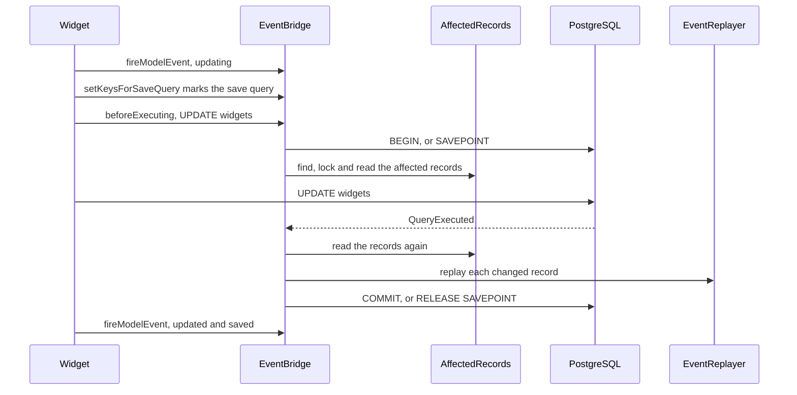

# Mirroring a write

This flow follows the event bridge through one write: `$widget->update(['title' => 'Renamed'])` on the workbench map. The bridge raises the gadget's model events, so the gadget's listeners run for a write through the widget. A write through a current model mirrors the other way, onto the previous model.

## Seeing the model events

The bridge sees every model event of a mapped model, because the model hands each dispatch to it. `HasCompatibility::fireModelEvent()` passes the event to `EventBridge::fireModelEvent()`, with a callback that runs Eloquent's own dispatch. So the bridge sees each dispatch start and end, whatever its listeners return.

The bridge acts only on a model of a mirrored map, which it finds by the exact class name. It acts on nothing inside `EventBridge::withoutMirroring()`. It also acts on nothing without a dispatcher, or under the null dispatcher that `Model::withoutEvents()` and every quiet write install.

At the start of a dispatch, the bridge acts on three kinds of event:

- A beginning event, creating, updating or deleting, begins a pending mirrored write, as [beginning](#beginning) describes.
- A created, updated or deleted event pairs with its own write, as [finishing, re-entry and fakes](#finishing-re-entry-and-fakes) describes.
- A saved event forgets the write of a save that sent no statement.

Every other event, saving among them, needs nothing at its start. Around every dispatch, the bridge adds one to its dispatch depth and takes it away again after.

The bridge forgets a beginning event's write when the dispatch returns false, which is Eloquent's own veto, or throws. It also forgets the write when the dispatcher is an `EventFake` that recorded the event during this dispatch, because no listener ran. The bridge counts the fake's record of the event for the instance before and after the dispatch. So an event the fake recorded before `EventFake::except()` keeps no later write from mirroring.

Any other result keeps the write. That covers a direct listener that returns a value, such as an arrow function, which stops the dispatch before later listeners run. It also covers a `$dispatchesEvents` class whose listener returns a value, after which Eloquent dispatches no string event at all.

The dispatch depth tells a write's own events from those of a write its listeners make. Eloquent fires a write's beginning event and its created, updated, deleted or saved event from one method, so they see the same depth. A listener's write runs inside a dispatch, at least one level deeper. The write records the depth of its beginning event in `PendingMirroredWrite::$depth`. The depth goes back down in a `finally` block, so a throw cannot leave it raised.

Besides the model events, the bridge listens only for `QueryExecuted`.

## The model contract

Every model of a mirrored map implements `Compatible` and uses `HasCompatibility`. The trait overrides three protected methods of Eloquent, and each calls its parent. The first, `fireModelEvent()`, shows the bridge every model event. Laravel 12 and 13 call the other two only inside the model's own write method, after its beginning event:

- `HasCompatibility::setKeysForSaveQuery()` serves an update, an increment, a decrement, a delete, a soft delete and a force delete. A restore and a touch call `Model::save()`, so they take that path too.
- `HasCompatibility::getAttributesForInsert()` serves an insert, through `Model::save()` or `saveOrIgnore()`.

Each method hands the model to `EventBridge::markOwnStatement()`, with the save query when there is one. No listener's query passes through either method, so the bridge never guesses which statement is the model's own. `EventBridge::mirror()` refuses a model that breaks the contract, as [INV-50](../invariants.md#inv-50-every-mapped-model-marks-its-own-statement) records. [Decision 0023](../decisions/0023-a-mapped-model-marks-its-own-statement.md) records why the mark lives on the model.

## Beginning

At the start of a beginning event, before any listener runs, the private `EventBridge::begin()` prepares the connection and records the write:

1. It adds a `Connection::beforeExecuting()` callback, once per connection, through `EventBridge::watch()`.
2. It closes any write a failed statement left behind, through `EventBridge::finishFailed()`. It closes only a write whose statement started.
3. It drops the connection's armed write, whose statement never came.
4. It pushes a `PendingMirroredWrite` onto the connection's stack, with the model dispatcher and the dispatch depth. It opens nothing yet.

A listener of the beginning event therefore runs with the write already on the stack. A write the listener makes begins on top of it, one level deeper.

## Marking the statement

When the model's own write method reaches a marking method, the bridge claims the model's write and arms it. `EventBridge::markOwnStatement()` claims the topmost write of the same instance that no earlier mark claimed. It claims only a write begun under the current model dispatcher. A quiet write inside a listener runs under Laravel's null dispatcher, so it claims nothing. Inside `EventBridge::withoutMirroring()`, the mark returns at once. With no write to claim, it runs the faked-dispatcher guard that [finishing, re-entry and fakes](#finishing-re-entry-and-fakes) describes.

Each connection holds one armed write at a time. An insert arms its write at once. A save query arms its write only when that query runs, through a `beforeQuery` callback on the query. The arm records the model's table as the query grammar writes it, so the bridge can recognise the model's statement. A soft delete sets its deleted-at and updated-at attributes after `setKeysForSaveQuery()`, and a mutator there is user code that can send a statement. A listener's query carries no mark, even one built from the same instance's `Model::newQuery()`, so it arms nothing. [INV-33](../invariants.md#inv-33-a-pending-mirrored-write-completes-only-on-its-own-statement) records the rule and its limits.

## Opening at the statement

The bridge opens the armed write when the connection starts the write's statement. Its `beforeExecuting` callback sees each statement before it runs. It takes the armed write only for an `INSERT`, `UPDATE` or `DELETE` on the model's own table, written as the model's query grammar writes that table. Any other statement leaves the write armed. A `SELECT` or an audit insert into another table that an earlier `beforeExecuting` callback runs first is one example. That callback's write to the model's own table would still take the armed write, a limit [INV-33](../invariants.md#inv-33-a-pending-mirrored-write-completes-only-on-its-own-statement) records.

First, the callback cleans the top of the stack. For each write there whose statement started, the private `EventBridge::closeFailed()` runs `select 1`:

- A failure means the write's statement failed, so the callback closes or forgets the write and goes on.
- A healthy transaction means the write's own statement is still running, and the callback stops. A later `beforeExecuting` callback, or a `QueryExecuted` listener registered before the bridge's, runs such a statement. The write stays open.

With an armed write, the callback also forgets each other write above it. Each of those is a write whose method has returned without its statement, such as a write whose cast threw after its beginning event. It also forgets each unclaimed, unsent write of the armed write's instance and operation at its depth. Such a write is an earlier attempt that threw before its mark, such as a delete whose `touchOwners()` failed. Without an armed write, the statement belongs to a listener or another write, and the stack stays as it is.

The private `EventBridge::open()` then opens the armed write:

1. It records that the statement started, with its SQL and bindings.
2. At transaction level 0, it opens a transaction. Above it, it issues `SAVEPOINT compatibility_<n>`, which Laravel's transaction level does not count.
3. It finds the affected records, locks them and reads each into a record snapshot, as the next two sections describe.

A throw in step 3 rolls the transaction or savepoint back and rethrows, so the statement never runs. A throw between the beginning event and the statement, such as a cast or a later listener, opens nothing at all. [INV-34](../invariants.md#inv-34-a-pending-mirrored-write-opens-at-its-statement) records the rule.

A listener on the beginning event can write another mapped model. That write begins, opens, completes and closes on top of the stack, before the outer write's statement starts. The cleanup leaves the outer write alone, because its statement has not started. A `QueryExecuted` listener registered before the bridge's can also write another mapped model after the outer statement. The cleanup then finds the outer transaction healthy, and leaves the outer write open.

## Finding the affected records

`AffectedRecords::of()` collects every record the write can change, from each map the model belongs to. What each map adds depends on the model's role in it:

- **A previous model** adds its current records: the primary row and each dependent row the view reads. After an insert, the key comes from the created key in `Setting::Created`.
- **A previous model's delete that removes the row** also adds every dependent row under the record's primary foreign key. The delete trigger removes them all, child rows and soft-deleted rows included, so each one raises its delete events. A delete removes the row when the model has no `isForceDeleting()` method, or when that method returns true. A soft delete keeps to the rows the view reads, and locks no others.
- **A primary current model** adds the previous records that link it. Before an insert there are none. After an insert, the record comes from the created key alone, so an insert that inserted no row adds none. A model whose key resolves to no row adds none either, and never the record an earlier insert created.
- **A dependent current model** adds the previous records of its original and its new primary foreign key. So a move between primary rows mirrors both.

The private `AffectedRecords::acrossMaps()` then adds, for each current record, the previous records of every other map over the same table on the write's connection. It does the same for a current model's own record in each of its maps, and leaves that record out of the result. So a write through one model class over a table reaches a map that names another class over it. Each affected record carries a record role. A previous record locks its retained table, but reads its view.

A model loaded without the column that names its record still mirrors. That column is the mapped key for a previous or primary model, and the primary foreign key for a dependent. `AffectedRecords::originalKey()` reads the column's original value when the model's raw original holds it. Otherwise it selects the persisted value by the model's own key. It reads the view for the previous model, and the table for a current model. So a column assigned but never loaded uses the persisted value too.

Eloquent syncs a new model's original only after its created and saved events. So a listener on either event that updates the same instance holds an empty raw original. When the model was just created and its raw original lacks its key, the bridge selects by the key in the model's attributes. So that update mirrors to the record the create made.

The bridge reads a new value only from an attribute the model holds. So a bridged write does not throw under `Model::preventAccessingMissingAttributes()`. A model with no persisted key, such as one before its insert, selects nothing.

## Locking and reading

`AffectedRecords::before()` locks the records before the statement, then reads them:

1. The private `AffectedRecords::lock()` locks the affected records, the model's own record and a dependent write's primary records, with `select 1 ... for update` on each. It sorts them by `RecordRole::lockOrder()`, then by lock table and key. Primary rows come first and retained rows second, the order the update and delete triggers use. So a dependent write locks its primary rows before its statement, and takes no record snapshot of them.
2. It finds the affected records again under those locks, for every operation. A record found only on that second pass is a newcomer, such as a dependent row another transaction committed before the primary lock. The bridge locks the newcomers, sorted by role among themselves. Without a concurrent writer, the second pass finds no newcomer.
3. `AffectedRecords::snapshots()` reads every record with `select *`, into a record snapshot. It takes no lock.

The model's own record comes from the key in its attributes. When the model does not hold the key column, the bridge selects the persisted value, as it does for an affected record. So a model loaded without its mapped key still locks its own row before the statement.

Before an insert, the bridge first clears the created key for each of the model's maps, through `KeyTranslator::clearCreatedPreviousKey()`. `Setting::Created` is local to the transaction, so it still holds the key of the transaction's previous insert. An insert that inserts no row, such as an ignored `saveOrIgnore()`, fires no trigger to replace it. The cleared setting then names no record, so the bridge replays no earlier record's created events.

A newcomer locks after every record of the first pass, so the lock order has an exception. A dependent row another transaction inserts can also escape the second pass. [INV-1](../invariants.md#inv-1-locks-follow-one-order) records both, with the constraints that close the gap.

## Completing

The bridge completes the write on the `QueryExecuted` of its own statement. `EventBridge::handleQuery()` takes the top write only when the event's SQL and bindings are identical to the ones the bridge recorded at the open. It parses no SQL. So a statement another listener runs while the write's own statement runs never completes the write. `EventBridge::complete()` then:

1. Marks the write as no longer pending.
2. Adds the records it finds only after the write, such as the current records of a new previous record. These have no row from before.
3. Reads every record again, without locks.
4. Runs the state machine trigger of each state change, then replays each record's events, with its row from before and after. [Replaying a transition](replaying-a-transition.md) follows the first half of this step.
5. Commits at level 0, or releases its savepoint, then forgets the write. A failed commit rolls back to the write's level, forgets the write and rethrows, as [failure and rollback](failure-and-rollback.md#a-failed-commit) describes.

The commit runs outside the bridge's own statements. So a mapped write in the after-commit work Laravel runs inside `Connection::commit()` mirrors too.

A completed write leaves the stack at once. Its own finishing events find nothing of it. The outer write of the same instance sits at a lower depth, so they never take that either. An ignored `saveOrIgnore()` fires no event after its statement, and leaves nothing behind.

In savepoint mode, step 4 runs inside `Connection::transaction()`, a Laravel nested transaction. Work a mirrored listener queues with `afterCommit` then rolls back with a failed replay. A throw in steps 2 to 4 rolls back and rethrows.

## Replaying

`EventReplayer::replay()` raises a record's events on a fresh instance of its model, on the source connection. It skips a record whose two rows are equal, and picks the events from the rows:

| Change | Events, in order |
| :-- | :-- |
| no row before | saving, creating, created, saved |
| no row after | forceDeleting, deleting, deleted, forceDeleted (the force events only for a soft-deleting model) |
| `deleted_at` set | deleting, trashed, deleted |
| `deleted_at` cleared | restoring, saving, updating, updated, saved, restored |
| any other change | saving, updating, updated, saved |

For a soft-deleting model, the replay sets the model's `forceDeleting` property as a native force delete does. It is false for forceDeleting, true for deleting and deleted, and false again for forceDeleted. So `isForceDeleting()` reports to a mirrored listener what it reports to a native one.

Each `-ing` event can stop the write, and the `-ed` events cannot. A listener that returns false raises `CompatibilityWriteRefused::byMirroredListener()`. A listener that changes an attribute raises `CompatibilityWriteRefused::byMirroredChange()`. The attribute's cast, or else its column type, decides what counts as a change. Numbers compare by exact decimal value, JSON by its decoded value, and encrypted and class casts as Eloquent compares them. Every other attribute compares exactly. [INV-15](../invariants.md#inv-15-a-mirrored-listener-may-refuse-a-write-never-change-it) gives the full rule.

A class in the model's `$dispatchesEvents` fires before the string event, as Eloquent does it. After the events, the replay dispatches `RecordMirrored`, with the map, the source model, the mirrored instance, the events and both rows.

## Excluding listeners

`EventMirror::excludedListeners()` lists the listeners to skip for mirrored events. `ExcludedListener::matches()` compares a listener's class, its method when one is named, and the event. Only a listener named by a class string, or by an array of a class or object and a method name, can be excluded. A closure or an invokable object cannot.

For a dispatch with exclusions, `EventReplayer::mask()` swaps the event's listeners for wrappers, and `EventReplayer::unmask()` restores them after. A wrapper skips its listener only when the payload's subject is the instance under replay, as the `Exclusion` held for that subject records. A native write inside a mirrored listener has another subject, so the excluded listener runs for it.

The private `EventReplayer::maskWildcards()` does the same in place for each wildcard that matches the event, such as `eloquent.updated: *`, so the wildcards keep their order. Its wrapper hands the listener the wildcard arguments, the event name and the payload. It needs Laravel's own `Illuminate\Events\Dispatcher`, so a decorating dispatcher's wildcard listeners stay unmasked.

The masking acts on the real dispatcher behind an `EventFake`, and the dispatch goes through the fake. So a faked event is recorded, and runs no listener.

## Finishing, re-entry and fakes

At the start of a created, saved, updated or deleted event, the bridge pairs the event with the instance's writes at the current dispatch depth. The private `EventBridge::finish()` does the pairing. A created, updated or deleted event takes only a write of its own operation: an insert, an update or a delete. A saved event takes the instance's write of either save operation, and never a delete. An owner in no mirrored map fires its saved event from `touchOwners()` at the depth of its child's delete. A listener there can save the child.

A completed write has already left the stack, so a paired write is one whose statement never completed. For each paired write, the bridge:

1. Throws when the event is created, updated or deleted and the write is unclaimed. Eloquent fires those events only after its own statement, so a statement ran without its mark. The bridge forgets the write and throws `CompatibilityEventMirrorBypassed::byUnmarkedStatement()`, which names the model and the event. Inside a transaction, the throw rolls the write back.
2. Commits the write when its statement started and it is still pending. That closes a write whose `QueryExecuted` the bridge never saw.
3. Forgets the write. At a saved event, an unclaimed write belongs to a save that sent no statement. An update that a listener left with nothing to change is one example.

So each finishing event pairs with its own write or with none. A save with nothing to change fires saved with no write at its depth. `touchOwners()` fires saved on a parent from inside its child's save, one level deeper than the parent's own write. So it takes nothing of the parent's.

A native write inside a mirrored listener begins its own write, on top of the stack, a write on the replayed instance included. The replay's own events never reach the bridge, because the replayer dispatches them without `HasCompatibility::fireModelEvent()`. The listener's write runs above transaction level 0, so it takes a savepoint.

`saveQuietly()`, query builder writes and raw SQL fire no model events. The triggers still store them correctly, and the bridge mirrors nothing.

The private `EventBridge::guard()` catches a test that fakes model events. The mark runs it when the model has no write to claim. It throws `CompatibilityEventMirrorBypassed::byFakedDispatcher()` when `Model::getEventDispatcher()` is an `EventFake` that recorded this instance's beginning event. The throw comes before the statement, so the write never reaches the database. A model in no mirrored map writes freely, and a raw write runs no model method, so neither throws.

The bridge marks its own statements through `EventBridge::internally()`, and its `QueryExecuted` handler and `beforeExecuting` callback ignore them. The bridge's commit and rollback run outside that mark.
