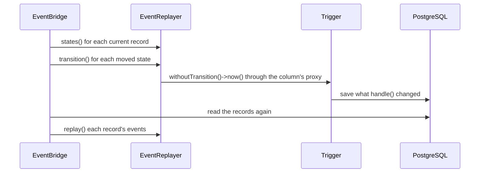

# Replaying a transition

This flow follows `EventBridge` through one write that moves a state: `$article->update(['status' => 'published'])` on the workbench map, [ArticleCompatibilityMap](../../tests/Fixtures/Support/Workbench/ArticleCompatibilityMap.php). `Article` is the previous model and `Publication` its primary current model. `Publication` casts `state` to a state machine enum from `aryeo/eloquent-state-machines`, and the article's `status` attribute maps onto that column. The statement stores the new state. The bridge then runs the trigger of the transition to that state, through `Trigger::withoutTransition()`, before it raises the publication's events. The publication's listeners then see what a native trigger gives them.

The [README](../../README.md) states the behaviour and its limits for an application. This page names the code. The trigger runs inside one step of [mirroring a write](mirroring-a-write.md): step 4 of `EventBridge::complete()`.

## When the bridge runs a trigger

`EventBridge::complete()` calls the private `EventBridge::transitions()` first in its replay callback, before any model event. A refused trigger therefore rolls back with the rest of the write, as [failure and rollback](failure-and-rollback.md) describes.

`EventReplayer::states()` lists the state columns of one record that the write moved. A state column is a column the record's model casts to a `StateMachineable` enum. A column counts when `EventReplayer::changed()` finds its two rows different, by the attribute's cast or column type, as for a mirrored listener's change. A create or a delete has one row only, so it moves no state. `EventReplayer::states()` returns nothing when `Trigger::withoutTransition()` does not exist, before it loads any other class of the package.

`EventBridge::transitions()` asks only about current records, and skips each record with `RecordRole::Previous`. A previous model's mapped column lives in a current model's table. A write through that current model ran its own trigger natively, or skipped the trigger on purpose, so the bridge runs nothing for it. When no current record moved a state, `EventBridge::transitions()` returns the records and their rows unchanged.

## Running the trigger

For each state column, in the order the model casts them, `EventReplayer::transition()` builds a fresh instance of the record's model on the write's connection. The private `EventReplayer::read()` reads the record just before that column's trigger. The instance's attributes and its raw original both hold that row, with this column back at its value from before. eloquent-state-machines requires that shape: the model holds the source state, and the persisted row holds the target. `handle()` therefore reads every other change the write stored. `EventReplayer::transition()` then:

1. Chooses the trigger through the private `EventReplayer::trigger()`. Both values must be cases of the enum, and exactly one `#[Transition]` of the stored state must lead to the new one. A value of a type the enum cannot take counts as no case. The trigger's method name is the camel-case basename of its class, the name the column's proxy accepts.
2. Calls that method on the column's proxy. When the bound bus dispatcher is a bus fake that would record the trigger, the private `EventReplayer::fakes()` says so, and the write throws `CompatibilityEventMirrorBypassed::byFakedBus()`.
3. Calls `Trigger::withoutTransition()` and `Trigger::now()`. The package checks the raw original against the source and, under a row lock, the persisted row against the target. It runs `allowed()`, the before event and `handle()`, and queues the after event for the outermost commit. Its lifecycle transaction is a savepoint inside the write's transaction. At the trigger's phase, the state attribute takes the target and is marked as unchanged, so the save after `handle()` writes only what `handle()` changed.
4. Refuses the write when the last outermost save of the instance during `Trigger::now()` does not complete, because a `saving` or `updating` listener vetoed it. `EventBridge::fireModelEvent()` hands each model event to `EventReplayer::trackSave()` before any listener runs, and each result to `EventReplayer::trackSaveResult()` after the dispatch. A `saving` event opens a save of the instance on a stack, and the save moves to writing when `saving` passes. A false result from `saving` vetoes it. So does a false result from the one `creating` or `updating` that the save fires while it is writing. The `saved` event completes the save after its dispatch. An `increment()` fires `updating` outside any writing save, so its veto changes no save. The save that closes the last open one sets the outcome. So a veto of the trigger's final save refuses the write, even after `handle()` saved the instance, and even when a `saving` listener saved the instance inside that final save. A save from `handle()` that a listener vetoes keeps the write when the final save completes, as natively. So does a vetoed save or increment inside a `saved` listener. A `saved` listener that changes the instance without saving it, or that returns false, keeps the write.

A failed check, an `Invalid` or a `BindingResolutionException` from the trigger, or a vetoed save throws `CompatibilityWriteRefused::byTransition()`. The refusal names the previous model's attribute and the current model's column, and keeps the failure as its previous exception. Any other exception from the trigger passes through unchanged. [INV-29](../invariants.md) holds the rule.

A second state column of one record runs on its own instance, read after the first trigger. That read carries the first column's new state and whatever the first trigger saved. A listener or `handle()` that refreshes the first instance therefore leaves the second column's source state intact.

While the triggers run, the private `EventReplayer::maskModelEvents()` masks every model event of the record's model that an excluded listener applies to. A wrapper skips the excluded listener when the event's subject is the instance a trigger runs on, or a custom event that holds that instance. So the map's exclusion holds for the trigger's own save, and not for any other model that `handle()` saves. [INV-18](../invariants.md) holds the rule.

## The trigger's own save

The trigger saves what `handle()` changed with an ordinary Eloquent save of the current model. Its `updating` event begins a pending write of its own, as any native write inside the bridge does ([INV-16](../invariants.md)). That write locks its records, completes on its own `UPDATE` ([INV-33](../invariants.md)), and mirrors the save to the previous model. A save of another current model inside `handle()` is mirrored the same way. The bridge itself writes nothing.

## Reporting each change once

Each change is reported once on each side, as a native trigger reports it. The trigger's save already reported `handle()`'s changes, natively on the current model and mirrored on the previous model. `EventBridge::transitions()` reads the source model's own record, from `AffectedRecords::native()`, before the first trigger runs. After the last trigger it reads every record again, with that own record. The reads give the bridge what it needs:

- **The current record's row from before.** The private `EventBridge::replayedBefore()` takes from the read after the triggers each column the triggers' saves changed. The bridge's own events therefore leave out what those saves reported.
- **The current record's row after.** The read after the triggers, so the bridge's events report the new state and the write's other changes. A row that the read no longer finds keeps the row after the statement, so the bridge reports only the statement's own change to it. The trigger's delete already reported its removal.
- **The source model.** The private `EventBridge::copy()` compares the two reads of the source model's own record. It sets each column that changed between them as the attribute and as the raw original, through a closure bound to the model. It drops only those columns from the model's cast caches. The previous model's own `updated` and `saved` events therefore report the caller's changes, and the instance holds what the database holds. A cast object the caller holds for another column stays bound to the instance, and a column the trigger changed reads its new value.

A column that the caller and `handle()` both change is reported once on each side, from the value the write stored. The trigger's save reports it on the current model, and the mirror of that save reports it on the previous model. The caller's own events and `getChanges()` leave it out.

A write through the previous model thus reports one transition in two sets of events on each side, where a native transition reports one set. The trigger's save comes first, and the state change follows. [INV-30](../invariants.md) holds the rule.

## Repairs

Two routes set a state no `#[Transition]` reaches, and the [README](../../README.md) shows both. A write through the current model is native, so `EventBridge::transitions()` runs nothing for it. A write through the previous model inside `EventBridge::withoutMirroring()` begins no pending write, so no trigger runs.

## A previous model that casts its column

A previous model may cast its mapped column to the same state machine enum. `EventBridge::transitions()` skips its record, as for any previous model, and runs the current model's trigger. The previous model's mirrored events carry the new state. [0017](../decisions/0017-a-cast-previous-model-changes-its-state-only-inside-the-guards-scopes.md) records the limit the first design had here, which no longer exists.

## Without the package

`composer.json` suggests `aryeo/eloquent-state-machines` and requires it for development only. [0018](../decisions/0018-the-state-machine-package-is-suggested-not-required.md) records the choice. Without it, or with a release that has no `Trigger::withoutTransition()`, `EventReplayer::states()` returns nothing. `EventBridge::transitions()` then returns the rows unchanged, and every write mirrors as it did before state changes ran a trigger. [INV-31](../invariants.md) holds the rule.

## Tests

`EventBridgeTransitionTest` covers the trigger end to end: each change once per side against a native transition, each refusal, a throw from the trigger, the saves inside `handle()`, a previous model that casts the column, the repair routes, two state columns in one write, `updated_at`, a failed caller transaction, the events under a fake, and a map without a state machine. It also covers a column both sides change, a cast object the caller holds, a cached cast the trigger changes, a dependent row the trigger deletes, a refreshed instance, and excluded listeners. It covers a vetoed save, a vetoed final save after `handle()` saved, a vetoed final save after a `saving` listener saved the instance inside it, a vetoed save inside `handle()` before a final save that completes, a vetoed increment inside a nested save before a vetoed final save, a vetoed save and a vetoed increment inside a `saved` listener, a `saved` listener that changes the instance, `saved` listeners that return false, a custom `saved` listener that returns a value, a faked `saved` event, a failure from `handle()`, `failed()`, and a bus fake. `EventBridgeOutsideTransactionTest::it_runs_the_trigger_of_a_state_change_made_outside_a_transaction_and_fires_its_after_event_after_the_commit()` covers the after event at level 0. `EventBridgeOutsideTransactionTest::it_mirrors_an_explicit_save_inside_a_trigger_run_outside_a_transaction_on_its_own_statement_and_commits_both()` covers a save inside `handle()` there. `EventBridgeOutsideTransactionTest::it_rolls_back_a_state_change_made_outside_a_transaction_and_fires_no_after_event_when_its_trigger_throws_or_refuses()` covers a failed trigger there.

The colocated tests cover each class. `EventReplayerTest` covers `EventReplayer::states()` and `EventReplayer::transition()`, with each refusal. `AffectedRecordsTest` covers `AffectedRecords::native()`. `CompatibilityWriteRefusedTest` covers `CompatibilityWriteRefused::byTransition()`.

Each test that needs eloquent-state-machines carries `#[RequiresMethod(Trigger::class, 'withoutTransition')]`, so it skips without the package. The CI job `tests-without-state-machines` removes the package and runs the suite.
