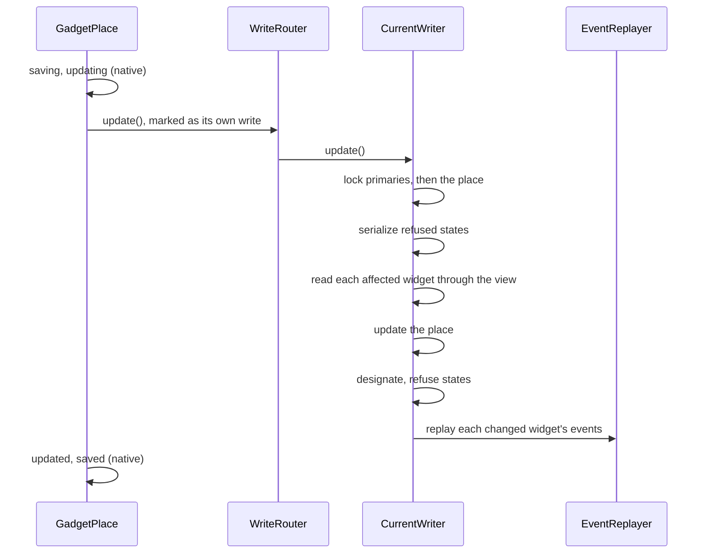

# Writing a current model

This flow follows a write of a current model's table, and how the write router keeps every previous model over that table in step. The example is `$place->update(['street' => '2 Second St'])` on the workbench map, where `GadgetPlace` is a dependent current model of `Widget`.

## What the current-side work replaces

The package once installed triggers on the current tables. `CurrentWriter` does their work in PHP, for every write of a current model's builder:

| Work | When | Skipped when |
| :-- | :-- | :-- |
| create the retained row, filled by `PreviousModel::fillWhenCreatedFromCurrent()` | an insert of a primary current row | the map's previous model is writing the row |
| delete the retained rows | a hard delete of a primary current row | the map's previous model is writing the row |
| fill an empty designation | an insert or update of a readable designated dependent row | the map's previous model is writing the row |
| refuse a refused state | an insert or update of a table a refused state checks | never |
| replay the previous model's events | a model's own write | a query builder write, `WriteRouter::withoutMirroring()`, or the map's previous model is writing the row |

`CurrentWriter` finds its maps through `MirrorIndex::forRelation()`, by the connection and the table, so a map that names another model class over the same table takes part too, as [INV-6](../invariants.md#inv-6-a-change-to-a-shared-current-table-keeps-every-previous-model-over-it-in-step) records.

A write with none of that work runs as one native statement. Every other write selects the rows it matches, then works row by row.

## An update

`CurrentWriter::update()`:

1. Reads the rows the builder matches, with each dependent's primary foreign key, before any lock.
2. Locks the primary rows those keys name, then the rows themselves, in key order, as [INV-1](../invariants.md#inv-1-locks-follow-one-order) requires.
3. Serializes each refused state on the table, as [INV-20](../invariants.md#inv-20-a-refused-state-is-serialized-per-record) records.
4. For a model's own write, locks each affected retained row and reads each affected previous record through the view.
5. Runs the native statement, restricted to the locked keys.
6. Fills empty designations, and refuses each row in a refused state, as [INV-14](../invariants.md#inv-14-a-refused-state-checked-on-a-table-holds-for-every-write-through-a-model) records.
7. Reads each affected previous record again, and hands both rows to `EventReplayer::replay()`.

The replayer raises the previous model's events on a fresh instance, with the row from before as its original and the row from after as its attributes. A mirrored `-ing` listener may refuse, and the refusal rolls the write back; it cannot change the record, as [INV-15](../invariants.md#inv-15-a-mirrored-listener-may-refuse-a-write-never-change-it) and [decision 0006](../decisions/0006-mirrored-events-are-replayed-after-the-statement.md) record. Each replay dispatches a `RecordMirrored` event, which `InteractsWithCompatibilityMaps` records for tests.

## An insert and a delete

`CurrentWriter::insert()` inserts each row through `insertGetId()`, which returns the key whatever its type. For a primary current row it reads the stored row back, defaults included, builds a model from it, and hands that model to each fill closure of the retained row. It then fills designations, checks refused states, and replays the created previous record.

`CurrentWriter::delete()` deletes the retained rows of each primary row first, then the rows, and replays the removed previous records. A soft delete is an update of the deleted-at column, and takes the update path.

## Writes the router cannot take

`upsert()`, `insertUsing()` and `insertOrIgnoreUsing()` refuse on a current model whose inserted rows need a retained row, a designation or a refused-state check. On any other current model they run natively. A write that bypasses Eloquent, such as DB::table('gadgets')->insert(...), skips the router: it creates no retained row and checks no refused state. `compatibility:check` reports what it leaves behind.
