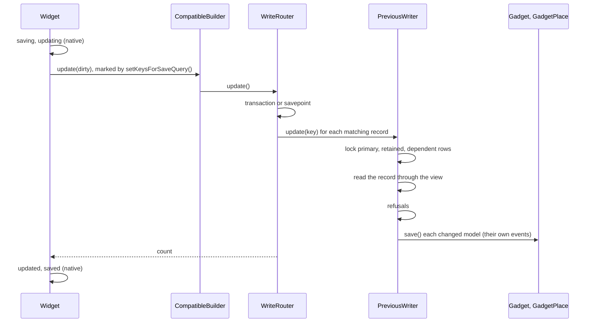

# Writing through the previous model

This flow follows a write of the previous model, from its Eloquent builder to the current models' rows. The example is `$widget->update(['title' => 'Renamed', 'street' => '2 Second St'])` on the workbench map, [WidgetCompatibilityMap](../../tests/Fixtures/Support/Workbench/WidgetCompatibilityMap.php). `Widget` is the previous model, `Gadget` its primary current model, and `GadgetPlace` and `GadgetSite` its dependent current models.

## Reaching the router

1. Eloquent fires the widget's `saving` and `updating` events. Listeners run first, and may change the widget, as they always do.
2. `Model::performUpdate()` calls `setKeysForSaveQuery()`. `HasCompatibility::setKeysForSaveQuery()` marks the builder through `RoutesCompatibleWrites::compatibilityWriteOf()`, so the router knows this is the widget's own write.
3. The builder is a `CompatibleBuilder`, which `HasCompatibility::newEloquentBuilder()` gave the model. `RoutesCompatibleWrites::update()` adds the updated-at column, as Eloquent's builder does, and hands the values to `WriteRouter::update()`.
4. `MirrorIndex::previousOf()` finds the map whose previous model is `Widget`. The router strips the view's name from each qualified column, opens `Connection::transaction()`, and selects the keys the builder matches from the view.

A query builder write, such as `Widget::query()->where('sku', 'A')->update([...])`, takes the same path without the mark in step 2. It honours the builder's conditions, order and limit.

## Writing one record

`PreviousWriter::update()` writes one record:

1. **Locks.** It reads the record's primary key from the retained row, locks the primary row, then the retained row, then each dependent row it reads through `Records::locate()`. [INV-1](../invariants.md#inv-1-locks-follow-one-order) records the order.
2. **Re-check.** It asks the builder again whether the locked record matches its conditions, as PostgreSQL re-checks an `UPDATE`'s condition. A record that no longer matches, or that the view no longer shows, is skipped.
3. **Read.** It reads the record through the view, after the locks. Every change, an increment's sum included, is computed from that read, as [INV-5](../invariants.md#inv-5-a-write-reads-its-record-only-after-its-locks) records.
4. **Changes.** It compares each written attribute with the record through `Values::same()`, by the view column's type, and keeps only those that changed.
5. **Refusals.** It refuses an attribute the map does not declare, a raw SQL value, a change to a read-only attribute, a null for a column the retained table holds `NOT NULL`, and each refused state whose `UnrepresentableState::checkedOnPreviousUpdate()` closure returns true.
6. **Primary.** It computes each changed column of the primary current model with the map's `TargetColumn` closures, loads the gadget without its global scopes, sets the raw values, and saves it. A change of the gadget's deleted-at column soft-deletes or restores it through its own methods instead.
7. **Retained.** It updates the retained row's changed columns through the query builder, after it serializes and before it checks each refused state on the retained table.
8. **Dependents.** It saves each dependent row it located. A dependent with no row creates one when `DependentCurrentModel::createdWhen()` says so, or when the write stores a non-null value in it, and fills its designation. A designated dependent whose designated row is no longer readable refuses.

On the widget's own write each save fires the current model's own events, and its listeners may change a value or veto the save, as [INV-16](../invariants.md#inv-16-a-current-models-own-listeners-run-before-its-row-is-written) records. On a query builder write the saves run inside `Model::withoutEvents()`, as [INV-17](../invariants.md#inv-17-a-query-builder-write-fires-no-model-events-on-either-side) records.

Each current model's save reaches its own builder, and so `CurrentWriter`. `WriteRouter::applying()` marks the model for the length of its save, so `CurrentWriter` skips the work the previous writer does itself, as [INV-3](../invariants.md#inv-3-a-previous-models-own-current-saves-skip-that-maps-current-side-work) records. It still checks refused states, and keeps every other map over the same table in step. [Writing a current model](writing-a-current-model.md) follows that path.

## Inserting

`PreviousWriter::insert()` creates a record:

1. It refuses an unknown attribute, a raw SQL value and a null for a `NOT NULL` retained column.
2. It creates the primary current model from `ResolvedMap::insertAssignmentsTo()` and `PrimaryCurrentModel::fillWhenCreatedFromPrevious()`. An omitted attribute leaves its column to the database's default, as [INV-28](../invariants.md#inv-28-an-insert-keeps-a-columns-default) records.
3. It inserts the retained row with the new primary key, and checks the retained table's refused states.
4. It creates each dependent row that `DependentCurrentModel::createdWhen()` allows, and fills its designation.
5. It reads the record back through the view, and returns its key. On the widget's own insert, Eloquent sets that key on the model.

`insertOrIgnore()` inserts each row in its own savepoint, and skips a row that raises a unique violation, as the old table did.

## Deleting

A widget that soft-deletes changes its deleted-at column, which the map stores on the gadget, so the write is an update: the gadget soft-deletes through its own `delete()`. A force delete, or a widget without soft deletes, runs `PreviousWriter::delete()`. It locks the record, deletes the retained row, then deletes each dependent row and the primary row through their models, with `forceDelete()` where the model soft-deletes. Rows of one table that reference each other go children first.

## Writes the router cannot take

The router refuses `upsert()`, `insertUsing()` and `insertOrIgnoreUsing()` on the previous model, and a raw SQL value anywhere in its writes. A write that bypasses Eloquent, such as DB::table('widgets')->update(...), reaches the read-only view, and PostgreSQL refuses it. [INV-22](../invariants.md#inv-22-every-write-method-of-the-builder-is-routed-or-refused) records the rule.
