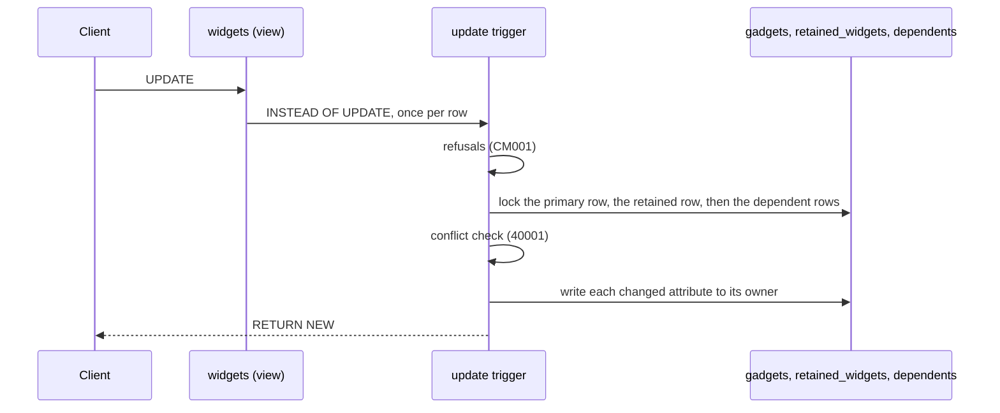

# Writing through the view

This flow follows a write after it reaches PostgreSQL. The triggers do the same work for every client: an Eloquent model, the query builder or raw SQL. `Compiler` builds all the SQL this page describes. The example is `update "widgets" set "title" = ? where "id" = ?` on the workbench map.



## What every function does first

Every compiled function refuses with CM001 when it fires on a relation other than its own, and `PUBLIC` holds no `EXECUTE` on it. It calls each built-in function through `pg_catalog`. [INV-37](../invariants.md#inv-37-a-trigger-function-runs-only-for-its-own-relation) records why.

The insert, update and delete functions hold the applying flag at the map's name while they run. PostgreSQL restores the earlier value when the function returns, so a nested write through another map's view leaves this map's name in place. [INV-3](../invariants.md#inv-3-the-views-own-writes-skip-this-maps-current-side-triggers) records the rule.

## An update

The update trigger runs once per row. `Compiler::updateFunction()` builds its body, which runs in this order:

1. Each read-only attribute refuses a change with CM001, with the reason from `Attribute::readOnlyBecause()`.
2. A mapped attribute whose same-named retained column is `NOT NULL` refuses a change to null, because the previous model never stored one. A record that already reads null keeps it, so a write to its other attributes still succeeds. A current model can create such a record. An attribute that writes only a `concurrency_revision` column the compiler owns is exempt, because the trigger drops that assignment.
3. The trigger locks the primary row with `FOR UPDATE`.
4. It locks the retained row and loads it into `previous_row`. A missing row refuses with CM001, and the hint names `compatibility:check`.
5. Each refused state with `UnrepresentableState::checkedOnPreviousUpdate()` refuses with CM001 when its condition holds.
6. The conflict check locks each dependent row the record reads with `FOR UPDATE`, into `key_<alias>`. It then reads every attribute through the tables. A row that differs from `OLD` raises 40001. A dependent row it no longer finds is not a conflict.
7. It updates the primary row when one of its attributes changed. Any row count other than one refuses with CM001.
8. It updates the retained row the same way, with no row count check.
9. It writes each dependent whose attributes changed, as the next section describes.
10. It reads each attribute that writes only a compiler-owned `concurrency_revision` column back into `NEW` from the stored rows. So `UPDATE ... RETURNING` reports the stored revision, not the value the caller sent.
11. It returns `NEW`.

`Compiler::update()` writes each column as `CASE WHEN NEW.x IS DISTINCT FROM OLD.x THEN ... ELSE <stored value> END`. A column whose attribute did not change keeps the value stored now. It still sits in the `SET` list, so an `UPDATE OF` trigger on it fires, as [INV-7](../invariants.md#inv-7-the-update-trigger-writes-only-what-changed) records. Each written value is cast to the column's type in the catalog.

An attribute whose type has no default btree equality operator, such as `json`, has no `=` to compare with. Every comparison above casts it to text first: the read-only check, the change test, the `CASE WHEN` and the conflict check. A whitespace or key-order change the caller wrote therefore counts as a change. [INV-36](../invariants.md#inv-36-an-attribute-without-a-btree-equality-compares-as-text) records the rule.

## A dependent row

The trigger writes only the dependent row the conflict check locked in step 6, by its key in `key_<alias>`. `Compiler::updateDependent()` selects no row of its own. What it does depends on that lock:

- A row was locked: the trigger updates it.
- No row was locked, but the subquery from `ResolvedMap::locate()` finds one now: the trigger raises 40001. Another transaction made that row readable after the lock, and the trigger never read it. [INV-5](../invariants.md#inv-5-a-concurrent-change-raises-40001) records the rule.
- No row was locked, and the designation names a row that still exists: the trigger refuses with CM001. That row is no longer readable, or belongs to another record.
- No row was locked, and the `DependentCurrentModel::createdWhen()` condition holds: the trigger inserts the row and designates it. Without a declared condition, the condition is that one of the dependent's attributes is not null.
- Otherwise the trigger refuses with CM001: the record has no such row, and the map does not create one.

## An insert

The insert trigger takes no locks. `Compiler::insertFunction()` builds it:

1. A mapped attribute whose same-named retained column is `NOT NULL` refuses a null. An attribute that writes only a `concurrency_revision` column the compiler owns is exempt, because the insert stores 1 there.
2. The trigger inserts the primary row, and `PrimaryCurrentModel::fillWhenCreatedFromPrevious()` fills the columns no attribute writes.
3. It inserts the retained row, linked to the primary row. A read-only retained attribute over a column the database always generates stays out of the insert, so the table fills it.
4. It inserts each dependent row whose `DependentCurrentModel::createdWhen()` condition holds, linked to the primary row, and designates it where the dependent has a designation.
5. It reads every attribute back into `NEW` from the stored rows, as the view reads it. So `INSERT ... RETURNING` reports defaults, fills, values other triggers set and formatted reads, as [INV-40](../invariants.md#inv-40-an-insert-through-the-view-returns-the-row-as-the-view-reads-it) records.
6. It stores the retained key as the created key in `Setting::Created`, and returns `NEW`.

The map maintains every link itself, so neither an attribute nor a fill sets one, as [INV-8](../invariants.md#inv-8-each-stored-column-has-one-owner) records. Registration refuses an attribute that stores a dependent's primary foreign key, and a fill of any primary foreign key or designation column. Compile refuses a writable attribute over the retained table's primary foreign key or a designation column.

Each insert stores a read-only attribute's value too, retained or mapped, in its stored column. Only the update trigger refuses a change to it. A read-only mapped attribute stays out of the insert when the database always generates its column, or when a writable attribute writes the same column. In the second case the writable value is stored, and both attributes read it. [INV-49](../invariants.md#inv-49-an-insert-through-the-view-stores-a-read-only-attribute) records the rule.

An omitted attribute arrives as NULL, unless its view column has a default. A target column that is `NOT NULL` and has a catalog default receives `COALESCE(<value>, <default>)`, so that default fills it. A domain column receives `CAST(COALESCE(<value>, <default>) AS <domain>)`, because a cast of NULL to a `NOT NULL` domain fails before the default applies. That holds in the primary, retained and dependent inserts, and in the update trigger's create branch. A nullable column with a default stores NULL. A target column that is `NOT NULL` without a default receives the NULL, and PostgreSQL refuses the write with 23502, as it refuses a native one. An update that sets such a column to null fails the same way. [INV-46](../invariants.md#inv-46-an-insert-through-the-view-keeps-a-not-null-columns-default) records the rule.

## A delete

The delete trigger locks the primary row, then loads and locks the retained row. It deletes the retained row, then every dependent row of the primary row in reverse declaration order, then the primary row. `Compiler::deleteFunction()` builds it.

A soft delete is an Eloquent `UPDATE` of `deleted_at`. The workbench map stores `deleted_at` on the gadget, so the update trigger writes it like any other attribute.

## Writes on the current side

The other trigger functions react to writes that do not come through the view. Three of them return early while the applying flag holds this map's name, so the view's own writes fire none of this map's current-side reactions:

- **Primary insert**: a new primary row gets a retained row, filled by `PreviousModel::fillWhenCreatedFromCurrent()`. The trigger stores the new retained key as the created key.
- **Primary delete**: a deleted primary row takes its retained rows with it.
- **Designate**: a dependent row that an insert or an update makes readable fills an empty designation on its primary row's retained rows.

The refuse function is the fourth. A row that enters a refused state refuses with CM001. It never skips, so it holds for every writer, the view included.

## The refused-state lock

A refused state's condition can read other rows of its table, as the workbench `second_root_place` state does. Two transactions that each insert one root place would each miss the other's uncommitted row, and both would commit. So on a dependent's table or the retained table, the refuse function first locks the record's primary row, then takes a transaction-scoped advisory lock:

```
PERFORM 1 FROM "<primary table>" WHERE "<primary key>" = NEW."<primary foreign key>" FOR KEY SHARE;
PERFORM pg_catalog.pg_advisory_xact_lock(pg_catalog.hashtextextended(pg_catalog.concat('<refuse function>:', NEW."<primary foreign key>"), 0));
```

The primary row lock comes first, so the refused-state lock joins the order of [INV-1](../invariants.md#inv-1-locks-follow-one-order). A view writer holds the primary row `FOR UPDATE` before it writes a dependent row. A dependent writer then waits on the primary row before it holds the advisory lock, so the two cannot deadlock on it. A dependent's primary foreign key and the retained table's both name the primary row.

The advisory lock's key joins the refuse function's name with the row's primary foreign key. A dependent uses its own primary foreign key, and the retained table uses the previous model's. So two writers of one record's rows check the state one after the other. `concat` turns a null key into an empty string, so every row with a null key shares one lock. `Compiler::function()` declares no volatility, so each function is VOLATILE. Under READ COMMITTED, the check after the wait therefore takes a new snapshot and sees the committed row.

The lock has four limits:

- **A state checked on the primary table takes no lock.** A primary row has no primary foreign key, and its condition always compares different records. So its check can race, and two writers can both commit the state. Enforce a cross-row rule on the primary table with a unique or exclusion constraint instead. `compatibility:check` still reports a row in the state. [0016](../decisions/0016-a-refused-state-on-the-primary-table-is-not-serialized.md) records the decision.
- **A condition that compares rows of different records can still race.** So can a condition that reads another table, whose writers take no lock.
- **Under REPEATABLE READ, the check after the wait misses the committed row.** The snapshot stays fixed for the whole transaction.
- **A writer that locks a dependent row and then updates it can deadlock a concurrent write through the view.** The view writer holds the primary row `FOR UPDATE` and waits on the dependent row. The refuse function's `FOR KEY SHARE` then waits on the view writer, and PostgreSQL raises 40P01. A raw write deadlocks on this pattern. A write through the event bridge locks the primary row first, so it deadlocks only when the application locked the dependent row itself. [INV-1](../invariants.md#inv-1-locks-follow-one-order) records the exception.

## Other statements through the view

An `UPDATE ... FROM` fires the update trigger once per joined row, and each firing writes the values of its own row. A record that joins two rows fires the trigger twice. The second firing finds the record changed since its `OLD` row, and raises 40001.

A simple view over the compatibility view takes writes too. PostgreSQL rewrites each write onto the compatibility view, so its triggers fire and their refusals hold. `information_schema.views` still reports the outer view as not updatable.

A `FOR UPDATE` read through the view succeeds. It locks the primary row and then the retained row, the two relations in the view's `FROM` list, in that list's order. So it waits on the primary row before it holds the retained row, as [INV-1](../invariants.md#inv-1-locks-follow-one-order) requires. It cannot deadlock a bridged write or a write through the view. The view reads each dependent through a scalar subquery, so the read locks no dependent row.

## Writes the view cannot take

An upsert, an update with a limit and a truncate fail on the view. The error is PostgreSQL's own, and `CompatibilityWriteRefused::isRefusal()` does not recognise it.

An `INSERT ... ON CONFLICT DO NOTHING`, which `insertOrIgnore()` and `saveOrIgnore()` send, reaches the insert trigger. The clause does not reach the trigger's own inserts, so a conflict there raises 23505 where the old table skipped the row. [Adopting a map](../adopting-a-map.md#an-ignored-insert-raises-on-a-conflict) describes what an application does about it.
