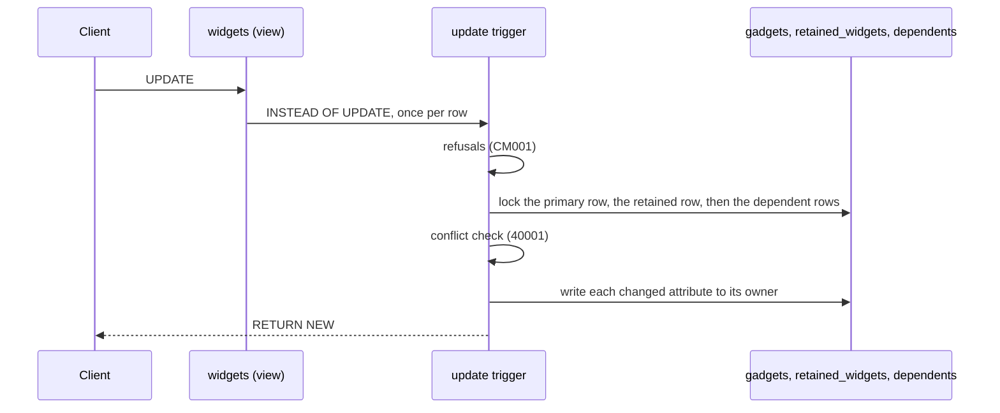

# Writing through the view

This flow follows a write after it reaches PostgreSQL. The triggers do the same work for every client: an Eloquent model, the query builder or raw SQL. The SQL comes from `Compiler`, so each step names the method that builds it. The example is `update "widgets" set "title" = ? where "id" = ?` on the workbench map.



## An update

Every compiled function first refuses with CM001 when it fires on a relation other than its own, and `PUBLIC` holds no `EXECUTE` on it. [INV-37](../invariants.md) records why.

`Compiler::updateFunction()` builds the update trigger's body. It runs once per row, in this order:

1. Each read-only attribute refuses a change with CM001. `Attribute::readOnlyBecause()` supplies the reason.
2. `Compiler::notNullChecks()` refuses a null for a mapped attribute whose same-named retained column is `NOT NULL`.
3. `Compiler::lockPrimary()` locks the primary row with `FOR UPDATE`.
4. `Compiler::loadPrevious()` locks the retained row and loads it into `previous_row`. A missing row refuses with CM001, and the hint names `compatibility:check`.
5. Each refused state with `UnrepresentableState::checkedOnPreviousUpdate()` refuses with CM001 when its condition holds.
6. `Compiler::conflict()` locks each dependent row the record reads with `FOR UPDATE`, through `ResolvedMap::locate()`, into `key_<alias>`. It then reads every attribute through the tables. A row that differs from `OLD` raises 40001. A dependent row it no longer finds is not a conflict.
7. `Compiler::applying()` sets the applying flag, `Setting::Applying`, to the map's name.
8. `Compiler::updateTable()` updates the primary row when one of its attributes changed. Any row count other than one refuses with CM001.
9. `Compiler::updateTable()` updates the retained row the same way, with no row count check.
10. `Compiler::updateDependent()` handles each dependent whose attributes changed, as the next section describes.
11. The trigger clears the applying flag and returns `NEW`.

`Compiler::update()` writes each column as `CASE WHEN NEW.x IS DISTINCT FROM OLD.x THEN ... ELSE <stored value> END`. A column whose attribute did not change keeps the value stored now. It still sits in the `SET` list, so an `UPDATE OF` trigger on it fires. [INV-7](../invariants.md) records the rule. `Compiler::value()` casts each written value to the column's type in the catalog.

An attribute whose type has no default btree equality operator, such as `json`, has no `=` to compare with. Every comparison above casts it to text first: the read-only check, `SqlFragments::changed()`, the `CASE WHEN` and the conflict check. A whitespace or key-order change the caller wrote therefore counts as a change. [INV-36](../invariants.md) records the rule.

## A dependent row

`Compiler::updateDependent()` writes the dependent row `Compiler::conflict()` locked in step 6, by its key in `key_<alias>`. It selects no row of its own.

- A row was locked: the trigger updates it.
- No row was locked, but the subquery from `ResolvedMap::locate()` finds one now: the trigger raises 40001. Another transaction made that row readable after the lock, and the trigger never read it. [INV-5](../invariants.md) records the rule.
- No row was locked, and the designation names a row that still exists: the trigger refuses with CM001. That row is no longer readable, or belongs to another record.
- No row was locked, and the `DependentCurrentModel::createdWhen()` condition holds: the trigger inserts the row and designates it. Without `DependentCurrentModel::createdWhen()`, the condition is that one of the dependent's attributes is not null.
- Otherwise the trigger refuses with CM001: the record has no such row, and the map does not create one.

## An insert

`Compiler::insertFunction()` builds the insert trigger. It takes no locks.

1. `Compiler::notNullChecks()` refuses a null for a `NOT NULL` mapped attribute.
2. The trigger sets the applying flag.
3. It inserts the primary row, with `PrimaryCurrentModel::fillWhenCreatedFromPrevious()` filling the columns no attribute writes.
4. It inserts the retained row, linked to the primary row. A read-only retained attribute over a column the database always generates stays out of the insert, so the table fills it.
5. It inserts each dependent row whose `DependentCurrentModel::createdWhen()` condition holds. A dependent with a designation is designated too.
6. It reads every attribute back into `NEW` from the stored rows, as the view reads it. So `INSERT ... RETURNING` reports defaults, fills, values other triggers set and formatted reads. [INV-40](../invariants.md) records the rule.
7. It clears the applying flag, stores the retained key in `Setting::Created` and returns `NEW`.

Each insert also stores the value of a read-only attribute, retained or mapped, in its stored column. The private `Compiler::insertAssignmentsTo()` adds a read-only mapped attribute's `storedAs()` target, unless the database always generates that column. Only the update trigger refuses a change to it. [INV-49](../invariants.md) records the rule.

An omitted attribute arrives as NULL, unless its view column has a default. `Compiler::insertValues()` writes `COALESCE(<value>, <default>)` to a target column that is `NOT NULL` and has a catalog default. So that default fills it, in the primary, retained and dependent inserts and in the update trigger's create branch. A nullable column with a default stores NULL. [INV-46](../invariants.md) records the rule.

## A delete

`Compiler::deleteFunction()` locks the primary row, then loads and locks the retained row. It sets the applying flag. It deletes the retained row, then every dependent row of the primary row in reverse declaration order, then the primary row.

A soft delete is an Eloquent `UPDATE` of `deleted_at`. The workbench map stores `deleted_at` on the gadget, so the update trigger writes it like any other attribute.

## Writes on the current side

The other trigger functions react to writes that do not come through the view. `Compiler::skipWhileApplying()` makes three of them return early while the applying flag holds this map's name. So the view's own writes fire none of this map's current-side reactions.

- `Compiler::primaryInsertFunction()`: a new primary row gets a retained row, filled by `PreviousModel::fillWhenCreatedFromCurrent()`. The trigger stores the new retained key in `Setting::Created`.
- `Compiler::primaryDeleteFunction()`: a deleted primary row takes its retained rows with it.
- `Compiler::designateFunction()`: a dependent row that an insert or an update makes readable fills an empty designation on its primary row's retained rows.
- `Compiler::refuseFunction()`: a row that enters a refused state refuses with CM001. It never skips, so it holds for every writer, the view included.

## The refused-state lock

A refused state's condition can read other rows of its table, as the workbench `second_root_place` state does. Two transactions that each insert one root place would each miss the other's uncommitted row, and both would commit. So on a dependent's table or the retained table, the refuse function first locks the record's primary row, then takes a transaction-scoped advisory lock:

```
PERFORM 1 FROM "<primary table>" WHERE "<primary key>" = NEW."<primary foreign key>" FOR KEY SHARE;
PERFORM pg_advisory_xact_lock(hashtextextended(concat('<refuse function>:', NEW."<primary foreign key>"), 0));
```

The primary row lock comes first, so the refused-state lock joins the order of [INV-1](../invariants.md). A view writer holds the primary row `FOR UPDATE` before it writes a dependent row. A dependent writer then waits on the primary row before it holds the advisory lock, and the two cannot deadlock on it. Both a dependent's primary foreign key and the retained table's name the primary row.

The advisory lock's key joins the refuse function's name, from `ResolvedMap::refuseFunctionName()`, with the row's primary foreign key. A dependent uses `ResolvedMap::primaryForeignKey()`, and the retained table uses the previous model's primary foreign key. So two writers of one record's rows check the state one after the other. `concat` turns a null key into an empty string, so every row with a null key shares one lock. `Compiler::function()` declares no volatility, so each function is VOLATILE. Under READ COMMITTED, the check after the wait therefore takes a new snapshot and sees the committed row.

The lock has four limits:

- **A state checked on the primary table takes no lock.** A primary row has no primary foreign key, and its condition always compares different records. Its check can race, and two writers can both commit the state. Enforce a cross-row rule on the primary table with a unique or exclusion constraint instead. `compatibility:check` still reports a row in the state. [0016](../decisions/0016-a-refused-state-on-the-primary-table-is-not-serialized.md) records the decision.
- **A condition that compares rows of different records can still race.** So can a condition that reads another table, whose writers take no lock.
- **Under REPEATABLE READ, the check after the wait misses the committed row.** The snapshot stays fixed for the whole transaction.
- **A writer that locks a dependent row and then updates it can deadlock a concurrent write through the view.** The view writer holds the primary row `FOR UPDATE` and waits on the dependent row. The refuse function's `FOR KEY SHARE` then waits on the view writer, and PostgreSQL raises 40P01. A raw write deadlocks on this pattern. A write through the event bridge locks the primary row first, so it deadlocks only when the application locked the dependent row itself. [INV-1](../invariants.md) records the exception.

## Writes the view cannot take

An upsert, an update with a limit and a truncate fail on the view. The error is PostgreSQL's own, and `CompatibilityWriteRefused::isRefusal()` does not recognise it. A `FOR UPDATE` read through the view succeeds.

## Tests

`InstallerTest` covers each write through the view: inserts, updates, deletes and soft deletes. It also covers refusals, hidden states, the current-side triggers and two maps over one primary table. `InstallerTest::it_makes_a_concurrent_write_wait_for_the_refused_state_check_of_the_same_record()` covers the refused-state lock on a second connection. `InstallerTest::it_does_not_deadlock_a_write_through_the_view_against_a_writer_holding_the_refused_state_lock()` covers the primary row lock, with a view writer in a child process. `DependentCurrentModelTest` covers designation. `CompilerTest::it_refuses_a_write_through_the_view_whose_retained_row_is_gone()` and `CompilerTest::it_refuses_a_write_through_the_view_that_updates_no_primary_row()` cover a write that is missing a row. `CompilerTest::it_raises_a_serialization_failure_when_a_primary_or_retained_attribute_changed_after_the_statement_read_the_view()` and `CompilerTest::it_raises_a_serialization_failure_when_a_dependent_attribute_changed_after_the_statement_read_the_view()` cover the conflict check. `CompilerTest::it_raises_a_serialization_failure_when_the_dependent_row_it_waited_on_stops_being_readable_and_another_becomes_readable()` covers a dependent row found only after the lock. `CompilerTest::it_writes_the_default_of_a_not_null_current_column_that_an_insert_through_the_view_leaves_empty()` covers the defaults an insert keeps. `CompilerTest::it_compares_a_json_attribute_by_its_text_in_every_write_through_the_view()` covers a `json` attribute. `CompilerTest::it_returns_every_attribute_of_an_insert_through_the_view_as_the_view_reads_it()` covers `INSERT ... RETURNING`. `CompilerTest::it_refuses_to_run_a_trigger_function_fired_on_any_relation_but_its_own()` covers the relation check.
