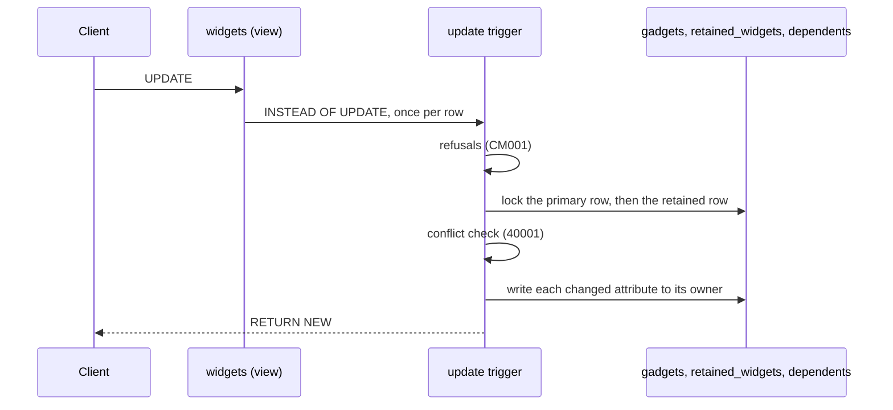

# Writing through the view

This flow follows a write after it reaches PostgreSQL. The triggers do the same work for every client: an Eloquent model, the query builder or raw SQL. The SQL comes from `Compiler`, so each step names the method that builds it. The example is `update "widgets" set "title" = ? where "id" = ?` on the workbench map.

## An update

`Compiler::updateFunction()` builds the update trigger's body. It runs once per row, in this order:

1. Each read-only attribute refuses a change with CM001. `Attribute::readOnlyBecause()` supplies the reason.
2. `Compiler::notNullChecks()` refuses a null for a mapped attribute whose same-named retained column is `NOT NULL`.
3. `Compiler::lockPrimary()` locks the primary row with `FOR UPDATE`.
4. `Compiler::loadPrevious()` locks the retained row and loads it into `previous_row`. A missing row refuses with CM001, and the hint names `compatibility:check`.
5. Each refused state with `UnrepresentableState::checkedOnPreviousUpdate()` refuses with CM001 when its condition holds.
6. `Compiler::conflict()` reads every attribute the primary and retained rows hold, through the tables. A row that differs from `OLD` raises 40001.
7. `Compiler::applying()` sets the applying flag, `Setting::Applying`, to the map's name.
8. `Compiler::updateTable()` updates the primary row when one of its attributes changed. Any row count other than one refuses with CM001.
9. `Compiler::updateTable()` updates the retained row the same way, with no row count check.
10. `Compiler::updateDependent()` handles each dependent whose attributes changed, as the next section describes.
11. The trigger clears the applying flag and returns `NEW`.

`Compiler::update()` writes each column as `CASE WHEN NEW.x IS DISTINCT FROM OLD.x THEN ... ELSE <stored value> END`. A column whose attribute did not change keeps the value stored now. `Compiler::value()` casts each written value to the column's type in the catalog.

## A dependent row

`Compiler::updateDependent()` first finds the dependent row the previous model reads, with the subquery from `ResolvedMap::locate()`. The view reads through the same subquery.

- A row was found: the trigger updates it.
- No row was found, and the designation names a row that still exists: the trigger refuses with CM001. That row is no longer readable, or belongs to another record.
- No row was found, and the `DependentCurrentModel::createdWhen()` condition holds: the trigger inserts the row and designates it. Without `DependentCurrentModel::createdWhen()`, the condition is that one of the dependent's attributes is not null.
- Otherwise the trigger refuses with CM001: the record has no such row, and the map does not create one.

## An insert

`Compiler::insertFunction()` builds the insert trigger. It takes no locks.

1. `Compiler::notNullChecks()` refuses a null for a `NOT NULL` mapped attribute.
2. The trigger sets the applying flag.
3. It inserts the primary row, with `PrimaryCurrentModel::fillWhenCreatedFromPrevious()` filling the columns no attribute writes.
4. It inserts the retained row, linked to the primary row, and sets `NEW`'s key from it.
5. It inserts each dependent row whose `DependentCurrentModel::createdWhen()` condition holds. A dependent with a designation is designated too.
6. It clears the applying flag, stores the retained key in `Setting::Created` and returns `NEW`.

## A delete

`Compiler::deleteFunction()` locks the primary row, then loads and locks the retained row. It sets the applying flag. It deletes the retained row, then every dependent row of the primary row in reverse declaration order, then the primary row.

A soft delete is an Eloquent `UPDATE` of `deleted_at`. The workbench map stores `deleted_at` on the gadget, so the update trigger writes it like any other attribute.

## Writes on the current side

The other trigger functions react to writes that do not come through the view. `Compiler::skipWhileApplying()` makes three of them return early while the applying flag holds this map's name. So the view's own writes fire none of this map's current-side reactions.

- `Compiler::primaryInsertFunction()`: a new primary row gets a retained row, filled by `PreviousModel::fillWhenCreatedFromCurrent()`. The trigger stores the new retained key in `Setting::Created`.
- `Compiler::primaryDeleteFunction()`: a deleted primary row takes its retained rows with it.
- `Compiler::designateFunction()`: a new readable dependent row fills an empty designation on its primary row's retained rows.
- `Compiler::refuseFunction()`: a row that enters a refused state refuses with CM001. It never skips, so it holds for every writer, the view included.

## Writes the view cannot take

An upsert, an update with a limit and a truncate fail on the view. The error is PostgreSQL's own, and `CompatibilityWriteRefused::isRefusal()` does not recognise it. A `FOR UPDATE` read through the view succeeds.

## Tests

`InstallerTest` covers each write through the view: inserts, updates, deletes and soft deletes. It also covers refusals, hidden states, the current-side triggers and two maps over one primary table. `DependentCurrentModelTest` covers designation.
